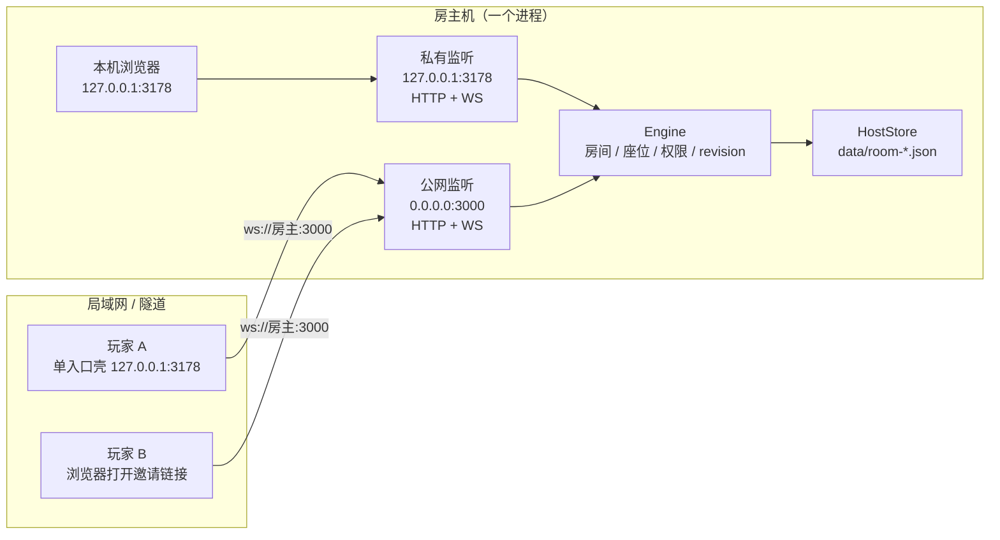
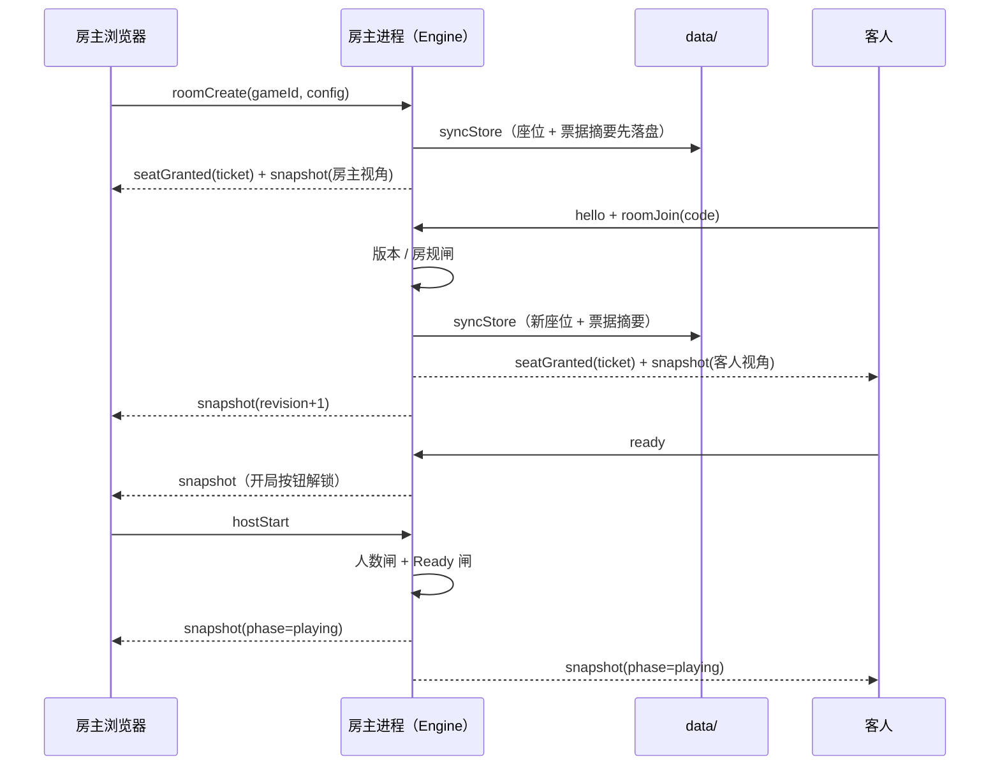
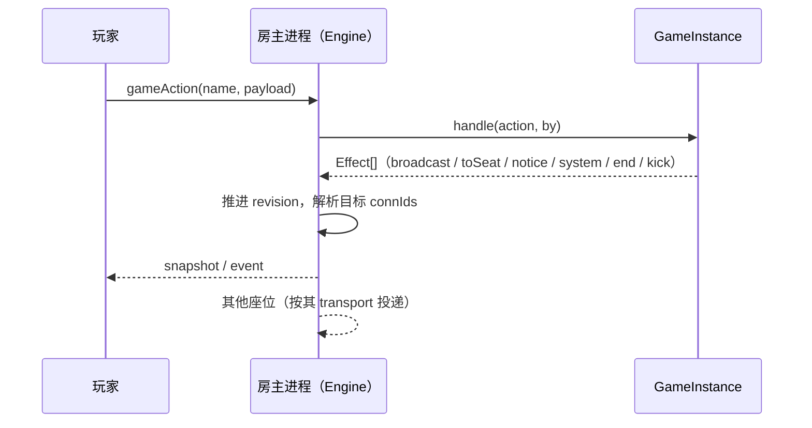
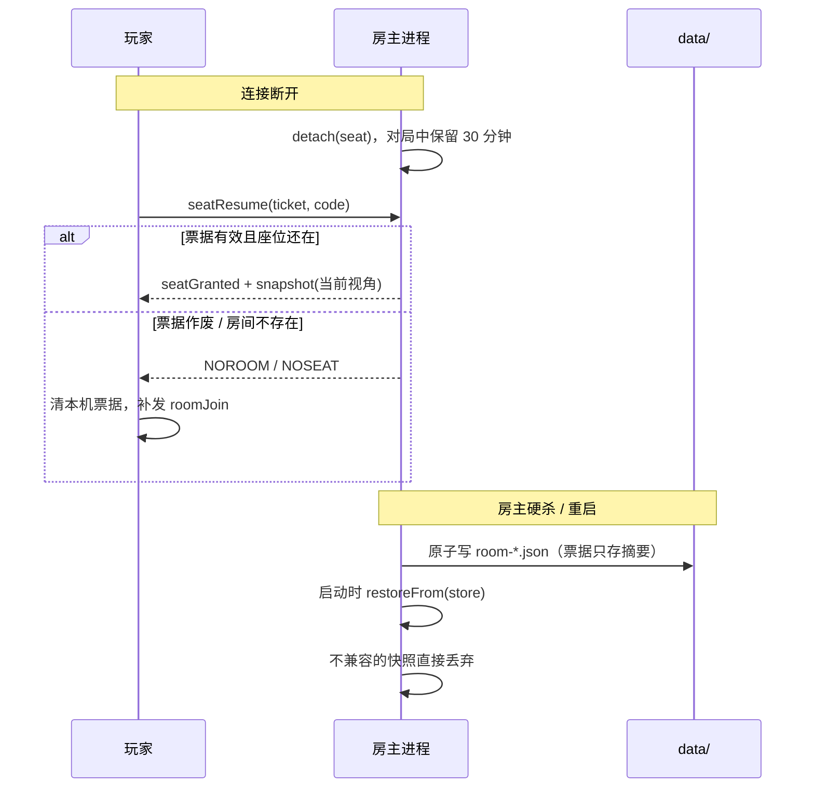
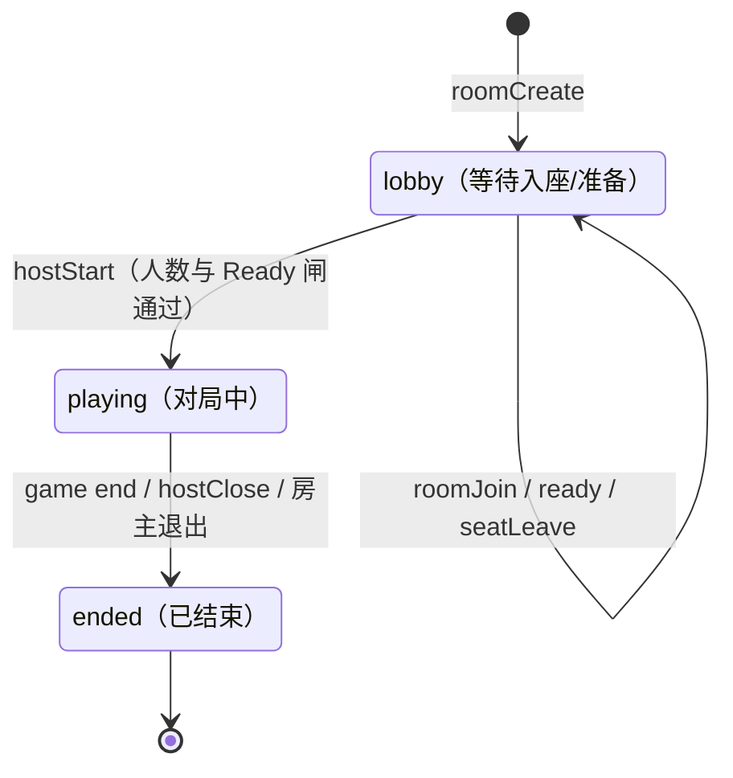
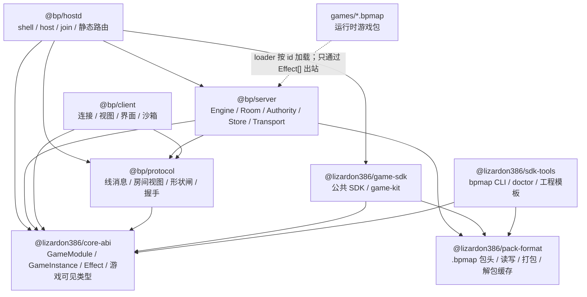

# 3178-battle-platform（3178 对战平台）· 方案架构设计

> 写给方案评审、维护和二次开发的人；设计方向、运行模式、流程、接缝、协议、语义和工程约束都在这里。
> 最近更新：2026-10-28
<!-- 日期必须留在这个 blockquote 里：check-docs.sh 的 [新]/[旧]/[期] 只读这里。改日期时 README、DESIGN、INTEGRATION_GUIDE、CONTEXT 顶部要同一天。 -->

## 1. 文档目录

| 文档 | 阅读对象 | 内容 |
|---|---|---|
| [README.md](README.md) | 玩家 / 房主 | 平台概述、运行环境与入口、对局流程、网络连接、数据存储、命令行用法、使用限制 |
| [DESIGN.md](DESIGN.md)（本文） | 开发者 / 二次开发 / 方案评审 | 设计方向（目标 / 约束 / 验收标准 / 测试手顺）；运行模式（单入口 shell 动态开 LAN / host 双监听 / join 单监听）；核心流程（建房、入座、准备、开局、动作广播、断线重连、落盘恢复）；架构与三处接缝；线协议；开发与构建；关键设计决策；已定语义与边界 |
| [INTEGRATION_GUIDE.md](INTEGRATION_GUIDE.md) | 游戏开发者 / 接入方 | SDK 获取与从零接入、GameModule/GameInstance/Effect[]、客户端入口、单文件包、回合制与实时模式边界、game-kit（事件流/聊天/记分板）、沙箱限制、版本自检与升级 |
| [CONTEXT.md](CONTEXT.md) | 维护者 / 交接的 agent | 逐阶段验收凭据、遗留问题、关键约束、变更记录、agent 交接记录 |
| [dogfood-output/猴测报告.md](dogfood-output/猴测报告.md) | 测试 / 维护者 | 15 条问题（4 高 / 9 中 / 2 低）、修法、实测证据、复跑次数、猴测台自身 9 个缺陷与未覆盖范围 |

本仓库推到 GitHub，文档内部用仓库相对链接。数字都是实测的，改动时请同步。

## 2. 设计方向

### 2.1 目标

做一个**游戏无关的宿主制联机对战平台**：每个人在自己电脑上跑一个可双击的客户端，谁建房谁的进程就是服务器，别人从局域网列表或邀请链接进房，类似 war3 对战平台。玩法通过 `GameModule` 接口接入，平台自己只管房间、座位、房主权限、准备、聊天、观战、电脑位、掉线宽限、版本检查、存档和传输。

它要同时满足两件事：

- **玩家侧**：双击即用，不装构建工具、不买服务器、不备案。
- **游戏侧**：玩法只面对 `GameModule` / `GameInstance` / `Effect[]`，不碰 socket、座位表和房间相位。

不做什么：目录服务器、账号 / 好友 / 段位 / 匹配、反作弊仲裁、自动写防火墙规则、内置游戏引擎或地图编辑器。

### 2.2 约束

- **离线双击可用**：不能要求朋友装构建工具、买服务器或备案。
- **平台与玩法必须真的能分离**：否则它就不是平台，只是又一个游戏。
- **私有信息不能泄**：观战与他人看不到别人的秘密。
- **权威只能落在某一台机器上**：不做分布式，也不做中央服务器。
- **游戏代码安装即信任**：服务端代码在房主进程里执行，第一版不做 worker 隔离；客户端代码放进 `sandbox=allow-scripts` 的 iframe，不给 `allow-same-origin`。

### 2.3 验收

#### 2.3.1 验收标准

| 验收项 | 通过标准 | 证据 |
|---|---|---|
| 平台与玩法解耦 | `tools/checks/check-seam.sh` 在平台包内零命中；两个形状不同的测试夹具跑同一套契约断言 | [contract.test.mjs](tools/testkit/test/contract.test.mjs) 19 例 |
| 私密状态 | 回合制夹具的秘密只给本人，观战视角为 `null` | 同一套契约测试 |
| 真 socket 联机 | 建房 → 入座 → 准备 → 开局 → 出招，两端各自拿到自己的视角 | [ws-live.test.mjs](packages/server/test/ws-live.test.mjs) 4 例 |
| 落盘与重连 | 重启后房号、座位、票据、对局状态都回来；坏文件不挡启动 | [store-discovery.test.mjs](packages/server/test/store-discovery.test.mjs) 11 例 |
| 单文件包 | 往返、篡改拒绝、路径穿越拒绝、坏包跳过、版本不符跳过 | `pack-format` / `pack-loader` / `bpmap-cli` 测试 |
| 沙箱客户端 | `fixture-kit` 在真实宿主里显示聊天、事件流、记分板，加载包内资源，非法动作有拒绝提示 | [fixture-kit.page.js](tools/checks/fixture-kit.page.js) + 浏览器实测 |
| 局域网源码校验 | 非安全上下文（局域网 HTTP）没有 `crypto.subtle` 时，仍能按 `seatGranted` 的 assets 校验客户端源码并执行 | 纯 JS SHA-256 测试 + 局域网 IP 浏览器实测 |
| 版本闸 | 当前只加载 `turn` / `1`；`/api/version` 与 `bpmap doctor` 用同一组常量 | `pack-loader` / `bpmap-cli` 测试 |
| 对局布局 | `playing` 时游戏区拉通整行；1280/1440 宽下 ≥1100×560，席位横向状态条，聊天/房主在可收起侧栏 | 无头浏览器实测 + [style-hooks.test.mjs](packages/client/test/style-hooks.test.mjs) |
| 规则与资料 | `manifest.ruleConfig` / `reference` 透传；房主房间内改规则、非房主 HOSTONLY、ready 重置、`RoomView.config`、资料 404/坏 JSON/HTML 转义/图片路径边界都有测试 | `module-contract` / `room-authority` / [rule-config.test.mjs](packages/client/test/rule-config.test.mjs) / [reference.test.mjs](packages/client/test/reference.test.mjs) |
| 单入口 | 根目录一个 `.bat`；启动只开本机口，建房时才开 LAN、组播与落盘；纯进房不写 `data/` | [single-shell.test.mjs](packages/hostd/test/single-shell.test.mjs) / [bat-entries.test.mjs](packages/hostd/test/bat-entries.test.mjs) |
| 当前回归门禁 | `npm test` 232 例全绿、`npm run seam` 零命中、`tsc -b` 通过 | 每次提交 |

#### 2.3.2 测试手顺

1. 安装与构建：

```bash
npm ci
npm run build
```

2. 自动化回归：

```bash
npm test
```

预期 232 例全绿。这一轮会重新生成三个测试夹具，并跑单元、契约、宿主集成和夹具猴测。

3. 接缝检查：

```bash
npm run seam
```

预期输出 `seam OK`。

4. 协议层猴测：

```bash
node tools/checks/monkey.mjs --seed 20261027 --users 3 --steps 300 --restarts 1 --port 3501
```

预期最后一行“不变式全部成立”，违规 0。长跑时换 `--seed` / `--steps`，失败时按打印的 seed 复现。

5. 浏览器沙箱检查：

- 启动宿主：`node packages/hostd/dist/cli.js host --port 3178 --no-lan`
- 打开 `http://127.0.0.1:3178/`
- 在 in-app Browser 的 `evaluate_script` 里执行 [fixture-kit.page.js](tools/checks/fixture-kit.page.js) 的函数；在 DevTools 里先粘贴整个文件，再调用 `bpFixtureKitCheck()`
- 预期：能建房、开局；聊天、事件流、记分板、包内资源、拒绝提示和加电脑位逐项通过

6. 外部消费者 smoke：

```bash
node tools/checks/smoke-sdk.mjs
```

临时工程从四个 tarball 安装 SDK，用模板跑 `build.mjs`、`bpmap doctor`，再把包交给真实宿主加载。预期最后输出 `[smoke] OK`；会联网安装 esbuild，跑完自动清理临时工程和 `games/sdk-smoke-game.bpmap`。

7. 发布 SDK（只在发版时跑）：

```bash
npm run bump:sdk -- 0.2.1
npm test
npm run seam
node tools/checks/smoke-sdk.mjs
npm run pack:sdk
git add -A && git commit -m "chore: SDK 0.2.1"
git tag sdk-v0.2.1 && git push origin master sdk-v0.2.1
```

`bump:sdk` 同步改四个包的 version 和 `@lizardon386/*` 内部依赖，再更新 lockfile；`pack:sdk` 生成 `dist-sdk/` 的离线资产。推 tag 后由 `publish-sdk.yml` 用 Trusted Publishing 发布 npm，不再需要 OTP 或 token。

8. 未自动化的验收：

- 双机组播 / 隧道：两台机器同 WiFi 互相发现、防火墙弹窗行为。
- 便携包：真正没有 Node 的电脑上双击启动。
- 这两项不阻塞本地回归，结果记录在 [CONTEXT.md](CONTEXT.md)。

逐阶段的实测凭据和历史复跑记录在 [CONTEXT.md](CONTEXT.md)；本节只保留当前门禁，避免 DESIGN 变成测试日志。


## 3. 运行模式

### 3.1 入口与角色

| 入口 / 角色 | 监听 | 本机页面 | 局域网发现 | 落盘 | 隧道 |
|---|---|---|---|---|---|
| `shell`（双击入口） | 启动 `127.0.0.1:3178`；建房时加 `0.0.0.0:3000` | `http://127.0.0.1:3178` | 启动只听组播；建房后广播 | 纯进房不写；建房后写 | 可选 |
| `host`（命令行房主） | `127.0.0.1:3178` + `0.0.0.0:3000` | `http://127.0.0.1:3178` | 广播组播 | 本机开的房落盘 | 可选，指向 3000 |
| `join`（命令行玩家） | `127.0.0.1:3178` | `http://127.0.0.1:3178` | 只听组播 | 自己开的房本机落盘；进别人的房不写 | 否 |

双击入口只启动 `shell`：先用本机口打开大厅，页面点「建房」时再按需开局域网监听、组播、`HostStore` 与邀请链接；`host` / `join` 留给命令行用户。三者都共享同一套 `Engine` / 房间 / 票据；`shell` 建房后的两个监听仍是**同一个 `Engine`**，不会新建第二个。

### 3.2 拓扑



`shell` 启动时只有 `PRIVATE`、组播浏览和临时解包缓存；页面调用 `/api/host/ready` 后才创建 `PUBLIC` 与 `HostStore`，但 `PUBLIC` 仍指向同一个 `ENGINE`。`host` 模式启动即完成这一步；`join` 只保留本机口。

### 3.3 权威、状态与落盘

- **权威在房主进程**：建房、开局、踢人、关房、移交都由它裁决；没有中央服务器。
- **内存状态归 `Room`**：座位表、房主标记、聊天环形缓冲、`revision`；游戏状态是 opaque blob，平台不解释。
- **落盘只在权威进程**：开发目录写仓库里的 `data/`；便携包（根目录有 `.portable-build.json`）改写到 `%LOCALAPPDATA%\3178-battle-platform\data`，因为整个程序目录会被新版本直接替换。`BP_DATA_DIR` 可覆盖，`diagnose` 会打印实际路径。写盘是原子写；盘上只存票据摘要（`secretHash`），不存明文票据。玩家进别人的房不写对方的盘；`shell` 纯进房不创建 `HostStore`，也不写 `data/`，建房后才启用；`join` 命令行壳自己开的房仍由本机落盘——此时它本身就是房主。
- **票据先落盘再离进程**：`onTicketIssued` 在唯一的发票据点触发 `syncStore`，避免“加入后立刻硬杀，重启后房在座位不在”。

### 3.4 房间发现与跨网

- **B+A 两档**：同网段 UDP 组播实时列表（房主广播、`join` 壳代浏览器收）；跨网用邀请链接 / 地址簿，不做目录服务器。
- **隧道**：`--tunnel` 调 cloudflared，指向 `--lan-port`；`/api/self` 把隧道地址或局域网地址作为 `publicOrigin` 交给页面生成邀请链接。隧道域名每次启动都变。

## 4. 核心流程

### 4.1 建房 → 入座 → 准备 → 开局



- 加入 / 重连的 `hello` 不声明大厅里当前选中的游戏版本；房间游戏由房主决定。拿本地下拉碰巧选中的版本去握手，会把“进别人的房”误判成 `VERSION`。

### 4.2 对局动作与广播



- 游戏不能直接碰 socket；游戏只通过 `Effect[]` 与平台交互。
- 每次可见状态变更都推进 `revision`；客户端按它去重，不推进就会被当重复帧丢掉。
- 出站目标在消息创建时就解析成具体 `connId`，避免关房/退出时最后一条通知凭空消失。

### 4.3 断线重连与落盘恢复



### 4.4 房间相位



### 4.5 房间界面：对局区、规则与资料

- **lobby 三栏等高**：左栏放房间信息与「本局规则与房主操作」控制台（房主可编辑规则和管理房间，非房主只读规则），右侧席位与聊天并排；三栏共用 `calc(100vh - 208px)` 的高度，桌面底边对齐，左栏控制台在栏内滚动。席位行按固定列对齐：状态列同宽，最右侧留动作列；真人席位行由房主直接点「转交房主」，房主的顶部按钮是「解散房间」而不是无意义的「离开」。进入 `playing` 后房间头移到顶部，游戏区拉通整行，席位压成横向状态条，聊天与同一控制台收进右侧抽屉，默认收起；按钮、`D` 键和 `Esc` 都能操作，关闭时焦点回到触发按钮。没有 deadline 时不显示倒计时块。
- **非房主视图**：左栏只保留房间名/房号/连接状态和规则摘要，开局、加电脑位、移交、请出、邀请和关房全部隐藏；座位号码牌不是颜色入口，电脑难度下拉也不会出现。席位与聊天位置和房主一致，`lobby` 只多一个「准备」按钮。截图见 [room-guest-lobby-1280.png](docs/images/room-guest-lobby-1280.png)。
- **桌面实测**：1280×800 下三栏同高 592px，游戏区 1248×560；低于 1100px 宽的桌面不在本档验收范围。
- **本局规则**：房间页在 `manifest.ruleConfig` 存在时在房主控制台里显示规则区；房主在 `lobby` 阶段可编辑，其他人只读，`playing` 后一律只读。修改走房主专用 `ruleConfig`，服务端用 `normalizeConfig` / `rulesHashOf` 重算，推进 revision，并把所有真人 ready 清零、发系统消息「房规已更新，请重新准备」。`RoomView.config` 与 `rulesHash` 随快照广播，后加入者从 `seatGranted` 的 manifest 和首个快照拿到新值；`RoomExport.config` 落盘，恢复后规则保持。平台不改 `normalizeConfig`，非法值仍由游戏兜底。
- **座位级选项**：`GameModule.seatOptions` 声明每个座位可配的字段（`roles` 过滤）。颜色字段直接驱动席位行的左侧色条/图标/号码牌，房主在 lobby 点号码牌选色；电脑座位在行内显示难度下拉；不再有通用“设置”按钮。变更走 `hostSeat {op:'setOptions'}`；只房主、只 lobby，服务端用 `normalizeSeatOptions` 或声明默认值收口，`SeatView.options` / `GameSeatInfo.options` 透传，`RoomExport` 随座位持久化。平台不解释 field 的玩法含义。
- **资料面板**：`manifest.reference.entry` 指向包内 JSON，第一次展开才请求 `/games/<id>/<entry>`，用 `parseGameReference` 校验；主界面和房间共用接近全屏的双栏弹层。只渲染纯文本与图片，文本走 `textContent`，不解析 HTML；图片走现有 `/games` 路由，`..`、绝对路径和反斜杠一律拒绝。图片 404 时用 `onerror` 显示 alt 文案；读取失败只在面板里说明，不影响对局。
- **服务端校验**：目录游戏与 `.bpmap` 在加载时用 `parseRuleConfig` / `parseGameReference` 校验声明，坏声明跳过该模块并记错误；`manifestOf` 再挡一次，避免测试或手工构造的模块把坏声明带进房间。包头的 `reference` 与模块里的 `reference` 同时存在但不一致时拒绝加载。

## 5. 架构与接缝

### 5.1 包结构

```text
3178-battle-platform/
├─ packages/                         平台源码
│  ├─ core-abi/                      游戏 ABI：GameModule / GameInstance / Effect / 游戏可见类型
│  ├─ protocol/                      线消息、房间视图、入站形状闸、握手
│  ├─ pack-format/                   .bpmap 包头、读写、校验、打包和解包缓存
│  ├─ game-sdk/                      游戏公共 SDK：re-export core-abi / pack-format；game-kit 在 src/kit，导出 /kit、/kit/server
│  ├─ sdk-tools/                     独立 SDK 工具：bpmap CLI、doctor、工程模板
│  ├─ server/                        引擎、房间、权限、落盘、传输、发现
│  ├─ client/                        浏览器端连接、视图、界面、沙箱挂载
│  └─ hostd/                         宿主壳 shell/host/join/diagnose/stop、静态路由
├─ tools/                            开发与测试工具
│  ├─ testkit/                       @bp/testkit：接口测试脚手架、模拟上下文、测试夹具
│  ├─ checks/                        架构检查、随机操作测试、存档/重连问题复现
│  └─ packaging/                     便携包、.bpmap CLI、启动器生成
├─ docs/images/                      README 实机截图（裁剪后，不含测试夹具名）
├─ games/                            运行时 .bpmap（不入库）
├─ dogfood-output/                   猴测报告
├─ README.md                         玩家使用说明
├─ DESIGN.md                         架构、流程与边界
├─ INTEGRATION_GUIDE.md              平台 SDK 接入开发指南
└─ CONTEXT.md                        进度、验收与交接记录
```

`dist/`、`node_modules/`、`data/`、`dist-portable/` 都是构建或运行产物，不入库，所以不画进源码树。



### 5.2 三处接缝

- **线协议**（`packages/protocol`）：消息目录、房间视图和形状闸是客户端/服务端唯一的字据。
- **`GameModule` / `GameInstance` 接口**（`packages/core-abi/src/module-api.ts`；`packages/server/src/module-api.ts` 转出并组装 manifest）：运行时按 id 动态加载目录游戏或单文件包，平台源码不 import 游戏。
- **包兼容闸**（`packages/server/src/loader.ts`）：加载前检查包头 `mode` / `apiVersion`；当前支持 `turn` / `1`，不支持的包跳过并记录原因。
- **`Effect[]` 出口**：游戏碰不到 socket；投递、限流、视角裁剪、审计都在平台。

> 接一个新游戏（GameModule / GameInstance / 客户端入口 / 目录与构建）见 [INTEGRATION_GUIDE.md](INTEGRATION_GUIDE.md)。

### 5.3 文件清单

> 只列关键文件；UI 观感相关的样式/字体/预览页不在这里展开。

**平台内核**

| 文件 | 用途 |
|---|---|
| [package.json](package.json) | npm workspaces 与 `build/test/seam/portable` 脚本 |
| [tsconfig.json](tsconfig.json) / [tsconfig.base.json](tsconfig.base.json) | 项目引用（`tsc -b`）与共享编译选项 |
| [packages/core-abi/src/module-api.ts](packages/core-abi/src/module-api.ts) | `GameModule` / `GameInstance` / `Effect` 接口（游戏 ABI 源） |
| [packages/core-abi/src/client.ts](packages/core-abi/src/client.ts) | 客户端 `mount` / `onEvent` / `actions` 契约 |
| [packages/core-abi/src/manifest.ts](packages/core-abi/src/manifest.ts) | `GameManifest` / `GameAsset` / `GameUiOptions` 类型 |
| [packages/core-abi/src/seats.ts](packages/core-abi/src/seats.ts) | `SeatRole` / `RoomPhase` / `SeatView` |
| [packages/core-abi/src/codes.ts](packages/core-abi/src/codes.ts) | `PlatformCode` / `NoticeCode` 取值 |
| [packages/core-abi/src/hash.ts](packages/core-abi/src/hash.ts) | 稳定摘要（房规/版本闸） |
| [packages/core-abi/src/version.ts](packages/core-abi/src/version.ts) | `API_VERSION`、`GAME_MODES`、宿主支持的 `apiVersion` / 模式 |
| [packages/protocol/src/wire.ts](packages/protocol/src/wire.ts) | 消息目录与房主命令表 |
| [packages/protocol/src/codes.ts](packages/protocol/src/codes.ts) | 平台错误码/通知码的默认文案与校验 |
| [packages/protocol/src/manifest.ts](packages/protocol/src/manifest.ts) | manifest 形状检查与握手比对 |
| [packages/protocol/src/seats.ts](packages/protocol/src/seats.ts) | 房间视图、组播条目、座位/相位校验 |
| [packages/protocol/src/guard.ts](packages/protocol/src/guard.ts) | 入站消息形状闸门 |
| [packages/server/src/engine.ts](packages/server/src/engine.ts) | 引擎：线消息 → 房间/游戏操作 → 出站编排 |
| [packages/server/src/room.ts](packages/server/src/room.ts) | 座位表、房主标记、聊天、revision、落盘导出/恢复 |
| [packages/server/src/authority.ts](packages/server/src/authority.ts) | 权限判定集中处 |
| [packages/server/src/module-api.ts](packages/server/src/module-api.ts) | 转出 core-abi，并提供 `manifestOf` |
| [packages/server/src/loader.ts](packages/server/src/loader.ts) | 运行时按 id 动态加载目录游戏或单文件包 |
| [packages/server/src/seat-options.ts](packages/server/src/seat-options.ts) | 座位选项默认值与声明式兜底收口 |
| [packages/pack-format/src/pack.ts](packages/pack-format/src/pack.ts) | 单文件游戏包的读取、校验、解包与缓存 |
| [packages/game-sdk/src/node/pack.ts](packages/game-sdk/src/node/pack.ts) | re-export `@lizardon386/pack-format`，保持 SDK 的 `/node` 公共路径 |
| [packages/server/src/pack.ts](packages/server/src/pack.ts) | re-export `@lizardon386/pack-format` |
| [packages/server/src/transport.ts](packages/server/src/transport.ts) | ws 薄壳：握手、编码、Origin、心跳 |
| [packages/server/src/store.ts](packages/server/src/store.ts) | 房主侧原子落盘与坏文件处理 |
| [packages/server/src/discovery.ts](packages/server/src/discovery.ts) | 组播信标：广播与过期表 |
| [packages/server/src/registry.ts](packages/server/src/registry.ts) | 房号分配与房间表 |
| [packages/server/src/ids.ts](packages/server/src/ids.ts) | 房号/座位 id/票据与摘要比对 |

**客户端**

| 文件 | 用途 |
|---|---|
| [packages/client/src/endpoint.ts](packages/client/src/endpoint.ts) | 房主地址解析与邀请链接 |
| [packages/client/src/connection.ts](packages/client/src/connection.ts) | ws 连接层：指数退避、心跳、帧校验 |
| [packages/client/src/clock.ts](packages/client/src/clock.ts) | 服务端时间轴：`serverNow` + 单调钟外推 |
| [packages/client/src/local-store.ts](packages/client/src/local-store.ts) | 地址簿、昵称、票据保管 |
| [packages/client/src/view-model.ts](packages/client/src/view-model.ts) | 帧流 → UI 状态归约（revision 去重等） |
| [packages/game-sdk/src/contract/client.ts](packages/game-sdk/src/contract/client.ts) | re-export core-abi 的客户端入口类型 |
| [packages/client/src/module-loader.ts](packages/client/src/module-loader.ts) | 游戏模块拉取、哈希校验、沙箱挂载、占位渲染 |
| [packages/client/src/rule-config.ts](packages/client/src/rule-config.ts) | 规则表单默认值、控件值收口与房间只读摘要 |
| [packages/client/src/seat-options.ts](packages/client/src/seat-options.ts) | 座位选项按角色过滤、控件值收口与摘要 |
| [packages/client/src/reference.ts](packages/client/src/reference.ts) | 规则资料懒加载、路径校验与纯文本/图片渲染 |
| [packages/client/public/game-sandbox.html](packages/client/public/game-sandbox.html) | 沙箱 iframe 页面：执行游戏客户端源码，用 postMessage 桥接 view/action |
| [packages/client/src/app.ts](packages/client/src/app.ts) | 界面装配：大厅 / 房间内 / 对局挂载点 |
| [packages/client/public/index.html](packages/client/public/index.html) | 页面骨架与 import map（原生 ESM，无打包） |

**宿主壳与入口**

| 文件 | 用途 |
|---|---|
| [packages/hostd/src/cli.ts](packages/hostd/src/cli.ts) | shell / host / join / diagnose / stop；shell 建房时动态开局域网；扫描单文件包 |
| [packages/hostd/src/data-dir.ts](packages/hostd/src/data-dir.ts) | 数据目录落点（便携包写用户目录，开发目录写仓库） |
| [packages/hostd/src/webroot.ts](packages/hostd/src/webroot.ts) | 静态与接口路由（含 `/api/self`、`/api/host/ready`、游戏产物根映射） |
| [packages/hostd/src/tunnel.ts](packages/hostd/src/tunnel.ts) | cloudflared 查找与隧道网址解析 |
| [3178对战平台.bat](3178对战平台.bat) | 唯一双击入口（CRLF） |
| [tools/packaging/gen-bat.mjs](tools/packaging/gen-bat.mjs) | 生成唯一的 .bat，保证编码与启动器结构 |

**游戏与工具**

| 文件 | 用途 |
|---|---|
| [games/](games/.gitkeep) | 运行时游戏包目录，只放生成的 `.bpmap` |
| [tools/testkit/src/test-games/turn-based/index.ts](tools/testkit/src/test-games/turn-based/index.ts) | 测试夹具·回合制（id `fixture-turn`）：回合游标 + 隐私 |
| [tools/testkit/src/test-games/simultaneous/index.ts](tools/testkit/src/test-games/simultaneous/index.ts) | 测试夹具·同时操作（id `fixture-simultaneous`）：无游标 + 无隐私 |
| [tools/testkit/src/test-games/kit-client/index.ts](tools/testkit/src/test-games/kit-client/index.ts) / [client.ts](tools/testkit/src/test-games/kit-client/client.ts) | 测试夹具·game-kit 界面（id `fixture-kit`）：服务端 FeedLog + 客户端 ChatPanel/FeedPanel/ScoreboardPanel，加载包内资源，`ui.chat='game'` |
| [tools/checks/check-seam.sh](tools/checks/check-seam.sh) | 架构检查：平台代码里不许出现玩法词 |
| [tools/checks/fixture-kit.page.js](tools/checks/fixture-kit.page.js) | 在真实大厅检查 fixture-kit：建房、开局、聊天、事件流、资源、拒绝、记分板和电脑位 |
| [tools/packaging/build-portable.mjs](tools/packaging/build-portable.mjs) | 绿色便携包装配与自检 |
| [tools/checks/monkey.mjs](tools/checks/monkey.mjs) | 协议层猴测（含 fixture-kit 的真实宿主路径） |
| [tools/packaging/bpmap.mjs](tools/packaging/bpmap.mjs) | .bpmap 打包/检查入口，调用 `@lizardon386/sdk-tools` CLI |
| [packages/sdk-tools/src/cli/index.ts](packages/sdk-tools/src/cli/index.ts) | `pack` / `inspect` / `unpack` 的 CLI 实现 |
| [tools/checks/monkey-ui.page.js](tools/checks/monkey-ui.page.js) | 页内 UI 猴测 |
| [tools/checks/smoke-sdk.mjs](tools/checks/smoke-sdk.mjs) | 外部消费者 smoke：tarball 安装、模板构建、doctor、宿主加载 |
| [tools/packaging/pack-sdk.mjs](tools/packaging/pack-sdk.mjs) | 生成 SDK Release 资产：四个 tarball、SHA256SUMS、发布说明 |
| [tools/packaging/bump-sdk.mjs](tools/packaging/bump-sdk.mjs) | 同步更新四个 SDK 包版本、内部依赖和 package-lock |
| [tools/checks/repro-persist.mjs](tools/checks/repro-persist.mjs) / [tools/checks/repro-resume.mjs](tools/checks/repro-resume.mjs) | 落盘窗口与票据重连复现 |
| [dogfood-output/猴测报告.md](dogfood-output/猴测报告.md) | 猴测报告：15 条问题、修法与复跑次数 |
| [docs/images/readme-host-room.png](docs/images/readme-host-room.png) / [readme-join-room.png](docs/images/readme-join-room.png) | README 建房 / 进房实机截图；裁剪掉游戏选择器，避免测试夹具名进入玩家文档 |
| [docs/images/room-host-lobby-1280.png](docs/images/room-host-lobby-1280.png) / [room-guest-lobby-1280.png](docs/images/room-guest-lobby-1280.png) / [room-playing-1280.png](docs/images/room-playing-1280.png) | 房间三栏布局实测：房主、非房主、对局中 |

**测试**

| 文件 | 用途 |
|---|---|
| [packages/protocol/test/protocol.test.mjs](packages/protocol/test/protocol.test.mjs) | 协议、manifest 与形状闸 |
| [packages/server/test/room-authority.test.mjs](packages/server/test/room-authority.test.mjs) | 房主权限/票据/座位模型 |
| [tools/testkit/test/contract.test.mjs](tools/testkit/test/contract.test.mjs) | 两个测试夹具共用同一套接口断言 |
| [tools/testkit/test/fixture-kit-monkey.test.mjs](tools/testkit/test/fixture-kit-monkey.test.mjs) | fixture-kit 随机动作猴测：事件流序号、记分板行数、拒绝码与计数自洽 |
| [packages/server/test/ws-live.test.mjs](packages/server/test/ws-live.test.mjs) | 真 socket 端到端 |
| [packages/server/test/store-discovery.test.mjs](packages/server/test/store-discovery.test.mjs) | 落盘恢复 + 信标编解码 |
| [packages/pack-format/test/pack.test.mjs](packages/pack-format/test/pack.test.mjs) | 单文件包：往返、篡改、路径穿越、缓存复用 |
| [packages/server/test/pack-loader.test.mjs](packages/server/test/pack-loader.test.mjs) | 单文件包：宿主加载、坏包跳过、同 id 去重 |
| [packages/server/test/bpmap-cli.test.mjs](packages/server/test/bpmap-cli.test.mjs) | .bpmap CLI：打包、检查、坏输入 |
| [packages/hostd/test/game-roots.test.mjs](packages/hostd/test/game-roots.test.mjs) | 游戏根映射：包目录、目录回退、越界 404 |
| [packages/client/test/client-logic.test.mjs](packages/client/test/client-logic.test.mjs) | 客户端无 DOM 逻辑 |
| [packages/client/test/sandbox-hooks.test.mjs](packages/client/test/sandbox-hooks.test.mjs) | 沙箱 iframe 的挂载、桥接与卸载 |
| [packages/hostd/test/hostd-http.test.mjs](packages/hostd/test/hostd-http.test.mjs) | 宿主壳集成（静态路由、穿越防线、真 WS） |
| [packages/hostd/test/bat-entries.test.mjs](packages/hostd/test/bat-entries.test.mjs) | 双击入口编码与结构防呆 |
| [packages/hostd/test/shell-join.test.mjs](packages/hostd/test/shell-join.test.mjs) | join 模式壳建房→加电脑→开局 |
| [packages/hostd/test/single-shell.test.mjs](packages/hostd/test/single-shell.test.mjs) | 单入口壳：纯进房不写 data；建房时开 LAN、共享同一个 Engine |
| [packages/hostd/test/sigint-shutdown.test.mjs](packages/hostd/test/sigint-shutdown.test.mjs) | Ctrl+C 收尾：落盘、删记录、退出码 0、端口释放 |
| [packages/hostd/test/dual-listener.test.mjs](packages/hostd/test/dual-listener.test.mjs) | 私网建房、公网进房，两个监听共享同一引擎 |
| [packages/hostd/test/data-dir.test.mjs](packages/hostd/test/data-dir.test.mjs) | 数据目录落点与覆盖顺序 |

## 6. 线协议

| 方向 | 消息 | 要座位 | 要房主 |
|---|---|---|---|
| C→S | `hello` `roomCreate` `roomJoin` `seatResume` `resync` `ping` | 否 | 否 |
| C→S | `ready` `gameAction` `chat` `seatLeave` | 是 | 否 |
| C→S | `hostStart` `hostClose` `hostKick` `hostTransfer` `hostSeat` | 是 | **是** |
| S→C | `welcome` `seatGranted` `snapshot` `event` `chat` `notice` `error` `pong` | — | — |

完整字段与中文错误码文案在 [wire.ts](packages/protocol/src/wire.ts) 与 [codes.ts](packages/protocol/src/codes.ts)。

## 7. 开发与构建

```bash
npm run build          # tsc -b 项目引用，无打包器
npm test               # node --test（当前 232 例）
bash tools/checks/check-seam.sh                        # 闸门：平台包内不得出现玩法词
npm run portable                                # 绿色便携包（dist-portable/，不入库）
node tools/checks/monkey.mjs --seed 707 --users 8 --steps 300 --restarts 3   # 协议层猴测
```

- `node --test` 跑目录参数在 Windows 下不可靠：必须用引号包住的 glob，并带 `--test-timeout`。
- `.bat` 由 [tools/packaging/gen-bat.mjs](tools/packaging/gen-bat.mjs) 生成，别手写。
- 便携包由 [tools/packaging/build-portable.mjs](tools/packaging/build-portable.mjs) 汇编并自检，产物 `dist-portable/` 不进 git。

## 8. 关键设计决策

| 决策 | 理由 | 代价 |
|---|---|---|
| TypeScript（Node ESM）+ 官方签名 `node.exe` | 本机 Smart App Control 强制，未签名 exe 被拦且没有“仍要运行” | 交付物是文件夹 + 快捷方式 |
| 宿主制权威，不做中央服务器/分布式 | 离线双击可用，不需要常开公网节点 | 房主关机=这局没了；天然不防房主 |
| 一个进程、两个监听、本机单一 UI origin | 昵称/票据按 origin 存；邀请链接必须给局域网/隧道地址 | 两套 `http.Server` + `WsTransport` 的生命周期；`--port` / `--lan-port` 分开 |
| 平台与玩法只经 `GameModule` 接口 | 旧 `Room` 同时管座位和规则，分层一改就穿透 | 接入要写一套接口 |
| `Engine` 只吐 `Outbound[]`，`WsTransport` 管 socket | 接口测试可纯内存跑，不依赖端口/网卡 | 投递要显式 `publish()` |
| 出站目标创建时解析成 `connId` | 关房/退出会先清会话表，按房间寻址会丢最后一条通知 | 消息生成后不能按房间状态寻址 |
| 游戏只能返回 `Effect[]` | 投递、限流、视角、审计统一在平台 | 跨端事件名没有集中枚举 |
| `revision` 每次可见变更推进 | 客户端按 revision 去重，不推进会丢新快照 | 聊天等高频事件也推版本号 |
| 入席发票据，`seatResume` 必须带票据 | 防猜房号+座位号占座；盘上只存摘要 | 票据丢了要等宽限到期 |
| `deadline` 下发相对毫秒 + `serverNow` | 两台机器时钟不齐时倒计时仍准确 | 客户端要维护单调钟外推 |
| 房间发现走 B+A（组播 + 地址簿/邀请） | 无公共服务器也要实时列表 | 组播限同网段；跨网靠邀请/隧道 |
| 落盘只发生在房间权威所在进程 | “谁是权威”只有一份 | 房主关机这局就没了 |
| playing 对局区拉通整行，席位横排，聊天/房主进侧栏 | 第一款真游戏的全屏界面在 600×400 牌桌里放不下 | 房间页多一套布局状态与键盘/焦点管理 |
| 规则表单只声明，值仍由游戏 `normalizeConfig` 收口 | 平台不解释玩法；非法值由游戏按自己的边界处理 | 游戏要保证字段 key 与配置 key 对得上 |
| 座位选项由游戏声明，平台只透传 `options` | 每座 AI 难度/颜色是玩法语义，不能写进平台 | SDK 增加 `seatOptions` 契约；游戏要提供 `normalizeSeatOptions` |
| 资料面板只认纯文本与图片，懒加载 | 不在浏览器里解析 Markdown/HTML，注入面只有文本节点 | 游戏要自己准备 JSON 与图片，不能直接塞网页 |
| 两个形状不同的测试 demo 游戏 | “平台无关玩法”必须有第二个形状做证据 | 多写约 300 行测试用游戏代码 |

## 9. 已定语义与边界

| 事项 | 结论 |
|---|---|
| 只有房主能开局 / 踢人 / 关房 / 移交 | 是，越权分别报 `NOTHOST` / `HOSTONLY` |
| 房主主动离开 | 弹窗二选一：直接关局 / 移交房主；平台侧表现为 `seatLeave` 被拒并提示“先移交或关房” |
| 移交 | 只转移权限，进程仍在原房主机；原房主再发命令报 `HOSTONLY` |
| 房主进程退出/崩溃 | 无法弹窗 → 广播 `HOSTLEFT` 并删局 |
| 玩家主动离座 | 立刻离座，不触发终局 |
| 掉线 | 对局中保留座位 30 分钟（可配），超时收回；房主掉线过久直接终局 |
| 断线重连坐回原位 | 按人正在待的房的房号翻本机票据；票据作废时清票据、摘“你”，并补发原本点的那一下（加入） |
| 加入方式 | 4 位房号（去掉易混字符）+ 房主地址；版本/房规不符报 `VERSION` / `RULES` |
| 房间列表 | 局域网组播实时列表（需本地壳）+ 地址簿 + 邀请链接；不做目录服务器 |
| 链路断开时的房间命令 | 一律本地拒绝并说清楚，不悄悄塞进待发队列；待发队列只留给拨号中的握手 |
| 游戏模块没带自己的界面 | 走内置占位状态面板；只在进房挂载时说一句，回到大厅清掉状态行 |
| 本机入口与存储 | 两个启动器都从 `127.0.0.1:3178` 打开；`3000` 只是局域网/隧道入口，昵称/地址簿/票据只有一份存储 |

- **宿主制天然不防房主**：权威进程在房主机上，“按视角裁剪”只防透视；移交只移权限、不迁进程。
- **从房主拉游戏模块 = 在浏览器里执行房主给的代码**。客户端现在默认在 `sandbox=allow-scripts` 的 iframe 中执行游戏入口，不给 `allow-same-origin`；沙箱内拿不到本机存储、票据和宿主 DOM。哈希只保证字节没被改，不保证代码无害，沙箱降低风险但不改变“玩法由房主提供”这一事实。
- **禁止**：写 Windows 防火墙入站规则、建议关闭 Smart App Control、`force push`。
- **混合内容方向性**：`http://127.0.0.1` 页面可连 `ws://` 与 `wss://`；`https://` 页面连 `ws://` 会被浏览器拦。
- 与 [uno-online](../uno-online/CONTEXT.md) 是同一份玩法的两种演进：玩法改动归那边，连接/身份/分发改动归这里；不要两边同时动同一份逻辑。
- 浏览器底线（Chrome/Edge 111+）与使用者视角的限制由 [README.md](README.md) 的「限制与注意事项」持有，本档不重述。

## 10. 工程约束

- **`.bat` 编码**：UTF-8 无 BOM + CRLF + 第 2 行 `chcp 65001`，中文只出现在 chcp 之后；否则 cmd 按 cp936 解析会把中文拼成命令分隔符。`.bat` 只能做启动器（`start …` 后 `exit /b 0`），Ctrl+C 才会落在 node 上，收尾后窗口自己关而不出 Y/N。
- **Ctrl+C 验证边界**：收尾处理器本身有测试；但“Windows 把控制台 Ctrl+C 投递成 SIGINT”这一步无法从外部模拟，靠 libuv 自身。
- **`HostStore.fileFor` 卡死房号字符集**：文件名来自磁盘内容，不校验就是路径注入面。
- **`server.close()` 在 keep-alive/WS 连接存在时回调不触发**：收尾要 `closeAllConnections()` + 超时竞速；`transport.close()` 先 `terminate()` 再 `close()`。
- **Windows 上 `child.kill('SIGTERM')` 是硬杀**：不走信号处理器；测试不能靠 kill 断言记录被删，要断言“记录留下、`stop` 收掉”。
- **测试写法**：`node --test` 目录参数在 Windows 下不可靠，必须用引号包住的 glob + `--test-timeout`；等消息要等符合条件的那一帧。
- **便携包运行时子集**：只带 `ws`、Tabler 的两个 dist 子集、`@bp/*` 实体副本与签名 `node.exe`；`dist-portable/` 不进 git。
