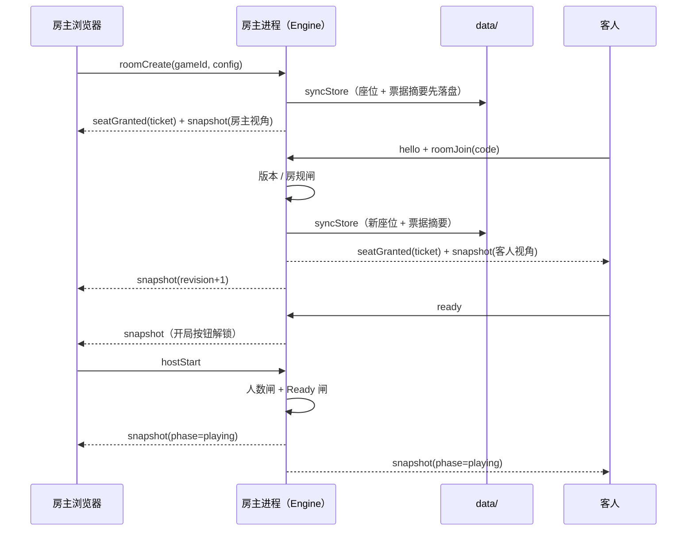
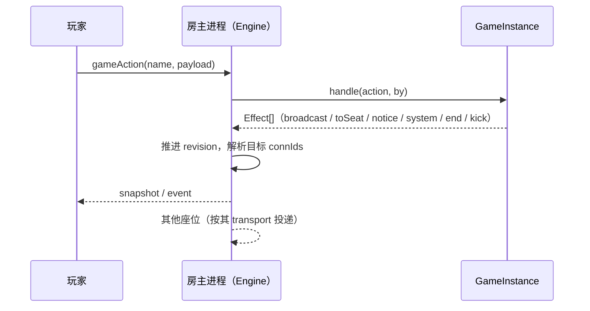
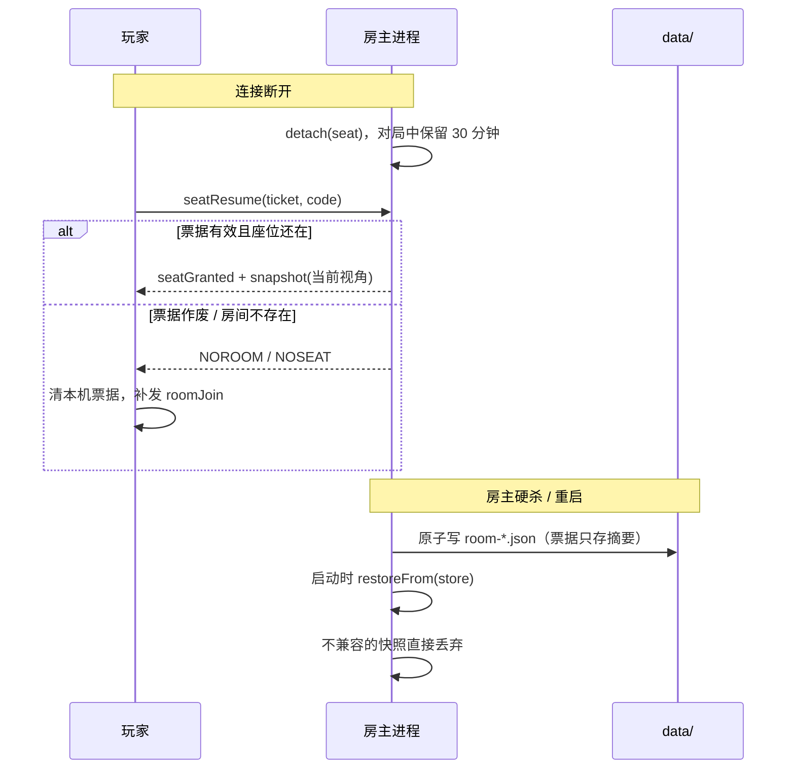
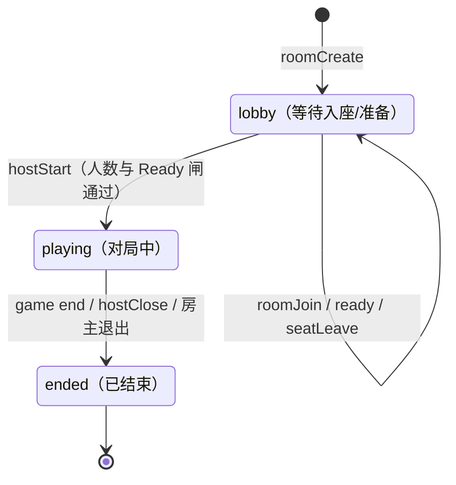
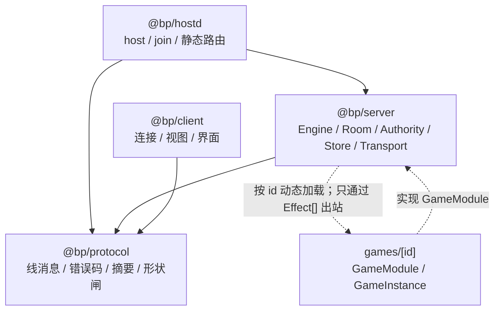

# 3178-battle-platform（3178 对战平台）· 方案架构设计

> 写给方案评审、维护和二次开发的人；运行模式、流程、接缝、协议、语义和工程约束都在这里。
> 最近更新：2026-10-21
<!-- 日期必须留在这个 blockquote 里：check-docs.sh 的 [新]/[旧]/[期] 只读这里。改日期时 README、DESIGN、CONTEXT 顶部要同一天。 -->

## 文档

| 文档 | 阅读对象 | 内容 |
|---|---|---|
| [README.md](README.md) | 玩家 / 房主 | 平台是什么、前置与双击入口、一局怎么走、命令行、限制与注意事项 |
| [DESIGN.md](DESIGN.md) | 开发者 / 二次开发 / 方案评审 | 目标与约束；运行模式（host 双监听 / join 单监听）；核心流程（建房、入座、准备、开局、动作广播、断线重连、落盘恢复）；架构与三处接缝；线协议；开发与构建；关键设计决策；已定语义与边界 |
| [INTEGRATION_GUIDE.md](INTEGRATION_GUIDE.md) | 游戏开发者 / 接入方 | GameModule / GameInstance / Effect[]、客户端入口、单文件包、沙箱限制、目录与构建、check-seam 要求 |
| [CONTEXT.md](CONTEXT.md) | 维护者 / 交接的 agent | 逐阶段验收凭据、遗留问题、关键约束、变更记录、agent 交接记录 |
| [dogfood-output/猴测报告.md](dogfood-output/猴测报告.md) | 测试 / 维护者 | 15 条 finding（4 High / 9 Medium / 2 Low）、修法、实测证据、复跑计数、猴测台自身 9 个缺陷与未覆盖范围 |

本仓库推到 GitHub，文档内部用仓库相对链接。数字都是实测的，改动时请同步。

## 1. 目标与约束

做一个**游戏无关的宿主制联机对战平台**：每个人在自己电脑上跑一个可双击的客户端，谁建房谁的进程就是服务器，别人从局域网列表或邀请链接进房，类似 war3 对战平台。玩法通过 `GameModule` 接口接入，平台自己只管房间、座位、房主权限、准备、聊天、观战、电脑位、掉线宽限、版本检查、存档和传输。

约束（每条都直接逼出后面的设计）：

- **离线双击可用**：不能要求朋友装构建工具、买服务器或备案。
- **平台与玩法必须真的能分离**：否则它就不是平台，只是又一个游戏。
- **私有信息不能泄**：观战与他人看不到别人的秘密。
- **权威只能落在某一台机器上**：不做分布式，也不做中央服务器。

怎么算做成了（都能用工具验证）：`tools/check-seam.sh` 在平台包内没有命中玩法词；仓库自带两个形状不同的测试夹具（`测试夹具·回合制` + 隐私 / `测试夹具·同时操作` 无游标 + 无隐私 + 同时操作，在 `packages/test-tools/test-games/`），用来证明接口与玩法无关；协议层与 UI 层两层猴测无违规。当前 `npm test` **145 例**全绿，逐阶段数据在 [CONTEXT.md](CONTEXT.md)。

## 2. 运行模式

### 2.1 两种角色

| 角色 | 监听 | 本机页面 | 局域网发现 | 落盘 | 隧道 |
|---|---|---|---|---|---|
| `host`（房主端） | `127.0.0.1:3178` + `0.0.0.0:3000` | `http://127.0.0.1:3178` | 广播组播 | 本机开的房落盘 | 可选，指向 3000 |
| `join`（玩家进房） | `127.0.0.1:3178` | `http://127.0.0.1:3178` | 只听组播 | 自己开的房本机落盘；进别人的房不写 | 否 |

两种角色都带完整 `Engine`，所以本机都能开房；`join` 只绑回环，别人连不进来。`host` 的两个监听共享**同一个** `Engine` / `HostStore`：本机页面和局域网玩家看到的是同一张桌子。

### 2.2 拓扑


### 2.3 权威、状态与落盘

- **权威在房主进程**：建房、开局、踢人、关房、移交都由它裁决；没有中央服务器。
- **内存状态归 `Room`**：座位表、房主标记、聊天环形缓冲、`revision`；游戏状态是 opaque blob，平台不解释。
- **落盘只在权威进程**：开发目录写仓库里的 `data/`；便携包（根目录有 `.portable-build.json`）改写到 `%LOCALAPPDATA%\3178-battle-platform\data`，因为整个程序目录会被新版本直接替换。`BP_DATA_DIR` 可覆盖，`diagnose` 会打印实际路径。写盘是原子写；盘上只存票据摘要（`secretHash`），不存明文票据。玩家进别人的房不写对方的盘；`join` 壳自己开的房仍由本机落盘——此时它本身就是房主。
- **票据先落盘再离进程**：`onTicketIssued` 在唯一的发票据点触发 `syncStore`，避免“加入后立刻硬杀，重启后房在座位不在”。

### 2.4 房间发现与跨网

- **B+A 两档**：同网段 UDP 组播实时列表（房主广播、`join` 壳代浏览器收）；跨网用邀请链接 / 地址簿，不做目录服务器。
- **隧道**：`--tunnel` 调 cloudflared，指向 `--lan-port`；`/api/self` 把隧道地址或局域网地址作为 `publicOrigin` 交给页面生成邀请链接。隧道域名每次启动都变。

## 3. 核心流程

### 3.1 建房 → 入座 → 准备 → 开局



### 3.2 对局动作与广播



- 游戏不能直接碰 socket；游戏只通过 `Effect[]` 与平台交互。
- 每次可见状态变更都推进 `revision`；客户端按它去重，不推进就会被当重复帧丢掉。
- 出站目标在消息创建时就解析成具体 `connId`，避免关房/退出时最后一条通知凭空消失。

### 3.3 断线重连与落盘恢复



### 3.4 房间相位



## 4. 架构与接缝

### 4.1 包结构

```text
packages/
  game-sdk/    GameModule 契约、.bpmap 打包/读取、客户端入口类型
  protocol/    线消息、错误码、摘要、入站形状闸
  server/      引擎、房间、权限、落盘、传输、发现
  client/      浏览器端连接、视图、界面、沙箱挂载
  hostd/       宿主壳 host/join/diagnose/stop、静态路由
  test-tools/  测试夹具与契约测试
games/         运行时 .bpmap
tools/         接缝闸门、猴测、便携包
```



### 4.2 三处接缝

- **线协议**（`packages/protocol`）：消息目录与错误码是客户端/服务端唯一的字据。
- **`GameModule` / `GameInstance` 接口**（`packages/game-sdk/src/module-api.ts`；`packages/server/src/module-api.ts` 转出）：运行时按 id 动态加载目录游戏或单文件包，平台源码不 import 游戏。
- **`Effect[]` 出口**：游戏碰不到 socket；投递、限流、视角裁剪、审计都在平台。

> 接一个新游戏（GameModule / GameInstance / 客户端入口 / 目录与构建）见 [INTEGRATION_GUIDE.md](INTEGRATION_GUIDE.md)。

### 4.3 文件清单

> 只列关键文件；UI 观感相关的样式/字体/预览页不在这里展开。

**平台内核**

| 文件 | 用途 |
|---|---|
| [package.json](package.json) | npm workspaces 与 `build/test/seam/portable` 脚本 |
| [tsconfig.json](tsconfig.json) / [tsconfig.base.json](tsconfig.base.json) | 项目引用（`tsc -b`）与共享编译选项 |
| [packages/protocol/src/wire.ts](packages/protocol/src/wire.ts) | 消息目录与房主命令表 |
| [packages/protocol/src/codes.ts](packages/protocol/src/codes.ts) | 平台错误码与通知码文案 |
| [packages/protocol/src/hash.ts](packages/protocol/src/hash.ts) | 稳定摘要（房规/版本闸） |
| [packages/protocol/src/manifest.ts](packages/protocol/src/manifest.ts) | `GameManifest` 形状检查与握手比对 |
| [packages/protocol/src/seats.ts](packages/protocol/src/seats.ts) | 座位/相位/房间视图与组播条目形状 |
| [packages/protocol/src/guard.ts](packages/protocol/src/guard.ts) | 入站消息形状闸门 |
| [packages/server/src/engine.ts](packages/server/src/engine.ts) | 引擎：线消息 → 房间/游戏操作 → 出站编排 |
| [packages/server/src/room.ts](packages/server/src/room.ts) | 座位表、房主标记、聊天、revision、落盘导出/恢复 |
| [packages/server/src/authority.ts](packages/server/src/authority.ts) | 权限判定集中处 |
| [packages/game-sdk/src/module-api.ts](packages/game-sdk/src/module-api.ts) | `GameModule` / `GameInstance` / `Effect` 接口（契约源） |
| [packages/server/src/module-api.ts](packages/server/src/module-api.ts) | 转出 SDK 契约，兼容服务端现有 import |
| [packages/server/src/loader.ts](packages/server/src/loader.ts) | 运行时按 id 动态加载目录游戏或单文件包 |
| [packages/game-sdk/src/node/pack.ts](packages/game-sdk/src/node/pack.ts) | 单文件游戏包的读取、校验、解包与缓存 |
| [packages/server/src/pack.ts](packages/server/src/pack.ts) | 转出 SDK 的单文件包实现 |
| [packages/server/src/transport.ts](packages/server/src/transport.ts) | ws 薄壳：握手、编码、Origin、心跳 |
| [packages/server/src/store.ts](packages/server/src/store.ts) | 房主侧原子落盘与坏文件处理 |
| [packages/server/src/discovery.ts](packages/server/src/discovery.ts) | 组播信标：广播与过期表 |
| [packages/server/src/registry.ts](packages/server/src/registry.ts) | 房号分配与房间表 |
| [packages/server/src/ids.ts](packages/server/src/ids.ts) | 房号/座位 id/票据与摘要比对 |

**客户端**

| 文件 | 用途 |
|---|---|
| [packages/client/src/endpoint.ts](packages/client/src/endpoint.ts) | 房主地址解析与邀请链接 |
| [packages/client/src/connection.ts](packages/client/src/connection.ts) | ws 连接层：指数退避、心跳、帧校验 |
| [packages/client/src/clock.ts](packages/client/src/clock.ts) | 服务端时间轴：`serverNow` + 单调钟外推 |
| [packages/client/src/local-store.ts](packages/client/src/local-store.ts) | 地址簿、昵称、票据保管 |
| [packages/client/src/view-model.ts](packages/client/src/view-model.ts) | 帧流 → UI 状态归约（revision 去重等） |
| [packages/game-sdk/src/client.ts](packages/game-sdk/src/client.ts) | 游戏客户端入口的 `mount` / `unmount` / `onEvent` 类型 |
| [packages/client/src/module-loader.ts](packages/client/src/module-loader.ts) | 游戏模块拉取、哈希校验、沙箱挂载、占位渲染 |
| [packages/client/public/game-sandbox.html](packages/client/public/game-sandbox.html) | 沙箱 iframe 页面：执行游戏客户端源码，用 postMessage 桥接 view/action |
| [packages/client/src/app.ts](packages/client/src/app.ts) | 界面装配：大厅 / 房间内 / 对局挂载点 |
| [packages/client/public/index.html](packages/client/public/index.html) | 页面骨架与 import map（原生 ESM，无打包） |

**宿主壳与入口**

| 文件 | 用途 |
|---|---|
| [packages/hostd/src/cli.ts](packages/hostd/src/cli.ts) | host / join / diagnose / stop；host 双监听；扫描单文件包 |
| [packages/hostd/src/data-dir.ts](packages/hostd/src/data-dir.ts) | 数据目录落点（便携包写用户目录，开发目录写仓库） |
| [packages/hostd/src/webroot.ts](packages/hostd/src/webroot.ts) | 静态与接口路由（含 `/api/self`、游戏产物根映射） |
| [packages/hostd/src/tunnel.ts](packages/hostd/src/tunnel.ts) | cloudflared 查找与隧道网址解析 |
| [房主建房.bat](房主建房.bat) / [玩家进房.bat](玩家进房.bat) | 双击入口（CRLF） |
| [tools/gen-bat.mjs](tools/gen-bat.mjs) | 生成 .bat，保证编码与启动器结构 |

**游戏与工具**

| 文件 | 用途 |
|---|---|
| [games/](games/.gitkeep) | 运行时游戏包目录，只放生成的 `.bpmap` |
| [packages/test-tools/test-games/turn-based/index.ts](packages/test-tools/test-games/turn-based/index.ts) | 测试夹具·回合制（id `fixture-turn`）：回合游标 + 隐私 |
| [packages/test-tools/test-games/simultaneous/index.ts](packages/test-tools/test-games/simultaneous/index.ts) | 测试夹具·同时操作（id `fixture-simultaneous`）：无游标 + 无隐私 |
| [tools/check-seam.sh](tools/check-seam.sh) | 接缝闸门 |
| [tools/build-portable.mjs](tools/build-portable.mjs) | 绿色便携包装配与自检 |
| [tools/monkey.mjs](tools/monkey.mjs) | 协议层猴测 |
| [tools/bpmap.mjs](tools/bpmap.mjs) | .bpmap 打包/检查入口，调用 `@bp/game-sdk` CLI |
| [packages/game-sdk/src/cli.ts](packages/game-sdk/src/cli.ts) | `pack` / `inspect` / `unpack` 的 CLI 实现 |
| [tools/monkey-ui.page.js](tools/monkey-ui.page.js) | 页内 UI 猴测 |
| [tools/repro-persist.mjs](tools/repro-persist.mjs) / [tools/repro-resume.mjs](tools/repro-resume.mjs) | 落盘窗口与票据重连复现 |
| [dogfood-output/猴测报告.md](dogfood-output/猴测报告.md) | 探索性 QA 报告：15 条 finding、修法与复跑计数 |

**测试**

| 文件 | 用途 |
|---|---|
| [packages/protocol/test/protocol.test.mjs](packages/protocol/test/protocol.test.mjs) | 协议与摘要 |
| [packages/server/test/room-authority.test.mjs](packages/server/test/room-authority.test.mjs) | 房主权限/票据/座位模型 |
| [packages/test-tools/test/contract.test.mjs](packages/test-tools/test/contract.test.mjs) | 两个测试夹具共用同一套接口断言 |
| [packages/server/test/ws-live.test.mjs](packages/server/test/ws-live.test.mjs) | 真 socket 端到端 |
| [packages/server/test/store-discovery.test.mjs](packages/server/test/store-discovery.test.mjs) | 落盘恢复 + 信标编解码 |
| [packages/game-sdk/test/pack.test.mjs](packages/game-sdk/test/pack.test.mjs) | 单文件包：往返、篡改、路径穿越、缓存复用 |
| [packages/server/test/pack-loader.test.mjs](packages/server/test/pack-loader.test.mjs) | 单文件包：宿主加载、坏包跳过、同 id 去重 |
| [packages/server/test/bpmap-cli.test.mjs](packages/server/test/bpmap-cli.test.mjs) | .bpmap CLI：打包、检查、坏输入 |
| [packages/hostd/test/game-roots.test.mjs](packages/hostd/test/game-roots.test.mjs) | 游戏根映射：包目录、目录回退、越界 404 |
| [packages/client/test/client-logic.test.mjs](packages/client/test/client-logic.test.mjs) | 客户端无 DOM 逻辑 |
| [packages/client/test/sandbox-hooks.test.mjs](packages/client/test/sandbox-hooks.test.mjs) | 沙箱 iframe 的挂载、桥接与卸载 |
| [packages/hostd/test/hostd-http.test.mjs](packages/hostd/test/hostd-http.test.mjs) | 宿主壳集成（静态路由、穿越防线、真 WS） |
| [packages/hostd/test/bat-entries.test.mjs](packages/hostd/test/bat-entries.test.mjs) | 双击入口编码与结构防呆 |
| [packages/hostd/test/shell-join.test.mjs](packages/hostd/test/shell-join.test.mjs) | join 模式壳建房→加电脑→开局 |
| [packages/hostd/test/sigint-shutdown.test.mjs](packages/hostd/test/sigint-shutdown.test.mjs) | Ctrl+C 收尾：落盘、删记录、退出码 0、端口释放 |
| [packages/hostd/test/dual-listener.test.mjs](packages/hostd/test/dual-listener.test.mjs) | 私网建房、公网进房，两个监听共享同一引擎 |
| [packages/hostd/test/data-dir.test.mjs](packages/hostd/test/data-dir.test.mjs) | 数据目录落点与覆盖顺序 |

## 5. 线协议

| 方向 | 消息 | 要座位 | 要房主 |
|---|---|---|---|
| C→S | `hello` `roomCreate` `roomJoin` `seatResume` `resync` `ping` | 否 | 否 |
| C→S | `ready` `gameAction` `chat` `seatLeave` | 是 | 否 |
| C→S | `hostStart` `hostClose` `hostKick` `hostTransfer` `hostSeat` | 是 | **是** |
| S→C | `welcome` `seatGranted` `snapshot` `event` `chat` `notice` `error` `pong` | — | — |

完整字段与中文错误码文案在 [wire.ts](packages/protocol/src/wire.ts) 与 [codes.ts](packages/protocol/src/codes.ts)。

## 6. 开发与构建

```bash
npm run build          # tsc -b 项目引用，无打包器
npm test               # node --test（当前 145 例）
bash tools/check-seam.sh                        # 闸门：平台包内不得出现玩法词
npm run portable                                # 绿色便携包（dist-portable/，不入库）
node tools/monkey.mjs --seed 707 --users 8 --steps 300 --restarts 3   # 协议层猴测
```

- `node --test` 跑目录参数在 Windows 下不可靠：必须用引号包住的 glob，并带 `--test-timeout`。
- `.bat` 由 [tools/gen-bat.mjs](tools/gen-bat.mjs) 生成，别手写。
- 便携包由 [tools/build-portable.mjs](tools/build-portable.mjs) 汇编并自检，产物 `dist-portable/` 不进 git。

## 7. 关键设计决策

| 决策 | 理由 | 代价 |
|---|---|---|
| TypeScript（Node ESM）+ 官方签名 `node.exe` | 本机 Smart App Control 强制，未签名 exe 被拦且没有“仍要运行” | 交付物是文件夹 + 快捷方式 |
| 宿主制权威，不做中央服务器/分布式 | 离线双击可用，不需要常开公网节点 | 房主关机=这局没了；天然不防房主 |
| 一个进程、两个监听、本机单一 UI origin | 昵称/票据按 origin 存；邀请链接必须给局域网/隧道地址 | 两套 `http.Server` + `WsTransport` 的生命周期；`--port` / `--lan-port` 分开 |
| 平台与玩法只经 `GameModule` 接口 | 旧 `Room` 同时管座位和规则，分层一改就穿透 | 接入要写一套接口 |
| `Engine` 只吐 `Outbound[]`，`WsTransport` 管 socket | 接口测试可纯内存跑，不依赖端口/网卡 | 投递要显式 `publish()` |
| 出站目标创建时解析成 `connId` | 关房/退出会先清会话表，按房间寻址会丢最后一条通知 | 消息生成后不能按房间状态寻址 |
| 游戏只能返回 `Effect[]` | 投递、限流、视角、审计统一在平台 | 跨端事件名没有集中枚举 |
| `revision` 每次可见变更推进 | 客户端按 revision 去重，不推进会丢新快照 | 聊天等高频事件也推版本号 |
| 入席发票据，`seatResume` 必须带票据 | 防猜房号+座位号占座；盘上只存摘要 | 票据丢了要等宽限到期 |
| `deadline` 下发相对毫秒 + `serverNow` | 两台机器时钟不齐时倒计时仍准确 | 客户端要维护单调钟外推 |
| 房间发现走 B+A（组播 + 地址簿/邀请） | 无公共服务器也要实时列表 | 组播限同网段；跨网靠邀请/隧道 |
| 落盘只发生在房间权威所在进程 | “谁是权威”只有一份 | 房主关机这局就没了 |
| 两个形状不同的测试 demo 游戏 | “平台无关玩法”必须有第二个形状做证据 | 多写约 300 行测试用游戏代码 |

## 8. 已定语义与边界

| 事项 | 结论 |
|---|---|
| 只有房主能开局 / 踢人 / 关房 / 移交 | 是，越权分别报 `NOTHOST` / `HOSTONLY` |
| 房主主动离开 | 弹窗二选一：直接关局 / 移交房主；平台侧表现为 `seatLeave` 被拒并提示“先移交或关房” |
| 移交 | 只转移权限，进程仍在原房主机；原房主再发命令报 `HOSTONLY` |
| 房主进程退出/崩溃 | 无法弹窗 → 广播 `HOSTLEFT` 并删局 |
| 玩家主动离座 | 立刻离座，不触发终局 |
| 掉线 | 对局中保留座位 30 分钟（可配），超时收回；房主掉线过久直接终局 |
| 断线重连坐回原位 | 按人正在待的房的房号翻本机票据；票据作废时清票据、摘“你”，并补发原本点的那一下（加入） |
| 加入方式 | 4 位房号（去掉易混字符）+ 房主地址；版本/房规不符报 `VERSION` / `RULES` |
| 房间列表 | 局域网组播实时列表（需本地壳）+ 地址簿 + 邀请链接；不做目录服务器 |
| 链路断开时的房间命令 | 一律本地拒绝并说清楚，不悄悄塞进待发队列；待发队列只留给拨号中的握手 |
| 游戏模块没带自己的界面 | 走内置占位状态面板；只在进房挂载时说一句，回到大厅清掉状态行 |
| 本机入口与存储 | 两个启动器都从 `127.0.0.1:3178` 打开；`3000` 只是局域网/隧道入口，昵称/地址簿/票据只有一份存储 |

- **宿主制天然不防房主**：权威进程在房主机上，“按视角裁剪”只防透视；移交只移权限、不迁进程。
- **从房主拉游戏模块 = 在浏览器里执行房主给的代码**。客户端现在默认在 `sandbox=allow-scripts` 的 iframe 中执行游戏入口，不给 `allow-same-origin`；沙箱内拿不到本机存储、票据和宿主 DOM。哈希只保证字节没被改，不保证代码无害，沙箱降低风险但不改变“玩法由房主提供”这一事实。
- **禁止**：写 Windows 防火墙入站规则、建议关闭 Smart App Control、`force push`。
- **混合内容方向性**：`http://127.0.0.1` 页面可连 `ws://` 与 `wss://`；`https://` 页面连 `ws://` 会被浏览器拦。
- 与 [uno-online](../uno-online/CONTEXT.md) 是同一份玩法的两种演进：玩法改动归那边，连接/身份/分发改动归这里；不要两边同时动同一份逻辑。
- 浏览器底线（Chrome/Edge 111+）与使用者视角的限制由 [README.md](README.md) 的「限制与注意事项」持有，本档不重述。

## 9. 工程约束

- **`.bat` 编码**：UTF-8 无 BOM + CRLF + 第 2 行 `chcp 65001`，中文只出现在 chcp 之后；否则 cmd 按 cp936 解析会把中文拼成命令分隔符。`.bat` 只能做启动器（`start …` 后 `exit /b 0`），Ctrl+C 才会落在 node 上，收尾后窗口自己关而不出 Y/N。
- **Ctrl+C 验证边界**：收尾处理器本身有测试；但“Windows 把控制台 Ctrl+C 投递成 SIGINT”这一步无法从外部模拟，靠 libuv 自身。
- **`HostStore.fileFor` 卡死房号字符集**：文件名来自磁盘内容，不校验就是路径注入面。
- **`server.close()` 在 keep-alive/WS 连接存在时回调不触发**：收尾要 `closeAllConnections()` + 超时竞速；`transport.close()` 先 `terminate()` 再 `close()`。
- **Windows 上 `child.kill('SIGTERM')` 是硬杀**：不走信号处理器；测试不能靠 kill 断言记录被删，要断言“记录留下、`stop` 收掉”。
- **测试写法**：`node --test` 目录参数在 Windows 下不可靠，必须用引号包住的 glob + `--test-timeout`；等消息要等符合条件的那一帧。
- **便携包运行时子集**：只带 `ws`、Tabler 的两个 dist 子集、`@bp/*` 实体副本与签名 `node.exe`；`dist-portable/` 不进 git。
