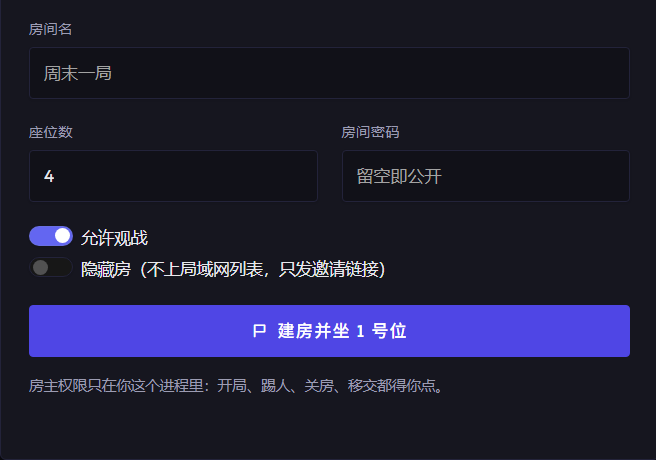
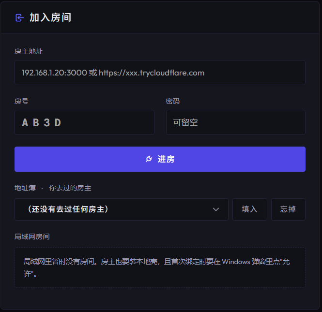
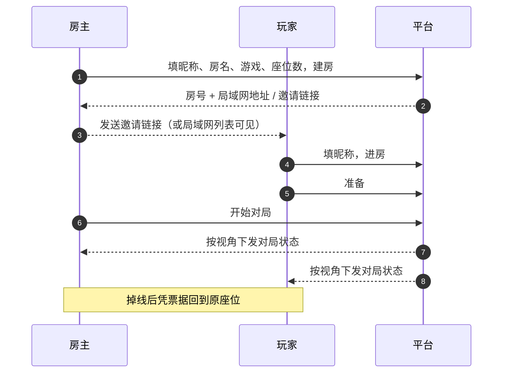
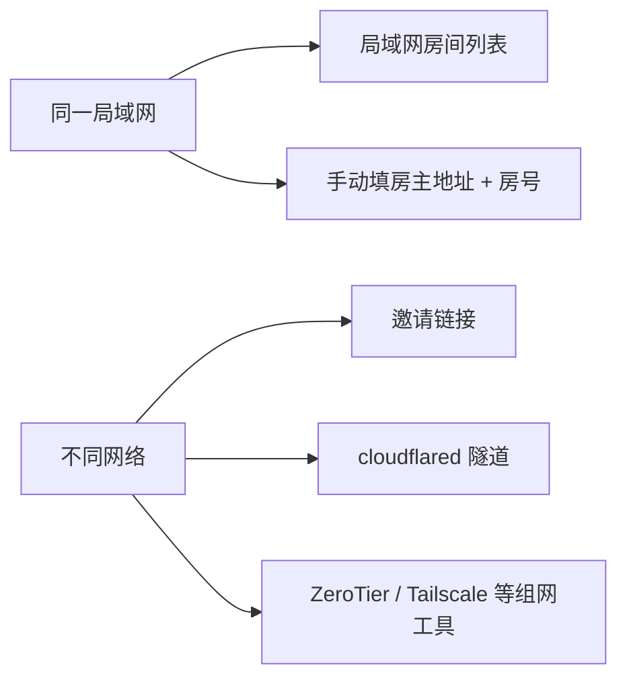

# 3178-battle-platform（3178 对战平台）· 使用说明

> 游戏无关的宿主制联机对战平台：谁建房谁的进程就是服务器，别人从局域网列表或邀请链接进房，类似 war3 对战平台。
> 最近更新：2026-10-28
<!-- 日期必须留在这个 blockquote 里：check-docs.sh 的 [新]/[旧]/[期] 只读这里。改日期时 README、DESIGN、INTEGRATION_GUIDE、CONTEXT 顶部要同一天。 -->

## 1. 文档目录

本文面向玩家和房主；开发、接入和维护文档见下表。

| 文档 | 阅读对象 | 内容 |
|---|---|---|
| [README.md](README.md)（本文） | 玩家 / 房主 | 平台概述、运行环境与入口、对局流程、网络连接、数据存储、命令行用法、使用限制 |
| [DESIGN.md](DESIGN.md) | 开发者 / 二次开发 / 方案评审 | 设计方向（目标 / 约束 / 验收标准 / 测试手顺）；运行模式；核心流程；架构与三处接缝；线协议；开发与构建；关键设计决策；已定语义与边界 |
| [INTEGRATION_GUIDE.md](INTEGRATION_GUIDE.md) | 游戏开发者 / 接入方 | SDK 获取与从零接入、GameModule/GameInstance/Effect[]、客户端入口、单文件包、回合制与实时模式边界、game-kit（事件流/聊天/记分板）、沙箱限制、版本自检与升级 |
| [CONTEXT.md](CONTEXT.md) | 维护者 / 交接的 agent | 逐阶段验收凭据、遗留问题、关键约束、变更记录、agent 交接记录 |

## 2. 平台概述

每个人在自己电脑上跑一个可双击的客户端；建房那台机器就是服务器。玩法通过 `GameModule` 接口接入，平台只负责房间、座位、房主权限、准备、聊天、观战、电脑位、掉线宽限、版本检查、存档和传输。

- **房主制**：建房人所在进程是权威；开局、踢人、关房、移交只有房主能发。
- **座位与票据**：玩家 / 电脑 / 观战角色；入席发票据，掉线可凭它坐回原位。
- **房间发现**：同网段 UDP 组播实时列表；跨网用邀请链接，可选 cloudflared 隧道。
- **版本与房规检查**：房规摘要或游戏版本对不上时挡在门外，不会开成一局不一样的。
- **断线重连与存档**：对局中保留座位 30 分钟；房主重启后房号、座位、票据、对局状态都回来。
- **按座位裁剪状态**：快照按座位生成，观战看不到别人的秘密。
- **不用打包**：浏览器直接吃原生 ESM，离线可用；界面覆盖大厅、房间内和对局挂载点，键盘可完整操作。

> 想接新游戏？按 [INTEGRATION_GUIDE.md](INTEGRATION_GUIDE.md) 安装 SDK，实现 `GameModule` / `GameInstance`，按需写客户端入口和 game-kit 面板，再用 `bpmap` 打包。当前回合制接入可用，实时模式在规划中。

## 3. 快速开始

### 3.1 运行环境

| 你拿到的是 | 需要什么 | 怎么启动 |
|---|---|---|
| 源码目录 | Windows + [Node 24](https://nodejs.org/)，先跑一次 `npm install && npm run build` | 双击下面的入口 |
| 绿色便携包 | 什么都不用装（自带官方签名 `node.exe`） | 双击下面的入口 |

浏览器用 Chrome / Edge 111 及以上（样式底座的 `oklch()` 色值需要）。一个入口：

| 双击 | 结果 |
|---|---|
| [3178对战平台.bat](3178对战平台.bat) | 打开本机大厅 <http://127.0.0.1:3178>；建房时自动开 3000 端口给局域网朋友，纯进房只开本机口 |

双击一次即可，建房和进房都从同一个大厅发起。

对局跑在**新开的控制台窗口**里。要停就在那个窗口按 <kbd>Ctrl</kbd>+<kbd>C</kbd>：先落盘收尾再退出，窗口自己关闭。首次绑定局域网时 Windows 会弹防火墙提示，需要你亲手点“允许”，勾选时把**专用网络**和**公用网络**都勾上更保险（只勾一个，换到别的 Wi-Fi 可能就进不来了）。启动器不写防火墙规则，也不会偷偷安装东西。

### 3.2 对局流程

1. **房主**：先在大厅填好昵称，再填房名、选游戏、定座位数 → 点「建房并坐 1 号位」，界面上出现四位房号。本机页面始终是 `127.0.0.1:3178`；房主页在「邀请链接」下面会列出局域网地址，那是给朋友的入口。
2. **客人**：另一台机器双击「3178对战平台.bat」，先填昵称，再填房主地址（房主页列出的局域网地址，或隧道网址）+ 房号；或者直接点房主发来的邀请链接，地址和房号都替你填好，昵称仍要先填。进别人的房不用先选游戏，房间用哪款游戏由房主决定。
3. 进房后左栏是房间信息和「本局规则与房主操作」；房主在这里改规则，只有 `lobby` 阶段能改，改完所有真人会回到未准备，需要重新准备。客人左栏只剩房间信息和只读规则摘要，没有开局、邀请、移交这些房主按钮。游戏声明了座位选项时，房主点座位号码牌改颜色，电脑座位行内直接改难度；真人座位不显示难度和设置按钮。
4. 各自点「准备」，房主的「开始对局」变亮后开局。人不够时按钮上会写明“等准备：谁”。
5. **掉线 / 关页面 / 换设备**：浏览器数据还在就会自动坐回原位；票据失效时界面会说明原因，不会只丢一句错误码。

对局开始后，游戏区会铺满整行；席位压成横向状态条，聊天与房主面板收进右侧「侧栏」（按钮或 <kbd>D</kbd> 键开关，<kbd>Esc</kbd> 关闭）。游戏提供资料时，「规则与资料」会在第一次展开时读取，读取失败只影响面板，不影响对局。

**房主建房**



房间名、座位数、观战开关和建房入口。

**玩家进房**



房主地址、房号、密码和进房入口。

昵称在进房前填好即可；输入框改完即保存，下次自动带出。清空输入框只表示本次不填，不会抹掉已经记住的名字。



### 3.3 网络连接



- **同一个 Wi-Fi 或路由器**：玩家双击「3178对战平台.bat」，局域网列表里就能看到房主的房，点一下加入。
- **列表里没有**：手动填「房主地址:端口 + 房号」。地址抄房主页列出的局域网地址；装了虚拟网卡时会有好几个，逐个试。房号是界面上那四位。
- **不同网络**：优先用邀请链接；房主也可以加 `--tunnel` 走 cloudflared。用 Radmin、ZeroTier、Tailscale 这类组网工具时，UDP 组播一般过不去，别等房间列表，直接填地址。

### 3.4 数据存储

| 位置 | 存什么 | 注意事项 |
|---|---|---|
| 浏览器存储（按站点） | 昵称、地址簿、每个座位的票据 | 单入口从 `127.0.0.1:3178` 打开，所以只有一份存储。清浏览器数据会让票据失效，旧座位要等宽限到期 |
| 房主机器的数据目录 | 房间快照：房号、座位、对局状态 | 只有建过房的进程才写；便携包在 `%LOCALAPPDATA%\3178-battle-platform\data`，开发目录在仓库的 `data/` |

想知道当前用的是哪个目录，跑 `node packages/hostd/dist/cli.js diagnose`，第一行就会打印出来。关房用房主面板的「关闭房间」，它会连盘上的房一起删掉。

| 位置 | 房主 | 玩家 | 观战 |
|---|---|---|---|
| 房间内 | 开局、加电脑位、移交房主、请出座位、复制邀请、关房 | 准备 / 离开 | 只看桌，不能动作 |
| 对局中 | 房主面板在右侧侧栏 | 游戏区铺满整行，席位是横向状态条 | 公开视角 |

房主不能直接走人：要么先移交，要么关房。这是 war3 的房主语义，不是用来防误触的。

### 3.5 命令行用法

```bash
node packages/hostd/dist/cli.js shell --port 3178 --lan-port 3000 [--tunnel] [--no-lan] [--no-announce]  # 单入口：建房时才开局域网
node packages/hostd/dist/cli.js host --port 3178 --lan-port 3000 [--tunnel] [--no-lan] [--no-announce]
node packages/hostd/dist/cli.js join --port 3178     # 只进房，绑 127.0.0.1
node packages/hostd/dist/cli.js diagnose             # node / 游戏 / cloudflared / 网卡 / 在跑的壳
node packages/hostd/dist/cli.js stop --port 3178
```

`--port` 是本机界面端口（只绑 `127.0.0.1`），`--lan-port` 是 `shell` / `host` 给局域网/隧道开放的端口；`--no-lan` 连公网监听一起关，`--no-announce` 只关组播广播。便携包里把 `node` 换成包内 `node.exe` 即可。

## 4. 使用限制与注意事项

- **便携包还没上第二台机器实测**：`npm run portable` 产出 `dist-portable/3178-battle-platform/`（约 94 MB，含官方签名 `node.exe`）；本机已用“剥掉 PATH 里的 node/npm”的方式验过启动、`/health` 与 `stop`，真正没有 Node 的电脑仍待实测。
- **局域网组播与隧道未双机实测**：编解码和过期表有测试，真网卡收发与防火墙弹窗还没验证；跨网目前只能靠邀请链接，隧道域名每次启动都变。
- **没有自带界面的游戏**：对局区显示平台内置的占位面板，仍可按平台给出的按钮操作；完整界面由游戏自己提供。
- **宿主制天然不防房主**：权威进程在房主机上，“按视角裁剪”只防透视；移交只移权限、不迁进程。
- **从房主拉游戏模块 = 在浏览器里执行房主给的代码**。客户端现在默认把它放进 `sandbox=allow-scripts` 的 iframe，不给 `allow-same-origin`，沙箱里读不到本机存储和票据。哈希只保证字节没被改，不保证代码无害；沙箱降低风险，玩法本身仍由房主提供。

本项目从同工作区的 `uno-online` 剥离连接层重写而来，那边代码一行没动；玩法改动归那边，连接/身份/分发改动归这里。

