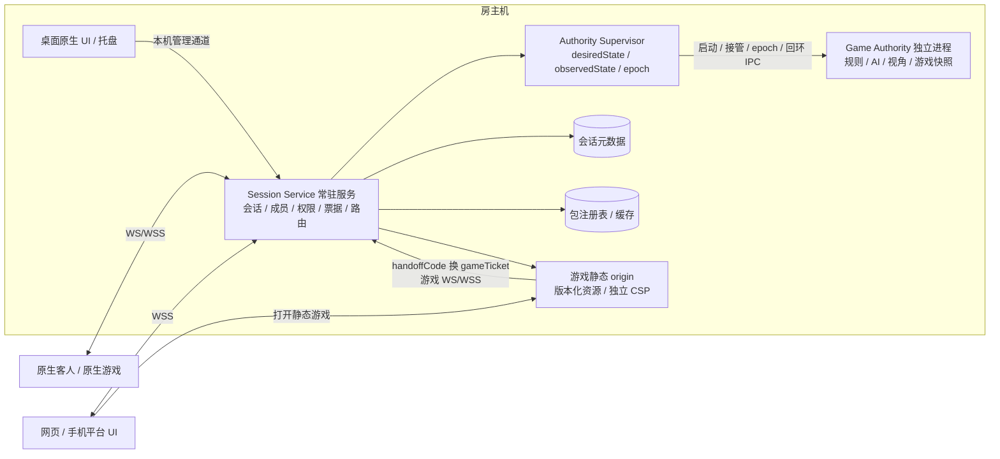
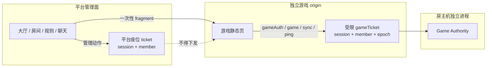
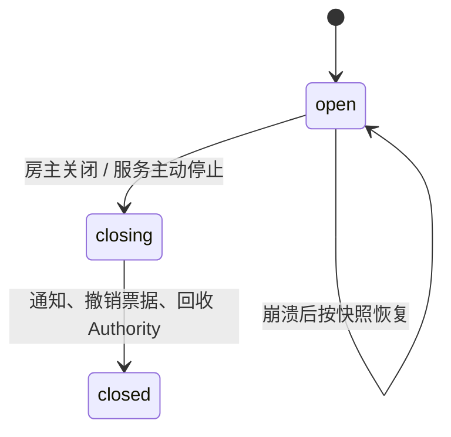
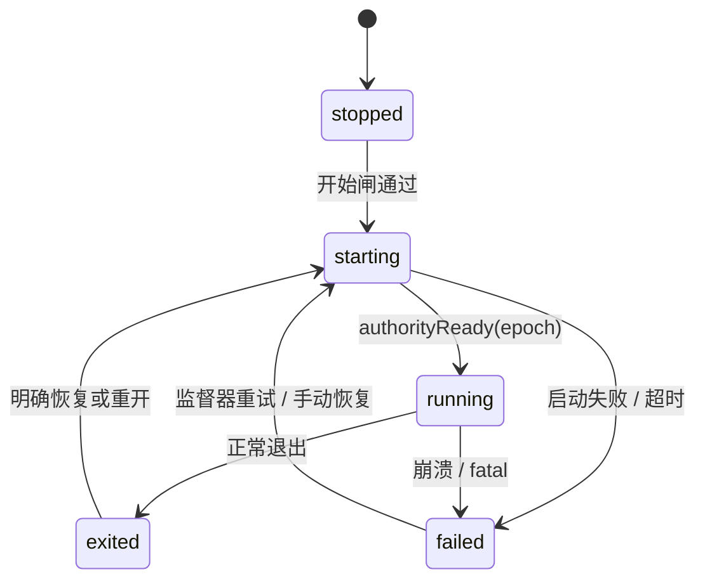
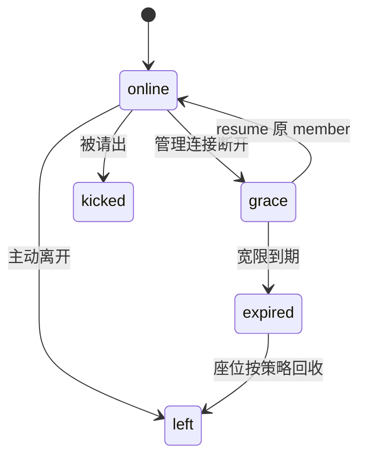
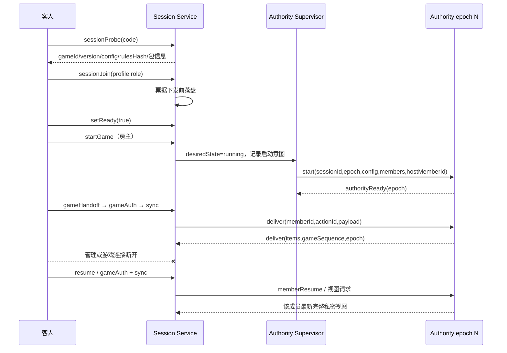
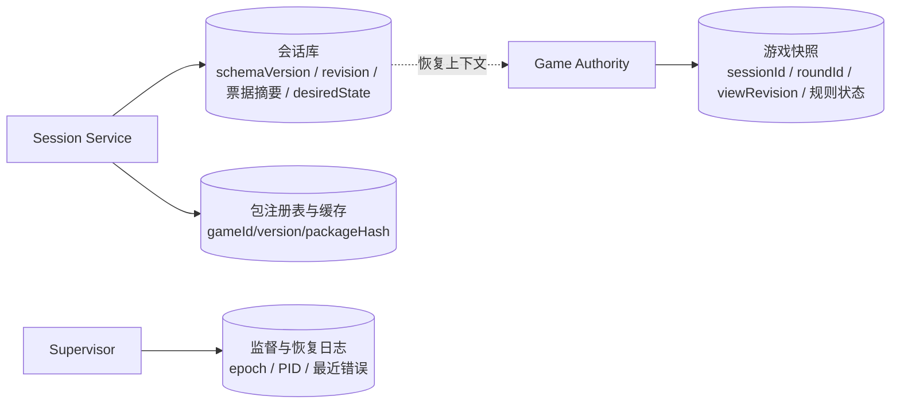
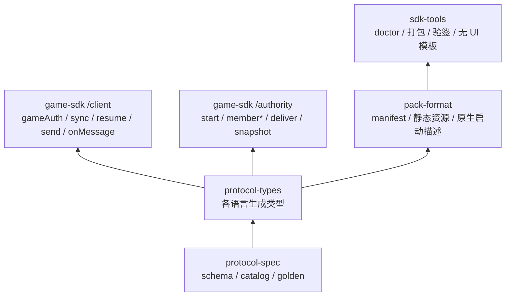
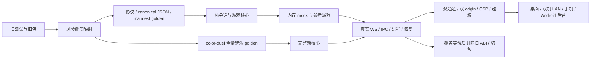

# 3178 对战平台 · 全局目标架构

> 日期：2026-11-12。状态：目标架构基线，描述尚未完整实现的新系统。
> 本文统一进程、协议、网络、安全、存储、包、SDK、UI、测试与迁移；实施顺序只表示依赖，不再用 S1/S2 切割架构。
> 权威顺序：本文 → `protocol/v0/` 机器契约 → 当前实现说明 → SDK 接入指南。`docs/DESIGN.md` 在目标落地前仍描述旧实现。

## 0. 当前证据边界

- 已有：三端 UI 设计契约、协议 v0 草案、41 条方向 golden、TS/Python 生成互解、内存 mock 与最小参考游戏。
- 这些只证明对应契约层的自洽，**不代表真实 WS、独立进程、崩溃恢复、双 origin、WSS、原生客户端或真机已验证**。
- 当前 v0 在全局评审前不冻结；没有真实消费者前可迭代，发布后破坏性变更才开新版本。
- 旧 Engine、旧 SDK 和 color-duel 旧包是迁移来源，不与目标架构混写。

## 1. 总体拓扑

核心原则：

- 平台管理进程与管理 origin 不执行游戏代码；可以分发 Authority 产物和网页静态代码。
- 每个会话一个 Authority；`desiredState` 与 `observedState` 分离，启动、接管和消息都带 `authorityEpoch`。
- 桌面 UI 关闭不影响服务；转交房主只转权限，不迁移机器。
- 会话、连接、成员、Authority 进程是四组正交状态，不用一个 phase 概括。
- 无自建目录/中继服务；cloudflared 明确列为第三方中继依赖。
- 当前产品只开放单会话；协议与存储仍以 sessionId 隔离，不把单会话写进消息结构。

## 2. 身份与信任边界

- 严格双通道：管理连接不承载游戏消息；游戏连接只允许 `gameAuth/game/sync/ping`。
- `handoffCode` 短期、一次性、绑定 session+member+origin；游戏页消费后立即从 fragment 清除。
- `gameTicket` 绑定 session+member+authorityEpoch；换代、踢出、离席、关会话即撤销。
- 管理与游戏连接分别显示状态；成员在线与宽限由管理通道决定，游戏通道断线只影响游戏视图与补发。
- 本地管理接口有 Origin 白名单与 DNS rebinding 防护；原生无 Origin 走独立鉴权。
- 三类凭证只存摘要；日志、URL 查询、Referer、崩溃报告不得泄露原文。

### 威胁模型

| 威胁 | 必须成立的防护 |
|---|---|
| 恶意网页游戏脚本 | 独立 origin + CSP + 仅 gameTicket；管理票据不可达，管理动作越权拒绝 |
| 恶意/出错客户端 | 方向 schema、权限、限流、动作幂等；Authority 校验全部玩法动作 |
| 旧连接或旧进程迟到消息 | 连接代际 + authorityEpoch + revision/viewRevision，旧帧拒绝 |
| 局域网伪造信标 | 信标只作发现提示，probe 与票据才决定入会；版本/配置/包哈希复核 |
| 本机恶意网页 / DNS rebinding | 管理 Origin 白名单、Host 校验、仅本机管理通道，不把 CORS `*` 当防护 |
| 包篡改与路径穿越 | 内容哈希、路径/大小写/大小/文件数限制、入口资产闭合、缓存复核 |
| 房主作弊或游戏进程读宿主机文件 | 不作为反作弊承诺；独立进程是故障与依赖隔离，不是安全沙箱 |

## 3. 状态机与恢复

统一语义：

- 房主不需要 ready；其他已连接真人都需 ready。AI/观战不参与开始闸。
- 断线真人阻塞开始，房主可先请出或等宽限结束；最低人数按真人+AI 玩家计算，观战不计。
- 开始后加入策略由清单声明 `spectator | player | deny`，默认 spectator。
- `failed/exited` 不直接等于游戏结束；恢复由 Supervisor 按快照和 epoch 执行。
- 正常停止服务进入 closing；硬杀留下恢复证据；只有明确关闭会话才删除 tombstone。
- Authority 正常退出后能否重开由游戏与会话策略决定；`roundClosed` 不改变进程状态，rematch 产生新 roundId。

### 恢复矩阵

| 事件 | 目标行为 |
|---|---|
| 关闭桌面 UI | 服务、会话与 Authority 继续；托盘明确显示存续 |
| 管理连接断开 | 成员进入宽限；游戏通道状态独立；可 resume 原 member |
| 游戏连接断开 | 不改变管理成员在线；gameTicket 可重连并 sync 补视图 |
| Authority 崩溃 | observedState=failed；保留会话；按策略以新 epoch 恢复或等待房主 |
| Session Service 崩溃 | 按会话库恢复；接管或回收旧 Authority；旧 epoch 不得再写入 |
| 隧道子进程崩溃 | 本地会话继续；隧道单独重建，游戏与管理 origin 分别恢复 |
| 机器重启 | 以 sessionId 恢复会话与游戏快照；不得仅凭可复用房号恢复 |

## 4. 成员、配置与加入闭环

成员模型拆分：

- `memberId`：真人、AI、观战的稳定身份与路由主键。
- `slot`：玩家/AI 的 1–8 显示槽位，可回收；观战无 slot。
- `role`：`player | ai | spectator`；`hostMemberId` 单独标识权限。
- ticket、profile、成员事件、`deliver.to` 和权限判断统一使用 memberId。

必须补齐：

- `sessionProbe/sessionPreview`：加入前返回房间名、游戏 id/version、规范化 config、rulesHash、容量、必需能力和包信息。
- 游戏清单查询：本机注册表、默认配置、观战/AI/迟到加入能力和静态包元数据。
- AI 加删、观战加入、指定/移动槽位、profile 修改、身份色占用、宽限到期事件。
- 平台会话选项、游戏 config、每座 options 分开，不共用一个无语义 options。
- 系统聊天、消息 ID、聊天 revision、历史快照和重连补历史。
- `gameAuth` 严格二选一 handoffCode/gameTicket；初次连接有显式 `sync`，Authority 补当前完整视图。

配置规则：

- 清单提供游戏显示名、字段默认值、类型、选项、依赖、必需能力和 Web 权限。
- 平台只做声明式规范化与校验，**先规范化再 canonical JSON+SHA-256**；Authority 启动后再次校验。
- 无法声明式表达的约束只能让开始失败，不能在开始前运行游戏代码。
- `toSeat` 对私密手牌类游戏是必需能力，不因全局能力表里可选就可省略。

## 5. 命令与副作用矩阵

| 命令 | 权限 / 前置状态 | 副作用与持久化 | 主要出站 |
|---|---|---|---|
| sessionProbe | 无需座位，会话 open | 无副作用 | 房间、游戏、配置、包与能力预览 |
| sessionCreate | 仅本机房主控制面 | 会话可见前落盘；分配 memberId/slot | seatGranted + sessionState |
| sessionJoin | probe 匹配；容量与密码合法 | 票据下发前落盘；按角色分配槽位 | seatGranted + 全量状态 + 聊天历史 |
| setReady | 本人、真人、未开始 | 更新 ready 并 bump revision | memberUpdate + sessionState |
| setConfig | 房主、stopped | 声明式规范化、重置真人 ready、重算 rulesHash | sessionState；开始后拒绝 |
| setSeatOptions | 房主、stopped、目标存在 | 更新该成员 options 与 revision | memberUpdate + sessionState |
| addAi / removeAi | 房主、stopped、槽位合法 | 分配/回收 slot；不写游戏状态 | memberJoin/memberLeave + sessionState |
| startGame | 房主；其他真人 ready；人数合法 | 先记录启动意图，再由 Supervisor 启动 epoch | start + 进程状态；失败不重复启动 |
| transferHost | 当前房主、目标真人 | 只改 hostMemberId 并落盘 | hostChanged + sessionState |
| kick / leave | 房主或本人；房主离开先移交/关会话 | 撤销凭证、按原因回收 slot、清理聊天关联 | memberLeave + sessionState |
| resume | 有效 ticket、宽限内 | 新连接代际接管；旧 close 不得污染 | seatGranted + 全量状态 + memberResume |
| gameHandoff / gameAuth | 管理座位有效；一次性码或有效 gameTicket | 签发/撤销受限凭证，绑定 epoch | gameGranted；旧游戏连接失效 |
| game / sync | 仅游戏通道、member 与 epoch 有效 | 不写平台会话状态；动作幂等 | deliver / 当前完整私密视图 |
| closeSession | 房主 | open→closing→closed；撤销票据并回收 Authority | 管理与游戏两端关闭通知 + tombstone |

## 6. 定序、同步与恢复时序

契约必须包含：

- `sessionId`、`memberId`、`authorityEpoch`、`requestId/actionId`、幂等键、`gameSequence`、`viewRevision`。
- 平台 revision 与游戏 viewRevision 分开；旧连接、旧 epoch、旧视图不得覆盖新状态。
- 断线不静默排队；重连强制全量同步，不做无限消息重放。
- `deliver` 支持 memberId/all，目标去重、顺序固定；平台不合并、不裁剪 payload。
- 真实 IPC 首帧、启动鉴权、4 字节大端长度、1 MiB 上限、半包/粘包、心跳、超时与关闭 ACK。

## 7. 存储与数据归属

- 数据目录分会话、Authority、包缓存、日志；单实例锁防两个服务写同一目录。
- 会话可见前、票据下发前、启动副作用前必须落盘；内容没变跳过只能做非关键写优化。
- 会话记录保存 schema 版本、游戏/包/清单哈希、成员、profile、ready、options、票据摘要、宽限、host、revision、聊天、desiredState 与最近 epoch。
- 游戏快照绑定 sessionId、roundId、游戏版本、rulesHash；Authority 自行原子写、结构校验、坏文件处理和 AI/计时重排。
- color-duel 的牌 ID 生成状态必须进快照；恢复后报牌、质疑、罚链和 AI 排程不得重置成错误语义。

## 8. 包、网络与 SDK

包清单同时描述 Authority、Web 静态入口和原生客户端启动：OS/架构、运行时、安装识别、启动参数、资源权限。所有入口必须在资产清单中，静态 URL 含 gameId/version/packageHash；有 CSP、CORS、MIME/nosniff、缓存、Service Worker 隔离和权限展示。签名只证明完整性，发布者信任与撤销另行展示，不假装已有 PKI。

接入矩阵：

| 场景 | 管理页面 | 管理通道 | 游戏静态页 | 游戏通道 |
|---|---|---|---|---|
| 原生桌面 | 原生控件 / 本机管理 | 本机或远程 WS/WSS | 原生游戏进程 | WS/WSS |
| LAN 网页 | HTTP | WS | 独立 HTTP origin | WS |
| 公网网页 / 手机 | HTTPS | WSS | 独立 HTTPS origin | WSS |
| cloudflared | 一个公开 hostname | 同隧道升级 WSS | 另一个公开 hostname | 另一个隧道的 WSS |

UDP 发现只服务能收组播的端；手机/纯网页依靠邀请或地址簿。多网卡、IP 变化、邀请过期、隧道重连和子进程监督均属实现范围。

- core-abi 的 GameModule/Effect 退出新运行时；旧包留 registry 作历史。
- game-sdk 不含 game-kit、mount/actions、UI 组件或玩法框架。
- 游戏核心、AI、视角和 UI 归游戏仓；SDK 只提供联机与工程能力。
- `@bp/protocol` 仍是平台内部实现，不是公共 SDK。

## 9. 三端 UI 与诊断

- 网页/手机共用 Web 管理实现，桌面 exe 用原生控件实现同一状态、文案、权限和视觉契约。
- UI 状态命名为 `prestart / authorityActive / failed` 等派生状态，避免与会话 open 混淆。
- 开始中、失败、恢复、管理断线、游戏断线、托盘存续均有明确界面；手机 320/360/390、44px、横竖屏、后台恢复。
- 原生游戏启动与网页 handoff 是两条不同 UI 路径。
- 单一 diagnose 展示服务/UI PID、监听、会话、epoch、数据目录、包注册表、隧道和最近恢复；日志不得记录三类凭证或私密 payload。
- 预览页的 CDP/视口/焦点检查从 `%TEMP%` 沉淀到 `tools/checks/`，保证干净 checkout 可复现。

## 10. 测试与迁移

- 保留通用测试能力与纯会话场景；重做 GameModule/Effect、fake-context、旧 contract-harness、fixture-kit UI、沙箱和可执行包测试。
- canonical JSON 必须有 TS/Python 字节与 SHA-256 golden，覆盖 Unicode 码点排序、数字、-0、大整数和非法值；不能沿用 UTF-16 排序或旧 FNV。
- color-duel 不采用删减版交付：先抽全量玩法 golden，再迁完整规则、AI、所有动作（含 report）、计时、质疑/碰/换手、视角、快照和 rematch；UI 另做移动信息架构。
- 旧 `.bpmap` 只作历史证据，不进新运行时。
- 新测试覆盖同等风险后才删除旧测试；seam 进一步禁止新运行时 import core-abi、GameModule/Effect、iframe/Blob 游戏入口和 game-kit。

## 11. 实施顺序（仅表示依赖）

1. **全局设计基线**：本文收口；主方案、评审包与交接文档指向同一权威顺序。
2. **契约一次补齐**：按本文修订 protocol/v0、catalog、manifest、golden、生成器和 mock；全局评审前不冻结。
3. **真实平台骨干**：Session Service、Supervisor、真实 WS/IPC、存储、包注册表、静态 origin、隧道和诊断共用同一契约；最小参考游戏先走真实链路。
4. **SDK 与外部消费者**：发布 protocol-types、game-sdk /client+/authority、pack-format、sdk-tools；Python 至少实现一个真实 IPC Authority 或 WS 客户端。
5. **三端实现**：Web/手机管理 UI、桌面原生 UI、托盘、原生/网页游戏启动和真实状态接入。
6. **color-duel 全量迁移**：另仓单写者，先 golden、再完整核心、Authority 存储、独立 Web/移动 UI，不以删减玩法作为完成定义。
7. **切换与发布**：覆盖等价后删除旧 ABI 和旧包入口；强化 seam；更新 README/DESIGN/INTEGRATION_GUIDE；做干净机器、双机 LAN、WSS/隧道和 Android 验收。

## 12. 全局完成定义

1. **完整联机**：原生房主建房，网页客人 probe/加入，统一 ready，独立 Authority，游戏 handoff，公私消息正确，完整一局并 rematch。
2. **独立故障**：管理连接、游戏连接、Authority、Session Service、隧道分别崩溃；旧连接、旧 ticket、旧 epoch 均不能污染新状态。
3. **三端与形态**：桌面原生、桌面网页、手机网页语义一致；原生/网页游戏替换时平台零改动；关 UI 会话继续。
4. **迁移与分发**：外部 SDK 消费者不依赖旧 ABI；旧包明确拒绝；包权限受控；干净 Windows、真实 LAN/WSS、Android 后台均有证据。

任何一项缺失都不能称新架构完成；mock、预览页和 golden 只作为对应层证据，不冒充真实系统验收。

<!-- multi-agent-task-handoff: scope=docs -->
