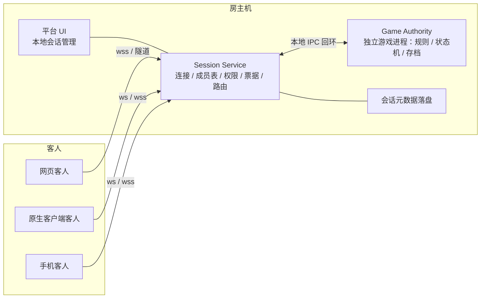

# 新版平台与 SDK 设计方案（候选 v0）

> **候选方案，核心决策 15:12 拍板、边界 15:20 修正**。D1/D2/D3/D4/D5/D6 按结论执行，D7 参考稿 v2（房间级保留 / 对局级删除）待用户反馈。S1–S6 尚未实现、未验证，本文不是已完成的实现依据。
> 本文属调研 / 设计类文档，放在 `docs/research/`。自包含：D1–D7 决策状态、证据边界与旧契约实证依据收在附录 A / B；过时的过程文档已删除，不再单独保留。
> 配套架构评审与拍板输入见 `docs/research/架构评审与决策输入包.md`（分层与边界、选型四列权衡、量级估算、七维风险、S0–S6 验收与回滚）。
> 日期：2026-11-10　写者：本会话

## 0. 读法

| 标记 | 含义 |
|---|---|
| `[事实]` | 现有代码或文档里核实过的 |
| `[建议]` | 本会话的设计判断；标记的是属性，不代表决策状态（决策状态见附录 B.1） |
| `[假设]` | 推断，无真机验证 |
| `[待拍板]` | 正文中尚未定的细节；D1–D6 已于 15:12 拍板，仅 D7 参考稿待反馈 |

**一句话定位**：平台是「联机会话服务」，不是应用宿主；SDK 是「语言中立的联机契约」，不是游戏运行时框架。

---

## 1. 目标与边界

| 平台做 | 平台不做 |
|---|---|
| 连接、心跳、重连、票据 | 渲染**对局期**游戏 UI（倒计时、结算、牌桌、再来一局、占位面板） |
| 会话成员表、消息定序、按座位投递 | 执行游戏逻辑、解释游戏状态 |
| 房主权限裁决（移交/踢人/关会话） | 提供 game-kit 或任何**游戏内** UI 组件 |
| 局域网发现、邀请链接、版本与房规闸 | 下发可执行客户端代码、iframe 沙箱 |
| 会话元数据落盘 | 存游戏状态、替游戏做视角裁剪 |
| **房间级四块 UI**：规则配置 / 席位配置 / 房间聊天 / 资料面板 `[15:20 用户确认保留]` | 读 `GameModule` 声明、解释配置语义 |

**边界口径**：按「房间级 / 对局级」切，不按「游戏功能 / 平台功能」切。房间级是 N 个进程之间要一致的会话状态与会话通信，归平台；对局期的画面与玩法反馈归游戏。

**可观察的成功信号**：

1. 一款游戏不 import 平台任何 UI 组件、不实现任何平台接口，只用协议就能联机。
2. 同一份协议在桌面原生、桌面网页客人、手机网页客人、不同语言客户端上跑通。
3. 关掉平台 UI 窗口，会话仍在（服务常驻）。
4. 游戏从网页换成原生（或反过来），平台代码零改动。
5. 平台代码里搜不到任何玩法词（现有 `check-seam.sh` 闸门继续成立）。

---

## 2. 平台设计

### 2.1 形态与角色 `[建议，依赖 D4]`

| 角色 | 形态 | 理由 |
|---|---|---|
| 房主 | 桌面原生 exe（Windows 优先），常驻服务 + 系统托盘 + 本地 UI | 要监听入站端口、组播发现、本地落盘、防火墙授权、管理隧道子进程。房主关机这局就没了，本来就是服务进程 |
| 客人（桌面） | 网页零安装入口 + 原生客户端并存 | 点邀请链接就进房，是本项目相对 war3 平台最大的便利 |
| 客人（手机） | **网页为首选**，原生客户端可选 | 手机只做客人、只主动外连，不当服务端。否掉「apk 当房主」的四条理由（后台被杀、NAT 后不可主动连入、端口不可达、防火墙授权）全是「当服务端」才有的，客人一条都不沾 |
| 游戏 | 形态自定，独立进程 | 游戏逻辑不进平台进程 |

**手机网页客人补述**（2026-11-10 追加）：
- **可以，而且应该是手机客人的首选形态**。零安装、点邀请链接即进房，与桌面网页客人共用同一份协议和同一个入口。
- 按 C3，游戏本体归游戏自己。平台在手机上只需一个**窄屏单列的会话/成员/连接界面**，不需要房间四块布局；此前把「四块布局在手机上不成立」当作手机限制，其实那是平台 UI 的问题，C7 微调时补竖屏单列重排 + 触控目标 ≥44px 即可。
- 三条必须处理的约束：① `https` 页面连 `ws://` 会被浏览器拦，需 wss 终结或隧道（§2.8 已标未解决，手机网页让它更紧迫）；② 切后台会断连，要靠 30 分钟宽限 + `seatResume` 自动坐回原位，且须验证浏览器后台节流下心跳是否被冻结；③ 320px 竖屏重排与焦点/触控达标，**未做真机验证**。
- **用词**：项目没有账号系统（`DESIGN.md §2.1` 明确不做账号/好友/段位/匹配），正确说法是「加入会话 / 进房」，不是「登入」。别在设计里引入账号概念。

**明确否掉**：把现有网页用 Electron/Tauri 打包成 exe（那是把浏览器塞进安装包，网页形态的税一条不少）；apk 当房主端立项。

### 2.2 进程拓扑 `[建议，依赖 D2]`

`[事实]` 现状是 `Engine`（平台进程）同时持有 `Room` 与 `GameInstance`，游戏逻辑在平台进程内 `import()` 执行，客户端在 iframe 沙箱里跑。**改的就是这一处**：把权威从平台进程挪到房主机上的独立游戏进程，平台只留连接、会话与路由。

### 2.3 权威与消息流 `[建议]`

1. 客人发 `game` 消息给 Session Service，payload 是不透明字节。
2. Session Service **不解释内容**，只做定序、鉴权、附上 `fromSeat`，转给 Game Authority。
3. Game Authority 算完，返回 `deliver`，带 `targets: seatId[] | 'all'` 与各自的 payload。
4. Session Service 按 targets 投递，不合并、不裁剪、不看内容。

**单一权威保住**：只有房主机上的 Game Authority 算状态。反过来让每个客户端各自算，就要做确定性帧同步、冲突裁决、断线重放，等于重写联机引擎。

**代价必须写明** `[建议]`：视角裁剪从「平台保证不泄露」变成「游戏自己保证」。平台不再调用 `serialize(viewer)`，只提供 `toSeat` / `toAll` 两种投递目标，游戏自己决定给每个座位发什么。这降低了平台的安全承诺，必须在 SDK 文档里写成显式警告，并在示例代码里示范裁剪。`[假设]` 是否需要平台级加密隔离，待真机验证后定。

### 2.4 会话生命周期 `[建议，依赖 D1]`

**平台只有两态**：`open` / `closed`，加一张成员表。`lobby` / `playing` / `ended` / `ready` / `roundEnd` 全部归游戏。

- 平台裁决的只有：谁建房、谁能入会、谁是房主、谁能踢人/移交/关会话、票据是否有效、掉线宽限是否到期。
- 游戏自己决定：什么时候开始一局、什么时候结束、要不要再来一局。
- 现有 `end` Effect 的坑（`engine.ts:831-834` 把房间改 `ended` 并广播 `HOSTLEFT`，玩家被踢回大厅）在新架构里直接消失：平台没有 `end` 语义，关闭会话只由房主或超时触发。

**这不是砍功能**：房号分配、票据失效、硬杀丢房、链路断开时命令被静默排队，这些是 N 个进程之间要一致的分布式状态，猴测报告 15 条里 10 条在这一层，留平台。

### 2.5 平台职责清单 `[建议]`

| 能力 | 具体 |
|---|---|
| 连接 | 建连、心跳、指数退避、断线重连、Origin 校验 |
| 发现 | UDP 组播信标、地址簿、邀请链接、cloudflared 隧道 |
| 准入 | 版本闸、房规摘要闸（`rulesHash` 只比对，不解释规则内容） |
| 身份 | 座位票据、`secretHash` 落盘、30 分钟掉线宽限、`seatResume` |
| 成员 | 成员表、房主标记、连接状态、`revision` 单调 |
| 路由 | 消息定序、`toSeat` / `toAll` 定向投递 |
| 权限 | 移交 / 踢人 / 关会话的裁决 |
| 存储 | 会话元数据原子落盘、坏文件跳过、重启恢复 |

### 2.6 平台 UI `[建议，依赖 D7，用户已确认「微调」]`

**15:20 边界修正**：用户判断规则配置 / 座位选项 / 资料面板 / 平台聊天是**房间相关**的，可以留；**对局相关**的删掉。这比 15:12 的一刀切更准 —— 之前把房间级会话功能也砍了，导致房间页从四块拆成三块，反而不像「微调」。

**边界口径**：按「房间级 / 对局级」切，不按「游戏功能 / 平台功能」切。房间级是 N 个进程之间要一致的会话状态与会话通信，归平台；对局期画面与玩法反馈归游戏。

**保留**：
- 现有四块布局全部保留：房间信息条、规则配置栏、席位配置、房间聊天；房主桌子级操作、席位六格、邀请链接与复制、`D` / `Esc` 焦点归还、暗色令牌、无渐变/关键帧/发光、已有可访问性处理。
- 资料面板（游戏资料入口）保留，仍只渲染纯文本与图片、路径校验沿用。
- **1256×708 实测过的三栏同高 319px 高度链可以沿用**，S4 改动量大幅下降。

**删除（只对局级）**：`#game-host` 整块、`playing` 态「游戏区拉通整行 + 席位横条 + 侧栏」布局、`deadlineInMs` 倒计时块、结算与再来一局、占位面板、iframe 沙箱 / Blob ESM / 客户端源码下发、玩法错误文案落点。`ui.chat='game'` 开关建议删除（平台聊天与游戏内聊天并存会出两份，游戏要做游戏内聊天自己画即可）`[待确认]`。

**四个模块的新契约**（留下来但不能把旧耦合放回来）：

| 模块 | 归平台 | 归游戏 | 改法 |
|---|---|---|---|
| 规则配置 | 表单渲染、ready 重置、`rulesHash` 准入闸、`RoomExport.config` 落盘 | 字段语义、归一化 | 声明从 `GameModule.ruleConfig` 移到**中立清单 `sessionConfig` 段**；平台按通用控件渲染，值 opaque 透传 |
| 座位选项 | 每座选项的存取、随成员表透传 | 颜色/难度的玩法含义、色块与牌桌渲染 | 平台渲染通用键值对，不画色块/难度下拉；色值由游戏读同一份 `options` |
| 资料面板 | 懒加载、纯文本/图片渲染、路径校验 | 资料内容 | 走清单 `reference` 段，不依赖 `.bpmap` 可执行入口 |
| 房间聊天 | 会话级消息、系统消息、聊天缓冲 | 游戏内聊天（若游戏要做） | 平台保留会话聊天；删 `ui.chat` 开关，不再让游戏替换平台聊天 |

**三条硬约束**（否则解耦白做）：① 平台不 import 游戏声明（`GameModule` 已删，声明必须是清单里的数据，不是 TS 类型）；② 平台不解释语义（`rulesHash` 只比对、`options` 只作成员表字段透传）；③ 语言中立（`sessionConfig` / `reference` 用 JSON 描述，exe / apk / 网页三端都能读）。

**数据重接**：`bp:room`、`deadlineInMs`、`SeatView.options`、玩法错误码文案收掉后，ViewModel 改绑到新会话协议；四个保留模块的声明源改绑到中立清单。组件变体几乎不变，组件契约换数据源。

**两个相位**：

| 相位 | 显示什么 |
|---|---|
| 大厅 / 房间（lobby） | 现有四块布局原样保留：房间信息 + 规则配置 / 席位配置 / 房间聊天三栏 |
| `open`（原 playing） | 缩成会话状态条 + 「打开游戏」入口，平台窗口可最小化到托盘 |

**D7 参考稿 v2（15:20 已出，待用户看后拍板）**：三相位示意图（房间页四块 / `open` 状态条 / 手机 320px 竖屏单列），沿用现有令牌 `#0a0a0f` 底、`#16161f` 卡、`#23233a` 线、`#6366f1` 强调、圆角 6px、无渐变无关键帧。靛紫=房间级保留、琥珀=数据重接（声明改中立清单）、灰=对局级删除。状态覆盖默认/加载/空/错误/成功恢复/权限受限/离线重试，`D` / `Esc` 焦点归还、触控目标 ≥44px、正文对比度 ≥4.5:1、reduced-motion。只定信息架构与层级，**不是像素稿，未做真机验证**。

**实现载体** `[假设，可撤销]`：保留的是信息架构与布局，载体（本地页面 / 原生控件 / WebView）随客户端形态定，用户未明确。

### 2.7 状态矩阵（平台 UI）

| 页面/组件 | 默认 | 加载 | 空 | 错误 | 成功/恢复 | 权限受限 |
|---|---|---|---|---|---|---|
| 大厅 | 建房/进房两卡 | 连接中、发现中 | 局域网无房间、地址簿为空 | 地址非法、连不上、版本/房规不符 | 建房成功显示房号与邀请 | 非房主不显示建房 |
| 会话信息 | 房号/名称/游戏 id/状态 | 同步中 | — | 连接断开、票据失效 | 复制邀请成功 | 非房主不显示邀请链接 |
| 成员名册 | 六格席位行 | 成员变更中 | 无成员 | 踢人/移交被拒 | 重连坐回原位 | 非房主无桌子级操作 |
| 连接状态条 | 已连接 | 重连中（含退避次数） | — | 断开并说明原因、可重试 | 恢复后自动清状态行 | — |
| 打开游戏入口 | 可用 | 启动中 | 未安装该游戏 | 启动失败、版本不符 | 拉起游戏进程 | 观战按游戏规则 |

离线/重试沿用现有语义：链路断开时命令本地拒绝并说清楚，不静默排队（猴测 Issue #10 的修法要保住）。

### 2.8 网络、发现与双端接入

| 端 | 接入 | 现状问题 |
|---|---|---|
| 原生房主 | 监听 TCP 对外端口 + UDP 组播 + 本地回环给 UI | `[事实]` 现有 3000 端口与组播可用 |
| 原生/网页客人 | 连房主 `ws` / `wss` | `[假设]` **未解决**：`https` 页面连 `ws://` 会被浏览器拦，现状靠 `http://127.0.0.1` 本机页绕过（`DESIGN.md §9`）。做成客户端后要么由平台提供 wss 终结，要么走 cloudflared 隧道。需真机验证 |
| 手机客人 | 同上 | 后台限制与前台服务待验证 |
| 房主机平台↔游戏进程 | 回环 TCP / Unix socket，简单帧协议 | 新通道，需定帧格式与超时 |

邀请链接、地址簿、隧道、版本闸沿用现有实现。

### 2.9 安全模型 `[建议，依赖 D2]`

| 项 | 现状 `[事实]` | 目标 `[建议]` |
|---|---|---|
| 游戏代码 | 房主进程 `import()` 执行，客户端 Blob ESM 在 iframe 沙箱里跑 | 用户自己安装游戏，平台不执行、不下发游戏代码 |
| 校验 | 客户端源码 sha256（无 `crypto.subtle` 时纯 JS 回退） | 包签名 / 来源校验 + 连接鉴权 + 版本与房规比对 |
| 私密信息 | 平台按座位调 `serialize(viewer)` 裁剪 | 游戏自己裁剪，平台只按 `toSeat` 投递，不解释内容 |
| 票据 | 明文只在客户端，盘上存 `secretHash` | 沿用 |

**净效果**：房主不再执行第三方游戏代码，反而更安全；代价是视角私密性从平台保证降为游戏自律。

### 2.10 存储 `[建议]`

平台只存会话元数据：房号、成员与座位、房主标记、票据摘要、连接状态、revision。游戏状态归游戏自己存。沿用原子写、坏文件跳过、便携包写 `%LOCALAPPDATA%\3178-battle-platform\data`、`BP_DATA_DIR` 可覆盖。

---

## 3. SDK 设计

### 3.1 定位变化

| | 现状 `[事实]` | 目标 `[建议]` |
|---|---|---|
| 形态 | 4 个 npm 包，TS 类型，运行时 ABI | 语言中立协议 spec + 各语言薄客户端 + 工程工具 |
| 游戏面对的接口 | `GameModule` / `GameInstance` / `Effect[]` | 只有「连上会话、发消息、收消息、按座位定向发送」 |
| UI | game-kit 提供 ChatPanel / FeedPanel / ScoreboardPanel | 无。游戏自己写 |
| 客户端契约 | `mount` / `onEvent` / `actions`，iframe 沙箱、Blob ESM | 无。游戏自己渲染 |
| 规则/座位/资料 | 平台读 `ruleConfig` / `seatOptions` / `reference` 声明并渲染 | **房间级 UI 保留**，但声明改中立清单 `sessionConfig` / `reference` 段；平台按通用控件渲染，不读 `GameModule`、不解释语义 |
| 包 | `.bpmap` 含可执行客户端与服务端入口，房主下发给浏览器 | 清单 + 资源描述 + 签名，不下发可执行代码 |

### 3.2 分层

1. **协议层（语言中立）**：一份 spec（JSON Schema 或 protobuf），含消息目录、错误码表、版本号、能力清单。多语言生成类型，spec 是唯一字据。
2. **传输层**：WebSocket（跨机）、本地回环帧协议（房主机平台↔游戏进程）、UDP 组播（发现）。
3. **客户端库（按语言）**：TS / Rust / Kotlin / C# 等薄封装，只提供 `connect / join / resume / send / onMessage / sendToSeat / close`。**不含任何 UI、不含任何玩法类型**。
4. **工具层**：清单校验（原 `bpmap doctor`）、工程模板（不含 UI 脚手架）、签名与校验工具。
5. **平台内部**：Session Service 的参考实现，不作为 SDK 暴露。

### 3.3 协议消息目录 `[建议]`

**连接与会话（客户端 ↔ Session Service）**

| 方向 | 消息 | 关键字段 | 说明 |
|---|---|---|---|
| C→P | `hello` | `protocolVersion`, `capabilities[]`, `clientKind` (native/web/mobile), `gameId`, `version` | 能力协商 |
| P→C | `welcome` | `sessionId`, `supported[]`, `serverVersion` | 声明平台支持项 |
| C→P | `sessionCreate` | `gameId`, `version`, `rulesHash`, `memberSlots`, `options` | 房主建房；`options` 平台不解释 |
| P→C | `seatGranted` | `seatId`, `ticket`, `sessionCode` | 票据只在此下发 |
| C→P | `sessionJoin` / `resume` | `code`, `ticket?`, `credentials` | 入会 / 凭票坐回原位 |
| P→C | `sessionState` | `code`, `members[]`, `hostSeatId`, `state` (open/closed), `revision` | 成员表与状态 |
| C→P | `leave` | — | 主动离席 |
| P→C | `notice` / `error` | `code`, `text` | **仅平台级**提示 |

**游戏消息（透传，平台不解释）**

| 方向 | 消息 | 关键字段 | 说明 |
|---|---|---|---|
| C→P | `game` | `to?: seatId \| 'all'`, `payload` (opaque) | 客人发给权威 |
| P→A | `deliver` | `fromSeat`, `payload` | 平台转给 Game Authority |
| A→P | `deliver` | `targets: seatId[] \| 'all'`, `payloadByTarget` | 权威算完，指定收件人 |
| P→C | `game` | `fromSeat`, `payload` | 按 targets 投递 |

**房主权限（平台裁决）**

| 方向 | 消息 | 说明 |
|---|---|---|
| C→P | `transferHost` / `kick` / `closeSession` | 平台校验 `hostSeatId`，越权回 `NOTHOST` |
| P→C | `sessionState` (revision+1) | 广播结果 |

**平台 ↔ Game Authority（本地 IPC）**

| 方向 | 消息 | 说明 |
|---|---|---|
| P→A | `register` | gameId / version / sessionCode |
| P→A | `memberJoin` / `memberLeave` / `memberResume` | 成员变化，权威据此给新人补状态 |
| A→P | `ready` / `closeRound` | 平台只转发，不解释语义 |

**错误码**：沿用 `PlatformCode` / `NoticeCode` 里属于会话的部分（`NOROOM` / `NOSEAT` / `NOTHOST` / `BADMSG` / `VERSION` / `RULES` / `FULL`）。玩法错误码全部移除，游戏自己定义。

### 3.4 能力协商 `[建议]`

`hello.capabilities` 声明客户端想要的能力，平台在 `welcome.supported` 里回支持的项：`protocolVersion`、`toSeat`、`resume`、`discovery.lan`、`tunnel`、`wss`、`game.installed`。客户端按能力降级，不靠文档里一句「规划中」。这解决现有沙箱桥无法运行时探测的问题。

### 3.5 身份与鉴权 `[建议]`

票据沿用现状：入席发票据、盘上只存 `secretHash`、`seatResume` 必须带票、掉线宽限 30 分钟可配。版本闸与房规闸仍在平台，但平台只比对 `version` 与 `rulesHash` 两个字符串，不解释规则内容。

### 3.6 包格式与分发 `[建议]`

`.bpmap` 从「下发可执行模块」改为**游戏清单 + 资源描述**：`id` / `version` / `platformRequirements` / `entryPoints`（原生与网页两种）/ `assets` / `signature` / `rulesHash` / **`sessionConfig`（房间级规则与座位选项的通用控件声明）** / **`reference`（资料入口）**。平台只在准入时校验 id、version、签名与房规摘要；`sessionConfig` 与 `reference` 是纯数据，平台按通用控件渲染，不 import 游戏类型。原生游戏走安装包，网页游戏走静态资源包，平台都不分发代码。

### 3.7 明确删除

- game-kit：`ChatPanel` / `FeedPanel` / `ScoreboardPanel` / `FeedLog`（游戏内组件）
- `GameClientContract`（`mount` / `unmount` / `onEvent` / `actions`）
- `GameModule` / `GameInstance` / `Effect[]` / `Reject` / `Outcome`
- **`GameModule` 上的 `ruleConfig` / `seatOptions` / `reference` 声明形式**（改成清单里的中立数据段；UI 本身保留，见 §2.6）
- `GameUiOptions` 里的 `ui.chat` / `deadline`（平台聊天保留、倒计时删除，开关不再需要）
- iframe 沙箱、Blob ESM、客户端源码哈希校验与下发；`/games/<id>/*` 静态路由改为清单资源路由
- **对局级**：`#game-host`、`playing` 全宽布局、平台倒计时渲染、结算/再来一局、占位面板、玩法错误文案
- `.bpmap` 里的客户端可执行入口

### 3.8 迁移策略 `[D3 已拍板：推倒重来，不做兼容]`

**用户决定**：color-duel 按新设计推倒重来，不做兼容妥协，一次做到位。**不设兼容适配器**，`GameModule` / `Effect[]` / `serialize(viewer)` 的映射层不写。

**代价（必须认）**：
1. color-duel v0.2.2 的 37 例测试、0.2.2 包、Release 与联调证据全部作废，第一款真游戏按新 SDK 从零重做（归「评估和设计游戏」会话）。
2. 平台侧 233 例回归里依赖旧契约的用例（`contract.test.mjs` 19 例、`fixture-kit` 相关、`pack-loader` / `bpmap-cli` / `sandbox-hooks` 等）要**重写为新协议契约测试**，不是删掉。纯会话层用例（房间/权限/票据/落盘/发现）保留。
3. S2 失去「旧游戏不改代码跑通」这个验收基准。
4. 没有旧契约运行时可回退，S2 的回滚只能靠代码分支与特性开关，不能靠旧游戏验证。

**架构缓解（替代兼容层）**：先写一个**最小参考游戏**（minimal reference game），按新协议实现建房 → 入席 → 一个动作 → 重连，只跑通链路、不做玩法。它同时是 S2 验收基准、SDK 示例和契约测试驱动。比兼容适配器更干净，且直接服务「一次到位」。放在平台仓库的测试夹具里，不对外发布。

### 3.9 分阶段路线 `[D3/D7 已更新]`

| 阶段 | 内容 | 可观察验收 |
|---|---|---|
| S0 | D1/D2/D3/D4/D7 拍板 | 决策表全部有结论（15:12 已完成） |
| S1 | 写语言中立协议 spec + 错误码表 + 能力清单 + 最小参考游戏 | 不改运行时；两种语言能从 spec 生成类型并互解消息；参考游戏跑通全链路 |
| S2 | 拆出 Session Service，权威迁到独立游戏进程 | 最小参考游戏跑通建房→入席→出招→重连；新协议契约测试全绿 |
| S3 | SDK 瘦身，发各语言薄客户端；旧 ABI 测试重写完毕 | 平台包内零 UI 组件、零玩法词；`check-seam.sh` 零命中；旧契约引用数为 0 |
| S4 | 平台 UI 按 D7 参考稿微调 | 保留/移除/数据重接三类清单逐条验收，改前改后对照 |
| S5 | 双形态：桌面 exe 壳、网页客人、手机网页客人；color-duel 按新 SDK 重写 | 三端各跑一遍同一局；关 UI 窗口会话仍在；重写后的游戏完成一局并再来一局 |
| S6 | 真机验证 | 防火墙授权、组播发现、wss 混合内容、Android 后台，逐项出证据 |

---

## 4. 决策依赖表

| 设计条目 | 依赖 | 若被否的替代 | 代价 |
|---|---|---|---|
| 平台仍持有会话/票据/重连/落盘（§2.5） | D1 | 平台退化为纯字节中继，每款游戏自己实现 | 每款游戏重踩房号/票据/硬杀丢房/断线排队，猴测 15 条里 10 条重现 |
| 权威在房主机独立游戏进程（§2.2/2.3） | D2 | 每端各自算状态 | 要确定性帧同步、冲突裁决、断线重放，方案重做 |
| 兼容适配器（§3.8） | D3 | 推倒重来 | 233 例回归与第一款真游戏联调证据作废 |
| 形态分配（§2.1） | D4 | 网页为主 / apk 当房主 | 需要常开中继，毁掉「不买服务器」前提 |
| 平台 UI 微调范围与 `open` 相位形态 | D7 | 重画或完全不动 | 完全不动会留下对局区空壳与失效的数据绑定 |

---

## 5. 验收清单

- [ ] 一款新游戏只用协议、不 import 任何平台 UI 组件即可联机
- [ ] 协议 spec 能生成至少两种语言的类型并互解消息
- [ ] 平台包内零玩法词、零 UI 组件
- [ ] 关掉平台 UI 窗口，会话与对局继续进行
- [ ] 游戏从网页换成原生，平台代码零改动
- [ ] 视角私密信息由游戏裁剪，且有示例与显式文档警告
- [ ] 掉线重连、票据失效、硬杀重启、断线时命令不静默排队，逐项复测
- [ ] 状态矩阵九个状态逐项可复现（默认/加载/空/错误/成功/权限受限/离线重试）
- [ ] 真机：Windows exe 常驻与防火墙授权、局域网组播、`wss` 混合内容、Android 客人后台
- [ ] 兼容层有退役日期

## 6. 风险与代价（诚实列出）

1. **视角私密性责任转移**：平台不再保证不泄露，游戏自己裁剪。这是本次解耦最大的安全退步，必须写进 SDK 警告并提供示例。
2. **网页客人的 `wss` 未解决**：`https` 页面连 `ws://` 被浏览器拦，现状靠本机 `http` 页面绕过。做成客户端后没有这个便宜可用，`[假设]` 需要 TLS 终结或隧道，未真机验证。
3. **apk 只能做客人**：不是成本问题，是形态不匹配。若用户坚持手机当房主，整个「无服务器」前提要重议。
4. **双端一致性成本**：两套实现共享一份交互契约，契约漂移要靠自动化检查兜住，不能靠人记。
5. **兼容层双契约**：适配器是临时件，不定退役日会长期拖累平台。
6. **现有文档大面积过期**：`DESIGN.md` 运行模式、三处接缝、客户端契约、沙箱、`.bpmap` 语义，`INTEGRATION_GUIDE.md` 几乎全文，都要重写。
7. **游戏侧会话在准备样张**：「评估和设计游戏」会话正按 600×360 与 `.game-host` 出改前/改后对照，本方案一落地前提就没了，需先同步。

## 7. 边界

- 本文是**候选设计方案**。核心决策虽已拍板，但 S1–S6 未实现、未验证，不得当作已完成的实现依据。
- 本轮未改任何代码、未跑测试、未提交、未安装技能。改动范围：本文补手机网页客人（§2.1）与附录 A/B；建立 `docs/research/` 并把本文移入；两份过时的过程文档已删除；更新工作日志。
- `[假设]` 项均无真机验证，不冒充测试结论。
- 游戏自身 UI 问题（色值重复、字阶、魔法数、功能牌截断）归「评估和设计游戏」会话，本文不涉及。
- 证据截至 2026-11-10 工作树；平台 HEAD 与游戏包版本以各自 `handoff/CONTEXT.md` 为准。

---

## 附录 A：旧契约实证依据

> 提炼自已删除的《平台与游戏交互设计评估》。该文基于旧契约（平台渲染游戏 UI + iframe 沙箱 + `.game-host`）做诊断，P1–P6 大半已失效。**只保留迁移时仍有用的实证，不保留结论**；原文不再保留。

### A.1 为什么必须把权威挪出平台进程

| 证据 | 位置 |
|---|---|
| `end` Effect 把 `room.phase` 改 `ended` 并广播 `HOSTLEFT`，客户端 `leaveToLobby()` 把人踢回大厅 | `engine.ts:831-834`、`app.ts:270-272` |
| `ROOM_PHASES` 只有 `lobby`/`playing`/`ended`，状态图 `ended --> [*]` 是终态 | `core-abi/src/seats.ts:6`、`DESIGN.md §4.4` |
| 游戏逻辑在房主进程内 `import()` 执行，客户端在 `sandbox="allow-scripts"` iframe 里跑 | `server/src/loader.ts`、`module-loader.ts:243` |

### A.2 为什么平台仍要持有联机共识（支撑 D1）

猴测报告 15 条问题（4 高 / 9 中 / 2 低）里 **10 条集中在「客户端边界输入与状态刷新」**：连接未就绪就 `send()`、非法房主地址、座位消失后按钮仍可点、建房后 2 秒硬杀丢房、加入后 <250ms 硬杀导致真票据被拒、链路断开时命令被静默排队重连后突然生效、地址簿陈旧选项静默丢弃等。修法全部落在房号 / 票据 / 落盘 / 连接状态这些 N 个进程之间要一致的状态上。若 D1 被否、平台退化成纯字节中继，这 10 类问题每款游戏都要重新踩一遍。证据：`dogfood-output/猴测报告.md`。

### A.3 为什么旧布局不能原样留

- 平台文档内部尺寸三套数字打架：验收表 `≥1100×560`（`DESIGN.md §2.3.1`）、决策表 `600×400 牌桌`（`§8`）、CSS `min-height:560px` / 窄屏 420（`style.css:835-843`、`:704-705`）；游戏按 600×360 设计。
- 平台替游戏渲染的声明与桥事件里，**对局级**部分要删：`deadlineInMs`、玩法错误码文案、`bp:room` / `bp:chat-history`（`game-sandbox.html:86-146`、`module-loader.ts:160-175`）。**房间级**四块（规则配置 / 座位选项 / 资料面板 / 房间聊天）按 15:20 边界修正保留，但声明源要从 `GameModule` 改为中立清单 `sessionConfig` / `reference` 段，平台不 import 游戏类型、不解释语义（§2.6）。

### A.4 已随之作废、不要再引用的结论

P1 画布尺寸契约、P2 主题令牌与座位色下发、P4 倒计时归属、P5 错误双通道、P6 沙箱能力协商；游戏侧交叉评审的两点修正（座位色 swatch 来源、`deadlineInMs` 是 view 字段）；协作接口与回写区。这些接口在新架构里被删除，结论不再成立。

---

## 附录 B：决策状态与变更记录

> 提炼自已删除的《双形态解耦设计变更跟踪》。原文不再保留。

### B.1 决策结论 `[15:12 已拍板]`

| # | 问题 | 结论 | 状态 |
|---|---|---|---|
| D1 | 平台是否仍持有会话/座位/票据/重连/落盘？ | 是，只持元数据 | 已定 |
| D2 | 权威放哪？ | 房主机上的独立游戏进程 | 已定 |
| D3 | 现有 color-duel 与 233 例测试？ | **推倒重来，不设兼容适配器**（用户否决推荐），用最小参考游戏替代验收基准 | 已定 |
| D4 | 是否采纳 §2.1 形态分配？ | 采纳 | 已定 |
| D5 | 是否安装 `architecture-design` + `electron-assistant`？ | 装；apk 无技能覆盖 | 已定，待执行 |
| D6 | 是否把本方案并入 `DESIGN.md` 文档目录表？ | 拍板后并 | 已定，待执行 |
| D7 | 是否采纳平台 UI 微调范围与 `open` 相位形态？ | **15:20 边界修正：房间级四块保留、对局级删除**；参考稿 v2 已出（§2.6），待用户看后拍板 | 待反馈 |

### B.2 证据边界

- **已核实事实**：本地 Node 进程才是真正的程序（`README.md §3.1`、`DESIGN.md §3.2`）；一个进程两个监听、组播、落盘；网页形态的额外约束（仅 `http://127.0.0.1` 可连 `ws://`、非安全上下文无 `crypto.subtle`、浏览器底线 111+、iframe 沙箱 + Blob ESM）；房间页 1256×708 实测。
- **用户确认**：双形态目标、运行时解耦、游戏全责、契合度优先不看成本、平台 UI 微调、手机客人可走网页、本会话分工；15:12 拍板 D3 推倒重来、D7 先看参考稿、其余按推荐。
- **待验证假设**：H1/H2/H3、手机网页的 wss 与后台节流、320px 竖屏重排、Android 客人后台；D7 参考稿未做真机验证。

### B.3 跨会话通道限制

WorkBuddy 无会话列表，`im_list_conversations` 被宿主策略阻止，Agent Mail 未开通，**无法直连已存在的「评估和设计游戏」会话**。可行通路是共享文件：对方日志在 `D:/agent_workspace/color-duel/.workbuddy/memory/2026-11-10.md`。`TeamCreate` + 命名 teammate + `SendMessage` 双向可达，但那是新建 agent，不是那个会话。

### B.4 变更记录

| 时间 | 变更 |
|---|---|
| 11:39 | 本会话定位：评估与设计本项目 |
| 11:59 | 分工：另一会话评估游戏，本会话负责平台与游戏交互 |
| 12:01 | 用户选择 Expert「网页界面设计与实现助手」（14:44 取消） |
| 12:0x | 产出旧契约评估文档，并入游戏侧交叉评审结论 |
| 13:50 | 用户提出双形态 + 运行时解耦 + 游戏全责 |
| 13:54 | 质疑 Expert 适配性；查到 4 个补位技能，无更合适专家 |
| 14:02 | 要求契合度优先、不看成本；给出形态与权威建议 |
| 14:05 | 建设计变更跟踪文档 |
| 14:16 | 用户提出平台 UI 微调；修正「Expert 闲置」的过强判断 |
| 14:44 | 取消 Expert；产出本方案候选 v0 |
| 14:46 | 文档改名「新版平台与SDK设计方案」 |
| 14:56 | 确认手机网页客人；建 `docs/research/`；两份旧文档提炼入本方案（当时误作归档） |
| 14:59 | 用户纠正：`/research/` 放调研不放归档，过时文档直接删。本文移入 `docs/research/`，两份过时过程文档已物理删除 |
| 15:06 | 用户选择 Expert「系统架构师」；产出 `架构评审与决策输入包.md`（分层边界、选型四列权衡、量级估算、七维风险、S0–S6 验收与回滚） |
| 15:12 | 用户拍板：D3 推倒重来不做兼容、D7 先出参考稿 v1、其余按推荐。§3.8 / §3.9 / §2.6 / 附录 B.1 与评审输入包 §3.6 / §6 / §7 / §8 同步更新 |
| 15:20 | 用户修正边界：规则配置 / 座位选项 / 资料面板 / 平台聊天属房间级，保留；只删对局级。出 D7 参考稿 v2（四块保留 + 对局区删除）；§1 边界表、§2.6、§3.1 / §3.6 / §3.7、附录 A.3 / B.1 同步；声明改中立清单 `sessionConfig` / `reference` 段 |

<!-- multi-agent-task-handoff: scope=docs -->
