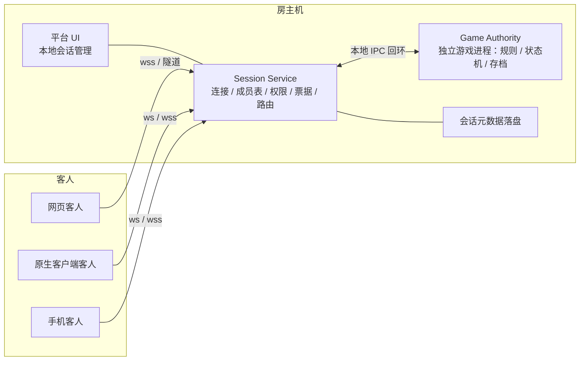

# 新版平台与 SDK 设计方案（候选 v0）

> **候选方案，核心决策已拍板**。D7 当前 UI 参考稿已确认，D8 已定。协议、双语言互解与内存 mock 已有对应层验证；真实 WS / 进程 / 恢复 / 三端实现尚未完成，本文不是已完成的实现依据。
> 本文属调研 / 设计类文档，放在 `docs/research/`。自包含：D1–D7 决策状态、证据边界与旧契约实证依据收在附录 A / B；过时的过程文档已删除，不再单独保留。
> 配套架构评审与拍板输入见 `docs/research/架构评审与决策输入包.md`（分层与边界、选型四列权衡、量级估算、七维风险、S0–S6 验收与回滚）。
> 补记 3：2026-11-12 全局设计收口到 [`全局目标架构.md`](全局目标架构.md)。进程代际、双连接身份、probe、成员模型、恢复、包、SDK、测试与迁移以该文档为总纲；本文保留决策历史与 UI 设计细节。
> 日期：2026-11-10　写者：本会话
> 补记：2026-11-11 完成界面审美与设计评审收口，结论落在 §2.6 末「界面评审收口」与 §2.7 后「状态矩阵落点」。本轮只改 `docs/research/平台UI预览.html` 与本文，未改实现代码，候选 v0 仍未批准。
> 补记 2：2026-11-11 用户补充拍板：成员准备与「开始游戏」归平台，开始后才拉起游戏进程；平台身份资料可传游戏，但身份色不等于阵营色；网页游戏按「独立 origin 静态包 + 受限 gameTicket」设计。预览页同步修正色板、默认色占用、触控目标、弹层焦点与窄屏溢出。候选 v0 仍未批准；D8 已拍板：三端共用设计与交互契约，网页 / 手机共用 Web 实现，桌面 exe 用原生控件。

## 0. 读法

| 标记 | 含义 |
|---|---|
| `[事实]` | 现有代码或文档里核实过的 |
| `[建议]` | 本会话的设计判断；标记的是属性，不代表决策状态（决策状态见附录 B.1） |
| `[假设]` | 推断，无真机验证 |
| `[待拍板]` | 正文中尚未定的细节；D1–D8 已有结论，其余全局语义见《全局目标架构》 |

**一句话定位**：平台是「联机会话服务」，不是应用宿主；SDK 是「语言中立的联机契约」，不是游戏运行时框架。

---

## 1. 目标与边界

| 平台做 | 平台不做 |
|---|---|
| 连接、心跳、重连、票据 | 渲染**对局期**游戏 UI（倒计时、结算、牌桌、再来一局、占位面板） |
| 会话成员表、消息定序、按座位投递 | 执行游戏逻辑、解释游戏状态 |
| 房主权限裁决（移交/踢人/关会话） | 提供 game-kit 或任何**游戏内** UI 组件 |
| 成员 ready、开始闸；开始后才拉起游戏进程 | 未开始前运行游戏进程、解释对局开始 / 结束 / 回合语义 |
| 局域网发现、邀请链接、版本与房规闸 | 下发可执行客户端代码、iframe 沙箱 |
| 会话元数据落盘 | 存游戏状态、替游戏做视角裁剪 |
| **房间级四块 UI**：规则配置 / 席位配置 / 房间聊天 / 资料面板 `[15:20 用户确认保留]` | 读 `GameModule` 声明、解释配置语义 |

**边界口径**：按「房间级 / 对局级」切，不按「游戏功能 / 平台功能」切。房间级是 N 个进程之间要一致的会话状态与会话通信，归平台；对局期的画面与玩法反馈归游戏。

**可观察的成功信号**：

1. 一款游戏不 import 平台任何 UI 组件、不实现任何平台接口，只用协议就能联机。
2. 同一份协议在桌面原生、桌面网页客人、手机网页客人、不同语言客户端上跑通。
3. 关掉平台 UI 窗口，会话仍在（服务常驻）。
4. 游戏从网页换成原生（或反过来），平台代码零改动。
5. 平台代码里搜不到任何玩法词（现有 `check-seam.sh` 闸门继续成立）。

---

## 2. 平台设计

### 2.1 形态与角色 `[建议，依赖 D4]`

| 角色 | 形态 | 理由 |
|---|---|---|
| 房主 | 桌面原生 exe（Windows 优先），常驻服务 + 系统托盘 + 本地 UI | 要监听入站端口、组播发现、本地落盘、防火墙授权、管理隧道子进程。房主关机这局就没了，本来就是服务进程 |
| 客人（桌面） | 网页零安装入口 + 原生客户端并存 | 点邀请链接就进房，是本项目相对 war3 平台最大的便利 |
| 客人（手机） | **网页为首选**，原生客户端可选 | 手机只做客人、只主动外连，不当服务端。否掉「apk 当房主」的四条理由（后台被杀、NAT 后不可主动连入、端口不可达、防火墙授权）全是「当服务端」才有的，客人一条都不沾 |
| 游戏 | 形态自定，独立进程 | 游戏逻辑不进平台进程 |

**手机网页客人补述**（2026-11-10 追加）：
- **可以，而且应该是手机客人的首选形态**。零安装、点邀请链接即进房，与桌面网页客人共用同一份协议和同一个入口。
- 按 C3，游戏本体归游戏自己。平台在手机上只需一个**窄屏单列的会话/成员/连接界面**，不需要房间四块布局；此前把「四块布局在手机上不成立」当作手机限制，其实那是平台 UI 的问题，C7 微调时补竖屏单列重排 + 触控目标 ≥44px 即可。
- 三条必须处理的约束：① `https` 页面连 `ws://` 会被浏览器拦，需 wss 终结或隧道（§2.8 已标未解决，手机网页让它更紧迫）；② 切后台会断连，要靠 30 分钟宽限 + `seatResume` 自动坐回原位，且须验证浏览器后台节流下心跳是否被冻结；③ 320px 竖屏重排与焦点/触控达标，**未做真机验证**。
- **用词**：项目没有账号系统（`DESIGN.md §2.1` 明确不做账号/好友/段位/匹配），正确说法是「加入会话 / 进房」，不是「登入」。别在设计里引入账号概念。

**明确否掉**：把现有网页用 Electron/Tauri 打包成 exe（那是把浏览器塞进安装包，网页形态的税一条不少）；apk 当房主端立项。

### 2.2 进程拓扑 `[建议，依赖 D2]`

`[事实]` 现状是 `Engine`（平台进程）同时持有 `Room` 与 `GameInstance`，游戏逻辑在平台进程内 `import()` 执行，客户端在 iframe 沙箱里跑。**改的就是这一处**：把权威从平台进程挪到房主机上的独立游戏进程，平台只留连接、会话与路由。

### 2.3 权威与消息流 `[建议]`

1. 客人发 `game` 消息给 Session Service，payload 是不透明字节。
2. Session Service **不解释内容**，只做定序、鉴权、附上 `fromSeat`，转给 Game Authority。
3. Game Authority 算完，返回 `deliver`，带 `targets: seatId[] | 'all'` 与各自的 payload。
4. Session Service 按 targets 投递，不合并、不裁剪、不看内容。

**单一权威保住**：只有房主机上的 Game Authority 算状态。反过来让每个客户端各自算，就要做确定性帧同步、冲突裁决、断线重放，等于重写联机引擎。

**代价必须写明** `[建议]`：视角裁剪从「平台保证不泄露」变成「游戏自己保证」。平台不再调用 `serialize(viewer)`，只提供 `toSeat` / `toAll` 两种投递目标，游戏自己决定给每个座位发什么。这降低了平台的安全承诺，必须在 SDK 文档里写成显式警告，并在示例代码里示范裁剪。`[假设]` 是否需要平台级加密隔离，待真机验证后定。

### 2.4 会话生命周期 `[建议，依赖 D1；2026-11-11 用户补充拍板]`

**会话仍只有两态 `open` / `closed`；平台另持成员 `ready` 与游戏进程状态，不解释对局相位。**

- **准备归平台**：`ready` 是成员表里的通用布尔标记，客人用 `setReady` 切换；平台广播成员表，不把它解释成任何玩法状态。
- **开始归平台**：只有房主的 `startGame` 能通过开始闸；所有真人未准备时本地置灰并由平台拒绝。保存玩法参数后清空真人 `ready` 也是平台的通用行为，不需要理解参数语义。
- **开始后才运行游戏进程**：`startGame` 通过后，平台才在房主机拉起 Game Authority，并把会话配置、成员与身份资料快照交给它；未开始前没有游戏进程。
- **进程状态不是对局相位**：平台只记录 `gameProcess: stopped / starting / running / failed / exited`，用于界面与重连；`playing / ended / roundEnd`、胜负、结算、再来一局归游戏。Game Authority 启动后默认随到会话关闭或进程退出，再来一局不重建平台会话。
- 平台裁决的还有：谁建房、谁能入会、谁是房主、谁能踢人/移交/关会话、票据是否有效、掉线宽限是否到期。转交房主只转移权限，不迁移 Session Service 或 Game Authority 所在机器。
- 现有 `end` Effect 的坑（`engine.ts:831-834` 把房间改 `ended` 并广播 `HOSTLEFT`，玩家被踢回大厅）在新架构里直接消失：平台没有 `end` 语义，关闭会话只由房主或超时触发。

**这不是砍功能**：房号分配、票据失效、硬杀丢房、链路断开时命令被静默排队，这些是 N 个进程之间要一致的分布式状态，猴测报告 15 条里 10 条在这一层，留平台。

### 2.5 平台职责清单 `[建议]`

| 能力 | 具体 |
|---|---|
| 连接 | 建连、心跳、指数退避、断线重连、Origin 校验 |
| 发现 | UDP 组播信标、地址簿、邀请链接、cloudflared 隧道 |
| 准入 | 版本闸、房规摘要闸（`rulesHash` 只比对，不解释规则内容） |
| 身份 | 座位票据、`secretHash` 落盘、30 分钟掉线宽限、`seatResume` |
| 成员 | 成员表、房主标记、连接状态、`ready` 通用标记、`revision` 单调 |
| 准备与开始 | 真人准备闸、房主 `startGame`、玩法参数变更后的准备重置 |
| 进程生命周期 | 开始后拉起 Game Authority、启动超时 / 崩溃 / 退出状态、按会话回收 |
| 路由 | 消息定序、`toSeat` / `toAll` 定向投递 |
| 权限 | 移交 / 踢人 / 关会话的裁决 |
| 存储 | 会话元数据原子落盘、坏文件跳过、重启恢复 |

### 2.6 平台 UI `[建议，依赖 D7，用户已确认「微调」]`

**15:20 边界修正**：用户判断规则配置 / 座位选项 / 资料面板 / 平台聊天是**房间相关**的，可以留；**对局相关**的删掉。这比 15:12 的一刀切更准 —— 之前把房间级会话功能也砍了，导致房间页从四块拆成三块，反而不像「微调」。

**边界口径**：按「房间级 / 对局级」切，不按「游戏功能 / 平台功能」切。房间级是 N 个进程之间要一致的会话状态与会话通信，归平台；对局期画面与玩法反馈归游戏。

**保留**：
- 现有四块布局全部保留：房间信息条、规则配置栏、席位配置、房间聊天；房主桌子级操作、席位六格、邀请链接与复制、`D` / `Esc` 焦点归还、暗色令牌、无渐变/关键帧/发光、已有可访问性处理。
- 资料面板（游戏资料入口）保留，仍只渲染纯文本与图片、路径校验沿用。
- **旧 1256×708 三栏同高 319px 高度链不再沿用**：规则配置已改为弹层，席位与聊天改为两栏等宽；S4 必须重新实测 1256 / 1440 / 320 三档。

**删除（只对局级）**：`#game-host` 整块、`playing` 态「游戏区拉通整行 + 席位横条 + 侧栏」布局、`deadlineInMs` 倒计时块、结算与再来一局、占位面板、iframe 沙箱 / Blob ESM / 客户端源码下发、玩法错误文案落点。`ui.chat='game'` 开关建议删除（平台聊天与游戏内聊天并存会出两份，游戏要做游戏内聊天自己画即可）`[待确认]`。

**四个模块的新契约**（留下来但不能把旧耦合放回来）：

| 模块 | 归平台 | 归游戏 | 改法 |
|---|---|---|---|
| 规则配置 | 表单渲染、ready 重置、`rulesHash` 准入闸、`RoomExport.config` 落盘 | 字段语义、归一化 | 声明从 `GameModule.ruleConfig` 移到**中立清单 `sessionConfig` 段**；平台按通用控件渲染，值 opaque 透传 |
| 座位选项 | 每座选项的存取、随成员表透传 | 颜色/难度的玩法含义、阵营与牌桌渲染 | 平台渲染通用键值对，不替游戏画阵营色块/难度下拉；玩法字段由游戏读同一份 `options` |
| 资料面板 | 懒加载、纯文本/图片渲染、路径校验 | 资料内容 | 走清单 `reference` 段，不依赖 `.bpmap` 可执行入口 |
| 房间聊天 | 会话级消息、系统消息、聊天缓冲 | 游戏内聊天（若游戏要做） | 平台保留会话聊天；删 `ui.chat` 开关，不再让游戏替换平台聊天 |

**平台身份资料与玩法字段分离（2026-11-11 用户确认）**：预览页的席位色是**平台身份色**，用于席位、编号牌与聊天箭头，不是游戏阵营色。平台向 Game Authority 提供只读 `profile` 快照：`{ nick, avatar?, displayColor? }`，并在成员变化时同步；游戏可用 `displayColor` 保持玩家识别一致，但不得把它当作阵营、队伍或胜负依据。后续增加的阵营、队伍、难度等玩法含义仍放 `options` 等 opaque 字段，由游戏解释。头像若引入，只允许受校验的同源图片资源或受控 URL，限制类型与大小，不渲染 SVG 脚本、不接收任意 HTML。

**三条硬约束**（否则解耦白做）：① 平台不 import 游戏声明（`GameModule` 已删，声明必须是清单里的数据，不是 TS 类型）；② 平台不解释语义（`rulesHash` 只比对、`options` 只作成员表字段透传）；③ 语言中立（`sessionConfig` / `reference` 用 JSON 描述，exe / apk / 网页三端都能读）。

**数据重接**：`bp:room`、`deadlineInMs`、`SeatView.options`、玩法错误码文案收掉后，ViewModel 改绑到新会话协议；四个保留模块的声明源改绑到中立清单。组件变体几乎不变，组件契约换数据源。

**两个相位**：

| 相位 | 显示什么 |
|---|---|
| 大厅 / 房间（lobby） | 现有四块布局原样保留：房间信息 + 规则配置 / 席位配置 / 房间聊天三栏 |
| `open`（原 playing） | 缩成会话状态条 + 「打开游戏」入口，平台窗口可最小化到托盘 |

**D7 参考稿 v2（15:20 已出，待用户看后拍板）**：三相位示意图（房间页四块 / `open` 状态条 / 手机 320px 竖屏单列），沿用现有令牌 `#0a0a0f` 底、`#16161f` 卡、`#23233a` 线、`#6366f1` 强调、圆角 6px、无渐变无关键帧。靛紫=房间级保留、琥珀=数据重接（声明改中立清单）、灰=对局级删除。状态覆盖默认/加载/空/错误/成功恢复/权限受限/离线重试，`D` / `Esc` 焦点归还、触控目标 ≥44px、正文对比度 ≥4.5:1、reduced-motion。只定信息架构与层级，**不是像素稿，未做真机验证**。

**实现载体** `[假设，可撤销]`：保留的是信息架构与布局，载体（本地页面 / 原生控件 / WebView）随客户端形态定，用户未明确。

**界面评审收口（2026-11-11，候选 v0 补充）**：按前端美学评审框架对 `docs/research/平台UI预览.html` 做完整体检。方向维持 **Industrial / Utilitarian（工业仪表 / 规格表）**，唯一记忆点仍是「58px 房号主读数 + 席位六色身份铭牌」；渐变网格、错峰入场动效、破格非对称三条刻意不照搬（违反无渐变 / 无关键帧 / 无发光，且用户已实测否掉左轨信号轨那版）。三套 OFL 字体（Tektur / Outfit / Geist Mono）非通用字体、正好三家族，维持。本轮落地四类修正，**全部在既有令牌内、零新增色值、零关键帧、零发光**：

1. **色彩三通道分离**：`--bp-seat` 只做身份（左轨 + 徽章边框，只读）、`--bp-seat-tag` 做用户标记（图标 + 编号铭牌）、状态由「已准备」绿色文字 + 勾图标表达。删掉 `.seat.is-ready{--bp-seat:var(--bp-ok)}`，解决内联 `style="--bp-seat:…"` 优先级压掉准备态的问题；色板改用 `--bp-seat-*` 别名，与 `--bp-ok/-warn/-bad` 在令牌层解耦，状态不再靠颜色单独判断（同时满足「不只靠颜色传达信息」）。
2. **对比度**：说明文字从 `--bp-dim-2`（2.59~2.89:1）改 `--bp-dim`（5.04~5.63:1）；角色徽章 12px 文字改 `--bp-dim-hi`（6.99:1）；primary 悬停保持 `--bp-accent-dim` 底色、只提亮边框，白字恒定 6.29:1。静态计算下全部正文 ≥4.5:1。`--bp-line` 1.17:1 仍属刻意低对比的装饰态，需真机确认，不判违规。
3. **字阶**：`--bp-step` 成为唯一随三档降级的正文基准，席位 / 聊天 / 资料 / 房间信息值统一引用；`--bp-title` 接管昵称字号，删掉零引用的 `--bp-count`；中窄档不再写死席位字号。
4. **形态与术语**：320px 手机档隐藏「最小化托盘」（按钮改「收起到后台」）；`open` 相位与规则 / 资料 / 转交弹层去掉「进程 / 相位 / sessionConfig / rulesHash / revision / lobby / 准备闸 / 桌子级」等内部词；`#i-login` 更名 `#i-enter`，与「无账号系统、说进房不说登入」一致。

5. **线型统一与告警层级（2026-11-11 二轮）**：全站 `dashed` / `dotted` 统一改实线。虚线原本承载的语义逐处迁到别的通道，避免「统一」变成「抹平」：只读输入框改用更暗凹底 + 灰字（禁用态另拆一条）；AI 席位去掉虚线左轨（紫色 + 机器人图标 +「电脑」徽章已三通道）；图片占位靠「图片占位」文字；禁用候选靠灰字 + `not-allowed` + 原因文字。连接告警带置于**顶栏之下、内容区之上**（正常态整条隐藏），重试从条尾 12px 小按钮升级为实心主行动色 + 循环图标 + 16.5px 展示体的主操作，与原因同组；错误 / 离线态告警文案放大加粗。「局域网房间」提示按状态分级：默认克制，加载琥珀、故障主文字色 + 状态点。**未把重试塞进顶栏内部身份区**（正常态会留空洞、320px 档挤压品牌与昵称、动作与原因分离）；告警带也不压在品牌栏之上，避免异常态把页面身份锚点挤到第二行。

6. **只读动效一致性（2026-11-11 四轮）**：`readonly` 与 `disabled` 拆成两条规则。readonly 仍是可点击 / 选中 / 复制的对象，静态观感（更暗凹底 + 灰字）表达「不可编辑」，但 hover 整圈靛紫、focus 抬底 + 快进过渡、focus-visible inset 加粗**全部沿用普通输入框的同一套动效**，光标保持文本态；只有 disabled 抑制 hover。用 `input[readonly]:not(:focus)` 约束静态底色，避免同特异性覆盖 `input:focus` 的抬升。**区域联动 `:has()` 排除 readonly 的旧修复保留**：点只读邀请框后焦点常驻，若让整块卡片跟着亮就会一直亮着不退。

7. **席位色板与去重（2026-11-11 五轮）**：色板从 6 色扩到 **8 色**（= 席位上限，是「一色一席」规则的最小完备集合，再多只会稀释识别度），按色相环排序；新增 `--bp-seat-cyan:#06b6d4` 等 500 系同源色，此前「零新增色值」口径由用户本次明确放宽（色值清单见第 8 条修订）。重复色不隐藏而是**禁用并写明占用席位号**（色块保留可辨识、`not-allowed`、`aria-disabled`、`title` 写明原因，点击给明确提示），避免色板尺寸跳动、也避免「怎么只剩几个色」的困惑。补「恢复默认颜色」按钮作为释放入口：席位可主动释放自己的颜色给其他席位选用；8 色全占满时，换色需走「A 释放 → B 改选 → A 再选」两步，这是去重规则的必然约束，不是缺陷。空位编号牌去掉 `role=button` / `tabindex` / hover 放大并在事件层拦截；请出房间与加电脑都把 `color` 清空，颜色不跟着空位或新成员走。

8. **色相间距与聊天格式（2026-11-11 六轮）**：用户指出色板里「有些颜色太相近」，并明确 **琥珀 / 靛紫不能改**——它们是 `--bp-warn` / `--bp-accent` 共享令牌，主 UI 的警示、强调高亮、身份色都用这两个，必须与色板保持同一色系。因此不动这两个锚点，只替换造成相近的邻居：原橙 25°（距琥珀仅 13°）→ 青柠 `#84cc16` 82°，原紫 258°（距靛紫仅 19°）→ 品红 `#d946ef` 292°。8 色重排为 0/38/84/142/189/239/292/330°（HSV 实测），**色相环最小相邻差由 13° 提到 30°**；其中原先扎眼的两对已分别拉到 46°（琥珀→青柠）与 53°（靛紫→品红），全局最小值 30° 落在「粉→红」的色相环回环处，二者在色板里分属首末位、不相邻显示；当前席位专用新增色值共 3 个（`#06b6d4` / `#84cc16` / `#d946ef`）。聊天区原本是两套排版（系统消息 14px mono + 半角空格 + 有箭头，玩家消息 16.5px UI + 全角空格 + 无箭头），现统一为同字族 / 同字号 `--bp-step` / 同行高 / 昵称 500 字重 / 全角空格分隔 / 每行都有 `▸` 前缀；系统消息只保留正文色稍弱这一处语义区分。箭头颜色由 `--bp-chat-mark` 驱动，**默认房主琥珀、客人靛紫**（复用锁定的共享令牌），用户改席位色后箭头联动，请出或恢复默认后回落，不显示旧数据。

9. **补充评审修正（2026-11-11 七轮，覆盖第 7/8 条的色板数值）**：8 色实测色相改为 **0/37.7/83.7/142.1/188.7/238.7/280.1/324.9°**，最小相邻差 **35.1°**；琥珀 / 靛紫仍锁死，紫红 `#b045e5` 与粉 `#ed47a8` 用来拉开靛紫→紫红→粉→红的末段。AI 席位改用中性 `--bp-dim-hi`，不再引入距靛紫 19.6° 的第九个紫色。默认琥珀 / 靛紫也参与一色一席占用；恢复默认遇占用时写明阻塞原因。席位编号改为 19px 粗体大号文字，靛紫底深字 4.42:1 按大号文字 ≥3:1 验收，不再宣称它是普通正文 ≥4.5:1。席位编号、空位加电脑、行内转交、色板关闭 / 恢复默认等可点目标均 ≥44px；客人底栏在中档与聊天底栏同高；窄档上下堆叠后聊天输入恢复单行；窄屏输入框补 `min-width:0`。昵称标签与输入值都突出，桌面同为 22px、输入值 600 字重。弹层与色板补焦点闭环，昵称注入 innerHTML 的位置统一转义，行内转交按钮改用数据属性避免重复 id。上述均为无头 Edge 真渲染与实算结果，真机触控和辅助技术仍未验证。

10. **席位行操作（2026-11-11 用户指定）**：空位用**前置加号**添加电脑，尾部不再重复加号；占用席位尾部改为**叉**。电脑位直接删除，真人玩家必须由房主见确认弹层后才请出；房主自己不可删除，客人不出现行内管理操作。删除后席位、颜色与准备状态一并回到空位默认。中窄档仍隐藏行尾操作，删除可走底栏「请出房间」，前置加号保留可用。

11. **席位对齐与手机视口（2026-11-11）**：尾部横杠与叉共用 44px 居中槽位。预览视口分为「手机 360」与「窄屏 320」：360 模拟常见手机 CSS 宽度，320 保留为极限验收；真实 ≤700px 视口下取消预览限宽，390 设备就按 390 布局。**DPR 只影响渲染清晰度，不改变 CSS 布局宽度**，S6 至少覆盖 360@2x、390@3x，并保留 320@2x 压力档。窄档昵称文本与「你」徽记拆成独立 flex 项，昵称可省略但徽记必须完整；席位行单独收紧留白，不改全局间距。

12. **窄档信息密度（2026-11-11 用户确认方向）**：复制 / 规则设置 / 游戏资料合并为一排，复制改用带无障碍名称的 44px 图标按钮，其余两按钮均分剩余宽度；基础样式不写内联，避免窄档覆盖失效。窄档只显示已占用席位，容量继续由「3 / 8 席」表达，底栏「加电脑」添加到第一个空位；桌面与中档保留完整空位席位图。代价是窄档不能点选某个具体空位，若未来玩法要求指定座位号，再补「展开空位」，不预先加控件。

13. **窄档减高（2026-11-11）**：不常显原始邀请 URL，复制仍取完整会话链接；房间信息网格间距 14→10px、内边距 14→12px；聊天历史限高 168px 滚动；上下堆叠后聊天输入栏从 117px 回到 **65px**（44px 控件 + 留白 + 顶线）。无头 Edge 实测 360 / 390 / 320 的产品内容高度均从 **1110.8→927.4px**，减少 **183.4px（16.5%）**；未缩字号、触控目标、房号读数或开始按钮。宽中档两栏底栏仍对齐，窄档不再为上下堆叠的卡片保留无意义的双行聊天底栏。

14. **窄档聊天侧抽屉（2026-11-11 用户确认方向）**：房间聊天默认收成 **52px 摘要条**，显示条数与最近一条；点击后同一聊天卡片变成右侧抽屉（`78vw`、上限 320px），带遮罩、背景滚动锁定、关闭按钮、Tab 焦点闭环与 Escape 归还。消息、输入、昵称和箭头仍复用同一份 DOM / state，切回宽中档或离开房间时自动关抽屉。实测窄屏产品内容高度由上一轮 927.4px 进一步降至 **704.4px**；相对本轮优化前 1110.8px 累计减少 **406.4px（36.6%）**。桌面与中档常驻聊天不变。

**D8 已拍板（2026-11-11）**：本预览页是**三端共同的设计与交互契约**，覆盖布局、状态、文案、令牌、对比度、触控与窄屏行为；网页客人与手机网页共用同一套 Web 实现，桌面 exe 使用原生控件实现同一契约。不把网页重新塞进 Electron / WebView 充当桌面房主端，也不把「共用契约」误写成「三端共用代码」。

### 2.7 状态矩阵（平台 UI）

| 页面/组件 | 默认 | 加载 | 空 | 错误 | 成功/恢复 | 权限受限 |
|---|---|---|---|---|---|---|
| 大厅 | 建房/进房两卡 | 连接中、发现中 | 局域网无房间、地址簿为空 | 地址非法、连不上、版本/房规不符 | 建房成功显示房号与邀请 | 非房主不显示建房 |
| 会话信息 | 房号/名称/游戏 id/状态 | 同步中 | — | 连接断开、票据失效 | 复制邀请成功 | 非房主不显示邀请链接 |
| 成员名册 | 六格席位行 | 成员变更中 | 无成员 | 踢人/移交被拒 | 重连坐回原位 | 非房主无桌子级操作 |
| 连接状态条 | 已连接 | 重连中（含退避次数） | — | 断开并说明原因、可重试 | 恢复后自动清状态行 | — |
| 打开游戏入口 | 可用 | 启动中 | 未安装该游戏 | 启动失败、版本不符 | 拉起游戏进程 | 观战按游戏规则 |

离线/重试沿用现有语义：链路断开时命令本地拒绝并说清楚，不静默排队（猴测 Issue #10 的修法要保住）。

**状态矩阵在预览页的可复现落点（2026-11-11 补齐）**：预览控制条新增「连接」组，逐项点开下表状态；产品界面新增顶栏下方的连接状态条（`role="status" aria-live="polite"`），语义色只落在 8px 圆点上，状态同时由文字承载。状态机只驱动展示层，不改席位与准备闸，因此不影响已有交互链路。

| §2.7 状态类 | 预览页落点 | 可复现方式 |
|---|---|---|
| 默认 | 状态条隐藏、四块布局正常 | 「默认」按钮 / 初始态 |
| 加载 | 琥珀状态条「正在连接房主 · 发现局域网房间…」+ 局域网区「正在发现…」 | 「加载」按钮 |
| 空 | 状态条隐藏 + 局域网区「暂无房间 · 可手动填地址」 | 「空」按钮；大厅原有空态 |
| 错误 | 顶栏之下红色告警带「地址不可达」+ 放大加粗文案 + 实心主操作「重试连接」+ 地址输入红框；局域网区同步升级为主文字色 + 红状态点 | 「错误」按钮；空消息发送原有红框 |
| 成功/恢复 | 绿色状态条「连接已恢复」，2.6s 后自动收回 | 「恢复」按钮 / 点「重试连接」；复制邀请原有 toast |
| 权限受限 | 琥珀状态条说明客人限制 | 「受限」按钮；切「身份=客人」复现只读参数与客人底栏 |
| 离线重试 | 顶栏之下红色告警带写明「命令已本地拒绝，未静默排队（第 2 次重试）」+ 放大加粗文案 + 实心主操作「重试连接」；局域网区「发现服务不可用」升级为主文字色 + 红状态点 | 「离线」按钮 |

仍未实现为真机行为：票据失效、版本 / 玩法参数不符、踢人 / 移交被拒、启动失败 / 未安装该游戏等分支目前只有文案，没有服务端状态驱动；三档响应式、reduced-motion、辅助技术与触控目标仍需 S6 真机验证。**预览页是演示态，不用它替代验收证据。**

### 2.8 网络、发现与双端接入

| 端 | 接入 | 现状问题 |
|---|---|---|
| 原生房主 | 监听 TCP 对外端口 + UDP 组播 + 本地回环给 UI | `[事实]` 现有 3000 端口与组播可用 |
| 原生/网页客人 | 连房主 `ws` / `wss` | `[假设]` **未解决**：`https` 页面连 `ws://` 会被浏览器拦，现状靠 `http://127.0.0.1` 本机页绕过（`DESIGN.md §9`）。做成客户端后要么由平台提供 wss 终结，要么走 cloudflared 隧道。需真机验证 |
| 手机客人 | 同上 | 后台限制与前台服务待验证 |
| 房主机平台↔游戏进程 | 回环 TCP / Unix socket，简单帧协议 | 新通道，需定帧格式与超时 |

邀请链接、地址簿、隧道、版本闸沿用现有实现。

### 2.9 安全模型 `[建议，依赖 D2；网页模型 2026-11-11 补充]`

| 项 | 现状 `[事实]` | 目标 `[建议]` |
|---|---|---|
| 游戏代码 | 房主进程 `import()` 执行，客户端 Blob ESM 在 iframe 沙箱里跑 | 原生游戏由用户安装；网页游戏由平台托管**版本化静态资源包**，在独立 origin 打开，不在平台管理页内执行 |
| 校验 | 客户端源码 sha256（无 `crypto.subtle` 时纯 JS 回退） | 清单内容哈希 + 来源展示 + 连接鉴权 + 版本与房规比对；签名为可选信任机制，不假装已有公钥基础设施 |
| 私密信息 | 平台按座位调 `serialize(viewer)` 裁剪 | 游戏自己裁剪，平台只按 `toSeat` 投递，不解释内容 |
| 票据 | 明文只在客户端，盘上存 `secretHash` | 平台管理票据与游戏连接凭证分离，见下 |

**网页游戏分发与隔离建议**：

1. **静态包可以分发，动态模块不下发**：原生端走安装包；网页端把 `.bpmap` 中的版本化 HTML / JS / 资源作为静态文件托管。这仍是代码分发，文档不再笼统写“网页也不下发代码”。平台只按清单校验与提供文件，不在自己的管理文档里 `import()` 游戏。
2. **独立 origin 是硬边界**：网页游戏与平台管理 UI 使用不同端口或不同主机名，禁止共享 DOM、cookie、localStorage 与 Service Worker；管理 origin 默认不开 CORS。不能再把第三方游戏页面嵌回平台同源文档。
3. **游戏拿不到平台管理票据**：平台座位票据只留在平台 UI。点「打开游戏」时，平台签发一次性 `handoffCode`，放在游戏 URL 的 fragment（不进查询日志与 Referer）；游戏页面用它换取**受限 `gameTicket`**。`gameTicket` 绑定 session + seat，只允许游戏消息收发与游戏侧重连，不允许建房、改参数、准备他人、踢人、移交或解散。
4. **静态包默认 CSP**：`default-src 'self'`、`object-src 'none'`、`base-uri 'none'`、`frame-ancestors 'none'`、`connect-src` 只放平台 WS / WSS；禁止 inline script、`eval` 与 Blob ESM。若游戏确有额外网络需求，必须在清单里显式声明并展示给用户。
5. **信任级别诚实分级**：S1 先做内容哈希、来源与版本展示；签名只验证“包未被改动”，不等于“发布者可信”。没有钥匙分发与撤销机制前，不把签名写成安全背书。
6. **权威仍需校验一切**：origin 与 gameTicket 解决的是平台管理面不被游戏页面控制，不是反作弊。Game Authority 必须校验每个动作，客户端隔离不能替代权威校验。

**净效果**：房主不再在平台管理进程里执行第三方游戏代码，网页游戏也不能直接摸到平台管理票据；代价是视角私密性从平台保证降为游戏自律，且平台要额外维护一个静态资源 origin 与受限凭证通道。

### 2.10 存储 `[建议]`

平台只存会话元数据：房号、成员与座位、房主标记、票据摘要、连接状态、revision。游戏状态归游戏自己存。沿用原子写、坏文件跳过、便携包写 `%LOCALAPPDATA%\3178-battle-platform\data`、`BP_DATA_DIR` 可覆盖。

---

## 3. SDK 设计

### 3.1 定位变化

| | 现状 `[事实]` | 目标 `[建议]` |
|---|---|---|
| 形态 | 4 个 npm 包，TS 类型，运行时 ABI | 语言中立协议 spec + 各语言薄客户端 + 工程工具 |
| 游戏面对的接口 | `GameModule` / `GameInstance` / `Effect[]` | 只有「连上会话、发消息、收消息、按座位定向发送」 |
| UI | game-kit 提供 ChatPanel / FeedPanel / ScoreboardPanel | 无。游戏自己写 |
| 客户端契约 | `mount` / `onEvent` / `actions`，iframe 沙箱、Blob ESM | 无。游戏自己渲染 |
| 规则/座位/资料 | 平台读 `ruleConfig` / `seatOptions` / `reference` 声明并渲染 | **房间级 UI 保留**，但声明改中立清单 `sessionConfig` / `reference` 段；平台按通用控件渲染，不读 `GameModule`、不解释语义 |
| 包 | `.bpmap` 含可执行客户端与服务端入口，房主下发给浏览器 | 清单 + 资源描述 + 签名，不下发可执行代码 |

### 3.2 分层

1. **协议层（语言中立）**：一份 spec（JSON Schema 或 protobuf），含消息目录、错误码表、版本号、能力清单。多语言生成类型，spec 是唯一字据。
2. **传输层**：WebSocket（跨机）、本地回环帧协议（房主机平台↔游戏进程）、UDP 组播（发现）。
3. **客户端库（按语言）**：TS / Rust / Kotlin / C# 等薄封装，只提供 `connect / join / resume / send / onMessage / sendToSeat / close`。**不含任何 UI、不含任何玩法类型**。
4. **工具层**：清单校验（原 `bpmap doctor`）、工程模板（不含 UI 脚手架）、签名与校验工具。
5. **平台内部**：Session Service 的参考实现，不作为 SDK 暴露。

**S1 已完成（mock 口径，2026-11-12）**：[`语言中立协议 v0 设计`](语言中立协议v0设计.md) 含语义、架构 / 状态 / 时序图；`protocol/v0/` 有 41 条方向 / 权限消息目录、JSON Schema、manifest、错误码、能力清单、全方向 golden 与示例。TS / Python 类型由固定 quicktype 生成并做 41 条双向互解；内存 mock 与最小参考游戏跑通准备、开始、动作、重连和私密补发。`npm test` 自动发现全部契约测试。**未接旧运行时，未做真实 WS / 进程 / 崩溃恢复。**

### 3.3 协议消息目录 `[建议]`

**字段不在本文复制维护。** 当前有效字段、方向、通道与权限以 [`protocol/v0/catalog.json`](../../protocol/v0/catalog.json) 和 [`messages.schema.json`](../../protocol/v0/messages.schema.json) 为唯一字据；语义、状态机与时序见 [`语言中立协议v0设计.md`](语言中立协议v0设计.md)，全局成员模型、probe、双通道与恢复收口见 [`全局目标架构.md`](全局目标架构.md)。

当前机器契约含 41 条方向消息、全方向 golden、错误码、能力清单和 manifest。`deliver` 的权威出站是 `items[]{to,payload}`；`start` 带 `hostSeatId`，房主变更用 `hostChanged`，离席原因是 `disconnected | left | kicked`。后续 memberId/slot、epoch、sync 等全局修订仍回写同一份 schema，不在本文另开字段表。

**错误码**以 [`protocol/v0/errors.json`](../../protocol/v0/errors.json) 为准。玩法错误码由游戏自定义并经 `deliver` 投递，平台不注册、不翻译。

### 3.4 能力协商 `[建议]`

`hello.capabilities` 声明客户端想要的能力，平台在 `welcome.supported` 里回支持的项：`protocolVersion`、`toSeat`、`resume`、`discovery.lan`、`tunnel`、`wss`、`game.installed`。客户端按能力降级，不靠文档里一句「规划中」。这解决现有沙箱桥无法运行时探测的问题。

### 3.5 身份与鉴权 `[建议]`

票据沿用现状：入席发票据、盘上只存 `secretHash`、`seatResume` 必须带票、掉线宽限 30 分钟可配。网页游戏不拿这张管理票据，使用 §2.9 的受限 `gameTicket`。版本闸与房规闸仍在平台，但平台只比对 `version` 与 `rulesHash` 两个字符串，不解释规则内容。成员 `profile` 由平台维护并同步给游戏；`displayColor` 是识别资料，不是阵营字段。

### 3.6 包格式与分发 `[建议]`

`.bpmap` 从「平台进程加载并在同源页面执行的可执行模块」改为**游戏清单 + 资源描述**：`id` / `version` / `platformRequirements` / `entryPoints`（原生与网页两种）/ `assets` / `signature` / `rulesHash` / **`sessionConfig`（房间级规则与座位选项的通用控件声明）** / **`reference`（资料入口）**。平台只在准入时校验 id、version、内容哈希 / 签名与房规摘要；`sessionConfig` 与 `reference` 是纯数据，平台按通用控件渲染，不 import 游戏类型。原生游戏走安装包；网页游戏走版本化静态资源包，由独立 origin 托管并用受限 `gameTicket` 连接（§2.9），不再进入平台管理页的 iframe / Blob ESM。

### 3.7 明确删除

- game-kit：`ChatPanel` / `FeedPanel` / `ScoreboardPanel` / `FeedLog`（游戏内组件）
- `GameClientContract`（`mount` / `unmount` / `onEvent` / `actions`）
- `GameModule` / `GameInstance` / `Effect[]` / `Reject` / `Outcome`
- **`GameModule` 上的 `ruleConfig` / `seatOptions` / `reference` 声明形式**（改成清单里的中立数据段；UI 本身保留，见 §2.6）
- `GameUiOptions` 里的 `ui.chat` / `deadline`（平台聊天保留、倒计时删除，开关不再需要）
- iframe 沙箱、Blob ESM、客户端源码哈希校验与下发；`/games/<id>/*` 静态路由改为清单资源路由
- **对局级**：`#game-host`、`playing` 全宽布局、平台倒计时渲染、结算/再来一局、占位面板、玩法错误文案
- `.bpmap` 里的客户端可执行入口

### 3.8 迁移策略 `[D3 已拍板：推倒重来，不做兼容]`

**用户决定**：color-duel 按新设计推倒重来，不做兼容妥协，一次做到位。**不设兼容适配器**，`GameModule` / `Effect[]` / `serialize(viewer)` 的映射层不写。

**代价（必须认）**：
1. color-duel v0.2.2 的 37 例测试、0.2.2 包、Release 与联调证据全部作废，第一款真游戏按新 SDK 从零重做（归「评估和设计游戏」会话）。
2. 平台侧 233 例回归里依赖旧契约的用例（`contract.test.mjs` 19 例、`fixture-kit` 相关、`pack-loader` / `bpmap-cli` / `sandbox-hooks` 等）要**重写为新协议契约测试**，不是删掉。纯会话层用例（房间/权限/票据/落盘/发现）保留。
3. S2 失去「旧游戏不改代码跑通」这个验收基准。
4. 没有旧契约运行时可回退，S2 的回滚只能靠代码分支与特性开关，不能靠旧游戏验证。

**架构缓解（替代兼容层）**：先写一个**最小参考游戏**（minimal reference game），按新协议实现建房 → 入席 → 准备 → 开始 → 一个动作 → 重连，只跑通链路、不做玩法。S1 先让它对 **spec 生成的 mock Session Service** 跑通，充当契约测试驱动；S2 真实 Session Service 拆出后再跑真实全链路，成为验收基准与 SDK 示例。比兼容适配器更干净，且直接服务「一次到位」。放在平台仓库的测试夹具里，不对外发布。

### 3.9 分阶段路线 `[D3/D7 已更新]`

| 阶段 | 内容 | 可观察验收 |
|---|---|---|
| S0 | D1/D2/D3/D4/D7/D8 拍板 | 核心决策与 D8 已有结论；第 8 节规模 / 语言 / wss / 预算 / 合规前提仍未完成，不把 S0 写成全部收口 |
| S1 | 写语言中立协议 spec + 错误码表 + 能力清单 + 最小参考游戏 | 不改运行时；[`语言中立协议 v0`](语言中立协议v0设计.md) 契约、TS / Python 生成互解、mock 与参考游戏全链路已完成；真实服务留到 S2 |
| S2 | 拆出 Session Service，权威迁到独立游戏进程 | 最小参考游戏对真实服务跑通建房→入席→准备→开始→拉起权威→出招→重连；新协议契约测试全绿 |
| S3 | SDK 瘦身，发各语言薄客户端；旧 ABI 测试重写完毕 | 平台包内零 UI 组件、零玩法词；`check-seam.sh` 零命中；旧契约引用数为 0 |
| S4 | 平台 UI 按 D7 参考稿微调 | 保留/移除/数据重接三类清单逐条验收，改前改后对照；连接状态七类逐项可复现；正文对比度 ≥4.5:1，大号粗体编号按 ≥3:1；席位标记色与状态语义色不共用通道；320px 不出现桌面专属控件且无产品区横向溢出；窄档只显示占用席位且底栏可继续添加，复制 / 规则 / 资料同排；聊天默认摘要条，打开为右侧抽屉且复用同一消息状态；三档字阶降级生效；线型全站实线且语义不丢失；告警带位于顶栏之下且正常态隐藏、重试为条内主操作；故障文字按状态分级；只读框 hover/focus 动效与可编辑框一致；席位色 8 色且一色一席，**默认身份色也参与占用**，占用色禁用并写明占用者、恢复默认可释放或说明阻塞；空位不可选色，请出 / 加电脑后颜色回默认；8 色最小相邻色相差 ≥35°，琥珀 / 靛紫仍为共享令牌，AI 不使用与靛紫相近的额外紫色；聊天行排版统一且箭头跟随席位色；产品可点目标 ≥44px；两卡底栏在宽中档的房主 / 客人态均对齐，窄档堆叠后聊天输入为单行；弹层与色板有焦点闭环；空位前置加号添加电脑，占用席位尾部叉删除，真人需确认而电脑直接删除，客人无行内管理操作 |
| S5 | 双形态：桌面 exe 壳、网页客人、手机网页客人；color-duel 按新 SDK 重写 | 三端各跑一遍同一局；关 UI 窗口会话仍在；网页游戏在独立 origin，用受限 gameTicket 连接且不能调用管理动作；重写后的游戏完成一局并再来一局 |
| S6 | 真机验证 | 防火墙授权、组播发现、wss 混合内容、Android 后台，逐项出证据；视口至少覆盖 360@2x、390@3x，并保留 320@2x 极限档（DPR 不代替 CSS 宽度验收） |

---

## 4. 决策依赖表

| 设计条目 | 依赖 | 若被否的替代 | 代价 |
|---|---|---|---|
| 平台仍持有会话/票据/重连/落盘（§2.5） | D1 | 平台退化为纯字节中继，每款游戏自己实现 | 每款游戏重踩房号/票据/硬杀丢房/断线排队，猴测 15 条里 10 条重现 |
| 权威在房主机独立游戏进程（§2.2/2.3） | D2 | 每端各自算状态 | 要确定性帧同步、冲突裁决、断线重放，方案重做 |
| 兼容适配器（§3.8） | D3 | 推倒重来 | 233 例回归与第一款真游戏联调证据作废 |
| 形态分配（§2.1） | D4 | 网页为主 / apk 当房主 | 需要常开中继，毁掉「不买服务器」前提 |
| 平台 UI 微调范围与 `open` 相位形态 | D7 | 重画或完全不动 | 完全不动会留下对局区空壳与失效的数据绑定 |

---

## 5. 验收清单

- [ ] 一款新游戏只用协议、不 import 任何平台 UI 组件即可联机
- [ ] 协议 spec 能生成至少两种语言的类型并互解消息
- [ ] 平台包内零玩法词、零 UI 组件
- [ ] 关掉平台 UI 窗口，会话与对局继续进行
- [ ] 游戏从网页换成原生，平台代码零改动
- [ ] 视角私密信息由游戏裁剪，且有示例与显式文档警告
- [ ] 掉线重连、票据失效、硬杀重启、断线时命令不静默排队，逐项复测
- [ ] 空位前置加号可添加电脑且尾部不重复加号；占用席位尾部叉可删除，电脑直接删除、真人必须经房主确认，房主自身与客人无此操作
- [ ] 平台成员 ready / 开始闸可用；startGame 通过前没有游戏进程，通过后权威拿到配置与成员 profile 快照
- [ ] profile 的 nick / avatar / displayColor 能同步给游戏；阵营等玩法字段不借用 displayColor
- [ ] 弹层与色板 Tab 焦点闭环；昵称含 HTML 字符时只显示文本，不注入节点
- [ ] 窄档聊天摘要条能更新条数与最近消息；右侧抽屉可发送、Tab 不离开、Escape / 遮罩可关闭并归还焦点，切档或离开房间自动关闭
- [ ] 房主 / 客人身份下，席位与聊天底栏在宽中档对齐；窄档堆叠后聊天输入为单行且功能完整
- [ ] 状态矩阵七类逐项可复现（默认/加载/空/错误/成功恢复/权限受限/离线重试）
- [ ] 真机：Windows exe 常驻与防火墙授权、局域网组播、`wss` 混合内容、Android 客人后台
- [ ] 无兼容适配器；最小参考游戏先对 mock、再对真实 Session Service 跑通准备 / 开始 / 动作 / 重连
- [ ] 网页游戏与平台管理 UI 不同 origin；游戏只持受限 gameTicket，不能执行踢人 / 移交 / 改参数 / 解散等管理动作
- [ ] 连接状态条覆盖默认/加载/空/错误/成功恢复/权限受限/离线重试七类，且恢复态自动清状态行
- [ ] 正文文字/背景组合静态对比度 ≥4.5:1；状态不只靠颜色（文字 + 图标双通道）
- [ ] 席位用户标记色不覆盖身份与状态信号；改座位色后「已准备」仍可读
- [ ] 320px 手机档不出现「最小化托盘」等桌面房主端专属控件；产品区可点目标均 ≥44px，且无产品区横向溢出
- [x] D8 已拍板：本页是三端共同设计契约；网页 / 手机共用 Web 实现，桌面 exe 用原生控件实现同一契约
- [ ] 全站无虚线 / 点线边框；只读、禁用、AI 席位、占位的语义改由底色 / 文字 / 图标承载且不丢失
- [ ] 连接告警带位于顶栏之下、内容之上且正常态隐藏；重试为条内实心主操作（≥44px、对比度 ≥4.5:1），动作与原因同组
- [ ] 「局域网房间」提示按状态分级，默认克制、故障醒目，且状态不只靠颜色
- [ ] readonly 输入框 hover / focus / focus-visible 与可编辑输入框反馈一致；disabled 仍抑制 hover；区域联动不因 readonly 常亮
- [ ] 席位色板 8 色、按色相环排列；默认身份色也参与占用，已被别的席位占用的颜色不可选且写明占用席位号
- [ ] 「恢复默认颜色」可释放自定义颜色；默认色被占用时写明阻塞原因，8 色全占满时仍可换色，用户不会被锁死
- [ ] 空位编号牌不可点（无 role=button / tabindex / hover 放大）；请出房间与加电脑后该席位颜色回到默认
- [ ] 琥珀 / 靛紫席位色仍引用 `--bp-warn` / `--bp-accent` 共享令牌；8 色最小相邻色相差 ≥35°
- [ ] 聊天行同字号同字族、昵称与分隔符格式统一、每行都有箭头；箭头颜色跟随用户席位色，改色 / 请出 / 恢复默认后联动

## 6. 风险与代价（诚实列出）

1. **视角私密性责任转移**：平台不再保证不泄露，游戏自己裁剪。这是本次解耦最大的安全退步，必须写进 SDK 警告并提供示例。
2. **网页客人的 `wss` 未解决**：`https` 页面连 `ws://` 被浏览器拦，现状靠本机 `http` 页面绕过。做成客户端后没有这个便宜可用，`[假设]` 需要 TLS 终结或隧道，未真机验证。
3. **apk 只能做客人**：不是成本问题，是形态不匹配。若用户坚持手机当房主，整个「无服务器」前提要重议。
4. **双端一致性成本**：两套实现共享一份交互契约，契约漂移要靠自动化检查兜住，不能靠人记。
5. **网页游戏独立 origin 与受限凭证**：这是新增的平台管理面边界；handoffCode 泄露、静态包 CSP 过宽、游戏票管理面越权都要进契约测试，不能靠“游戏自觉”。
6. **现有文档大面积过期**：`DESIGN.md` 运行模式、三处接缝、客户端契约、沙箱、`.bpmap` 语义，`INTEGRATION_GUIDE.md` 几乎全文，都要重写。
7. **游戏侧会话在准备样张**：「评估和设计游戏」会话正按 600×360 与 `.game-host` 出改前/改后对照，本方案一落地前提就没了，需先同步。

## 7. 边界

- 本文是**候选设计方案**。核心决策虽已拍板，但 S1–S6 未实现、未验证，不得当作已完成的实现依据。
- 本轮未改任何实现代码、未提交、未安装技能。改动范围：本文与评审输入包补充 ready/start、身份资料、网页游戏安全模型与阶段验收；`平台UI预览.html` 同步修正。预览页经无头 Edge 真渲染、HSV / WCAG 实算与内联脚本语法检查；真机 / 字体实际渲染 / 辅助技术仍未验证。
- `[假设]` 项均无真机验证，不冒充测试结论。
- 游戏自身 UI 问题（色值重复、字阶、魔法数、功能牌截断）归「评估和设计游戏」会话，本文不涉及。
- 证据截至 2026-11-10 工作树；平台 HEAD 与游戏包版本以各自 `handoff/CONTEXT.md` 为准。

---

## 附录 A：旧契约实证依据

> 提炼自已删除的《平台与游戏交互设计评估》。该文基于旧契约（平台渲染游戏 UI + iframe 沙箱 + `.game-host`）做诊断，P1–P6 大半已失效。**只保留迁移时仍有用的实证，不保留结论**；原文不再保留。

### A.1 为什么必须把权威挪出平台进程

| 证据 | 位置 |
|---|---|
| `end` Effect 把 `room.phase` 改 `ended` 并广播 `HOSTLEFT`，客户端 `leaveToLobby()` 把人踢回大厅 | `engine.ts:831-834`、`app.ts:270-272` |
| `ROOM_PHASES` 只有 `lobby`/`playing`/`ended`，状态图 `ended --> [*]` 是终态 | `core-abi/src/seats.ts:6`、`DESIGN.md §4.4` |
| 游戏逻辑在房主进程内 `import()` 执行，客户端在 `sandbox="allow-scripts"` iframe 里跑 | `server/src/loader.ts`、`module-loader.ts:243` |

### A.2 为什么平台仍要持有联机共识（支撑 D1）

猴测报告 15 条问题（4 高 / 9 中 / 2 低）里 **10 条集中在「客户端边界输入与状态刷新」**：连接未就绪就 `send()`、非法房主地址、座位消失后按钮仍可点、建房后 2 秒硬杀丢房、加入后 <250ms 硬杀导致真票据被拒、链路断开时命令被静默排队重连后突然生效、地址簿陈旧选项静默丢弃等。修法全部落在房号 / 票据 / 落盘 / 连接状态这些 N 个进程之间要一致的状态上。若 D1 被否、平台退化成纯字节中继，这 10 类问题每款游戏都要重新踩一遍。证据：`dogfood-output/猴测报告.md`。

### A.3 为什么旧布局不能原样留

- 平台文档内部尺寸三套数字打架：验收表 `≥1100×560`（`DESIGN.md §2.3.1`）、决策表 `600×400 牌桌`（`§8`）、CSS `min-height:560px` / 窄屏 420（`style.css:835-843`、`:704-705`）；游戏按 600×360 设计。
- 平台替游戏渲染的声明与桥事件里，**对局级**部分要删：`deadlineInMs`、玩法错误码文案、`bp:room` / `bp:chat-history`（`game-sandbox.html:86-146`、`module-loader.ts:160-175`）。**房间级**四块（规则配置 / 座位选项 / 资料面板 / 房间聊天）按 15:20 边界修正保留，但声明源要从 `GameModule` 改为中立清单 `sessionConfig` / `reference` 段，平台不 import 游戏类型、不解释语义（§2.6）。

### A.4 已随之作废、不要再引用的结论

P1 画布尺寸契约、P2 主题令牌与座位色下发、P4 倒计时归属、P5 错误双通道、P6 沙箱能力协商；游戏侧交叉评审的两点修正（座位色 swatch 来源、`deadlineInMs` 是 view 字段）；协作接口与回写区。这些接口在新架构里被删除，结论不再成立。

---

## 附录 B：决策状态与变更记录

> 提炼自已删除的《双形态解耦设计变更跟踪》。原文不再保留。

### B.1 决策结论 `[15:12 已拍板]`

| # | 问题 | 结论 | 状态 |
|---|---|---|---|
| D1 | 平台是否仍持有会话/座位/票据/重连/落盘？ | 是，只持元数据 | 已定 |
| D2 | 权威放哪？ | 房主机上的独立游戏进程 | 已定 |
| D3 | 现有 color-duel 与 233 例测试？ | **推倒重来，不设兼容适配器**（用户否决推荐），用最小参考游戏替代验收基准 | 已定 |
| D4 | 是否采纳 §2.1 形态分配？ | 采纳 | 已定 |
| D5 | 是否安装 `architecture-design` + `electron-assistant`？ | 装；apk 无技能覆盖 | 已定，待执行 |
| D6 | 是否把本方案并入 `DESIGN.md` 文档目录表？ | 拍板后并 | 已定，待执行 |
| D7 | 是否采纳平台 UI 微调范围与 `open` 相位形态？ | 房间级四块保留、对局级删除；当前逐屏预览与窄屏交互已确认，S4 按实现验收 | 已定（2026-11-12） |
| D8 | 客户端与网页是否共用一套 Web UI？ | 统一三端设计与交互契约；网页 / 手机共用 Web 实现，桌面 exe 原生控件，不共用代码 | 已定（2026-11-11） |

### B.1.1 补充拍板（2026-11-11）

| 问题 | 结论 |
|---|---|
| ready / start 归属 | 归平台；ready 是成员通用标记，startGame 是房主动作；开始后才拉起 Game Authority |
| 身份资料与阵营色 | 平台身份色与游戏无关；nick / avatar / displayColor 作为只读 profile 传游戏；阵营等玩法含义放 opaque options |
| 网页游戏分发与安全 | 版本化静态资源包 + 独立 origin + 一次性 handoffCode 换受限 gameTicket；管理票据不交给游戏 |
| 昵称视觉 | 标签与输入值都突出，不能只突出其中一项 |
| 其余界面细节 | 授权本轮按评审结论调整色板、占用、触控、焦点与窄屏布局 |

### B.2 证据边界

- **已核实事实**：本地 Node 进程才是真正的程序（`README.md §3.1`、`DESIGN.md §3.2`）；一个进程两个监听、组播、落盘；网页形态的额外约束（仅 `http://127.0.0.1` 可连 `ws://`、非安全上下文无 `crypto.subtle`、浏览器底线 111+、iframe 沙箱 + Blob ESM）；房间页 1256×708 实测。
- **用户确认**：双形态目标、运行时解耦、游戏全责、契合度优先不看成本、平台 UI 微调、手机客人可走网页、本会话分工；15:12 拍板 D3 推倒重来、D7 先看参考稿、其余按推荐。
- **待验证假设**：H1/H2/H3、手机网页的 wss 与后台节流、320px 竖屏重排、Android 客人后台；D7 参考稿未做真机验证。

### B.3 跨会话通道限制

WorkBuddy 无会话列表，`im_list_conversations` 被宿主策略阻止，Agent Mail 未开通，**无法直连已存在的「评估和设计游戏」会话**。可行通路是共享文件：对方日志在 `D:/agent_workspace/color-duel/.workbuddy/memory/2026-11-10.md`。`TeamCreate` + 命名 teammate + `SendMessage` 双向可达，但那是新建 agent，不是那个会话。

### B.4 变更记录

| 时间 | 变更 |
|---|---|
| 11:39 | 本会话定位：评估与设计本项目 |
| 11:59 | 分工：另一会话评估游戏，本会话负责平台与游戏交互 |
| 12:01 | 用户选择 Expert「网页界面设计与实现助手」（14:44 取消） |
| 12:0x | 产出旧契约评估文档，并入游戏侧交叉评审结论 |
| 13:50 | 用户提出双形态 + 运行时解耦 + 游戏全责 |
| 13:54 | 质疑 Expert 适配性；查到 4 个补位技能，无更合适专家 |
| 14:02 | 要求契合度优先、不看成本；给出形态与权威建议 |
| 14:05 | 建设计变更跟踪文档 |
| 14:16 | 用户提出平台 UI 微调；修正「Expert 闲置」的过强判断 |
| 14:44 | 取消 Expert；产出本方案候选 v0 |
| 14:46 | 文档改名「新版平台与SDK设计方案」 |
| 14:56 | 确认手机网页客人；建 `docs/research/`；两份旧文档提炼入本方案（当时误作归档） |
| 14:59 | 用户纠正：`/research/` 放调研不放归档，过时文档直接删。本文移入 `docs/research/`，两份过时过程文档已物理删除 |
| 15:06 | 用户选择 Expert「系统架构师」；产出 `架构评审与决策输入包.md`（分层边界、选型四列权衡、量级估算、七维风险、S0–S6 验收与回滚） |
| 15:12 | 用户拍板：D3 推倒重来不做兼容、D7 先出参考稿 v1、其余按推荐。§3.8 / §3.9 / §2.6 / 附录 B.1 与评审输入包 §3.6 / §6 / §7 / §8 同步更新 |
| 15:20 | 用户修正边界：规则配置 / 座位选项 / 资料面板 / 平台聊天属房间级，保留；只删对局级。出 D7 参考稿 v2（四块保留 + 对局区删除）；§1 边界表、§2.6、§3.1 / §3.6 / §3.7、附录 A.3 / B.1 同步；声明改中立清单 `sessionConfig` / `reference` 段 |
| 2026-11-11 晚 | 补充拍板 ready/start 归平台、profile 传游戏、网页游戏独立 origin + 受限 gameTicket；预览页按实算与真渲染修正，S1 改 mock 验收，S4 口径同步 |

<!-- multi-agent-task-handoff: scope=docs -->
