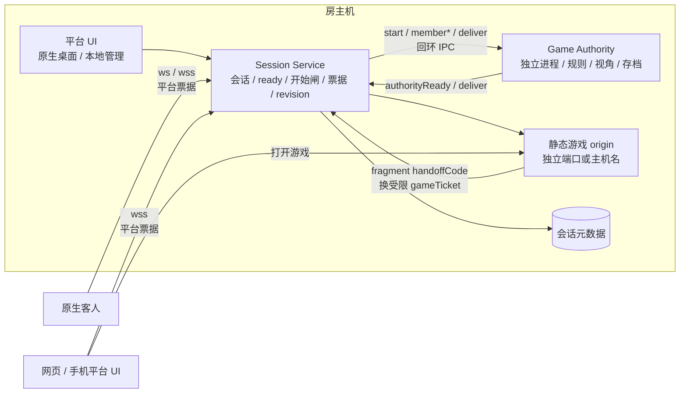
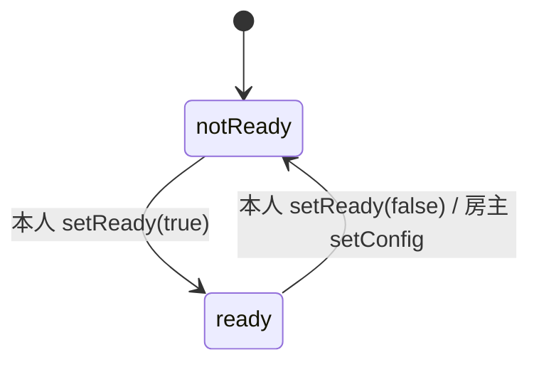
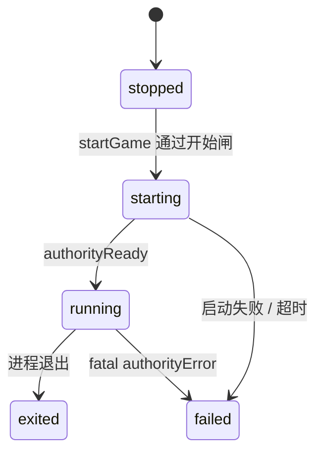
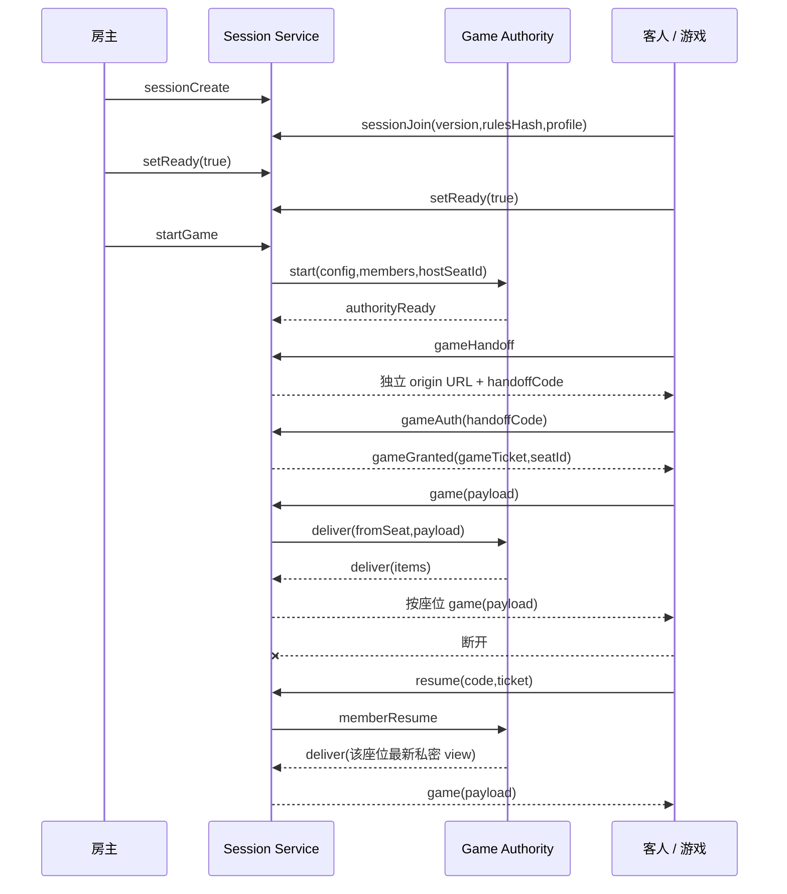
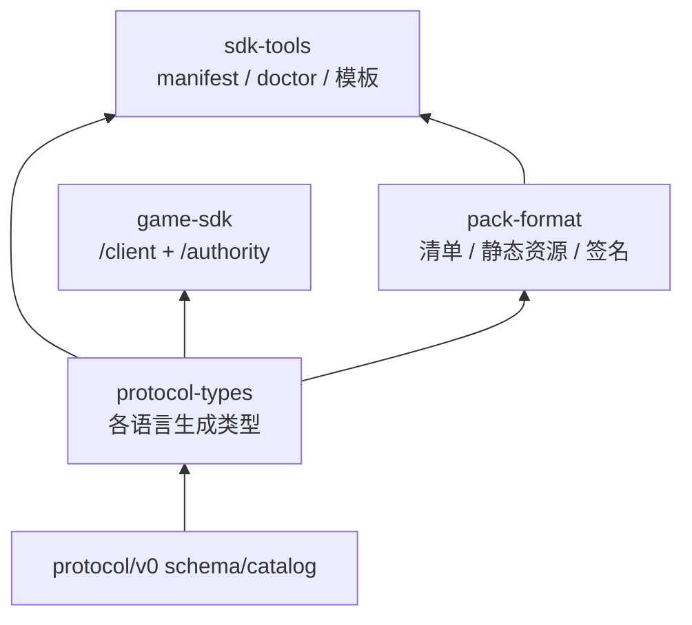
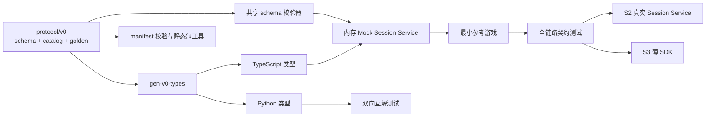

# 3178 语言中立会话协议 · v0

> 状态：S1 契约、双语言生成、内存 mock 与最小参考游戏已落地；**不接现有运行时，不兼容旧 `PROTOCOL_VERSION=1`，未做真实网络 / 进程 / 崩溃恢复验证**。
> 唯一字据：[`catalog.json`](../../protocol/v0/catalog.json)（方向与权限）+ [`messages.schema.json`](../../protocol/v0/messages.schema.json)（字段形状）+ [`errors.json`](../../protocol/v0/errors.json) + [`capabilities.json`](../../protocol/v0/capabilities.json)。本文解释语义；字段冲突以 JSON Schema 为准。

## 1. 边界与目标拓扑

- 平台持有会话 `open/closed`、成员表、通用 `ready`、开始闸、票据、revision、会话落盘与游戏进程生命周期。
- `startGame` 通过前没有 Game Authority 进程；通过后平台才拉起它并发送 `start` 快照。
- 平台不解释 `config`、`options` 与游戏 `payload`；不替游戏做视角裁剪。
- 平台身份资料 `profile` 可传给游戏；`displayColor` 仅用于识别，不是阵营或队伍。
- 转交房主只转移权限，不迁移 Session Service 或 Game Authority 所在机器。

## 2. 状态机

### 会话与成员

- `open`：会话存在，可入席、准备、聊天；与是否开始游戏无关。
- `closed`：会话终止；由房主关闭或平台超时策略触发。
- `ready` 是平台成员表里的通用布尔值，只由本人 `setReady` 改变。
- `setConfig` 只在 `gameProcess=stopped` 时合法；成功后所有 `kind=player` 的成员 `ready=false`，revision 增加。
- AI 与观战成员的 `ready` 恒为 `false`，不计入开始闸。
- 开始闸：仅房主可执行 `startGame`；至少一名真人，且所有已连接真人 `ready=true`。断线真人仍处于掉线宽限时不能绕过开始闸。

### 游戏进程

- `stopped`：尚未开始；允许 `setConfig` / `setSeatOptions` / `startGame`。
- `starting`：平台已收到合法 `startGame`，正在拉起进程；重复开始返回 `PHASE`。
- `running`：收到 `authorityReady`；平台转发成员变化与游戏消息。
- `failed`：启动失败、启动超时或权威报告致命错误；平台广播原因，允许房主决定是否关闭会话。
- `exited`：进程退出；平台不把它解释成胜负、结算或回合结束。
- 回合、胜负、结算、再来一局归游戏。`roundClosed` 的 `payload` 对平台不透明。
- `start` 必须带 `hostSeatId`；权限移交后平台向权威发 `hostChanged {hostSeatId, revision}`，房主专属玩法规则不依赖客户端自报。

## 3. 身份、权限与网页游戏

- 平台座位票据只在 `seatGranted` 下发；盘上只存其摘要。`resume` 必须带票据。
- 网页游戏不取得平台管理票据。平台通过 `gameHandoff` 返回独立 origin 的 URL 与一次性 `handoffCode`；游戏以 `gameAuth` 换取受限 `gameTicket`。
- `handoffCode` 只放 URL fragment，短期有效、一次性、绑定 session + seat；不得写入查询日志或 Referer。
- `gameTicket` 只允许 `gameAuth`、`game`、`ping` 与游戏侧重连；不得调用准备他人、配置、开始、踢人、移交或解散。
- `profile = { nick, avatar?, displayColor? }`。`displayColor` 是 `#RRGGBB`，不使用 CSS 变量。头像只能是平台校验后的资源地址；schema 只限制长度，资源安全策略由实现层执行。
- 阵营、队伍、难度等玩法含义放 `options`，不得借用 `displayColor`。

## 4. 消息、方向与最小链路

消息是扁平 UTF-8 JSON 对象，以 `type` 判别；未声明字段一律拒绝。完整方向、通道与权限见 `catalog.json`。解码必须按 `(from,to,type)` 选 schema，不能只凭 `type`，因为 `deliver/ping/pong` 在不同方向重复。

- 客户端 ↔ 平台：WebSocket；`hello` 只协商平台协议与能力，不带大厅里预选的 `gameId/version`。
- 平台 ↔ Game Authority：本地回环 TCP；同一 `type` 在不同方向可有不同字段，分别使用 `Platform*` / `Authority*` schema。
- 客户端 `game` 只发给权威，不提供客户端直达其他座位的 `to` 字段。
- 权威 `deliver.items[]` 是唯一出站形式：`{to: seatId | 'all', payload}`。平台逐项投递，不合并、不裁剪、不读 payload。
- `sessionState` 是成员与进程状态的全量快照；`revision` 单调递增，客户端不得接受同房旧 revision 覆盖新状态。
- `memberLeave.reason` 是 `disconnected | left | kicked`；掉线保留座位，主动离开或被踢由游戏决定是否移出牌局。

## 5. 配置、清单与落盘

- `rulesHash` 由平台计算，不信任客户端自报。算法：对 `config` 做递归键排序的 canonical JSON（对象键按 Unicode 码点排序、数组保序、无多余空白），UTF-8 编码后 SHA-256，输出小写 hex。
- `sessionJoin` 的版本与 `rulesHash` 是针对目标房间的声明；`resume` 只凭票，不重新声明大厅预选版本。
- 平台只落盘会话元数据：房号、成员与 profile、票据摘要、连接状态、ready、config、options、gameProcess 与 revision。
- 游戏状态由 Authority 自有快照、原子写和重启恢复负责。快照目录、版本与兼容判断归游戏；S1 mock 不实现崩溃恢复。
- [`manifest.schema.json`](../../protocol/v0/manifest.schema.json) 定义游戏清单：`platformRequirements`、authority/web entryPoints、静态 assets、可选签名、`sessionConfig.fields/seatOptions` 与 `reference`。color-duel 示例只保留玩法参数和电脑难度，不把旧 GameModule 或平台身份色带回来。

## 6. 本地 IPC 帧

- 传输：回环 TCP，不在非本机地址监听。
- 帧：4 字节无符号大端长度 `N` + N 字节 UTF-8 JSON；N 不含长度字段自身。
- 上限：单帧 1 MiB；长度超限、JSON 解析失败或 schema 不匹配均关闭 IPC 并记 `BADMSG`。
- 每条 IPC 连接只允许一个会话；进程启动后第一条游戏侧消息必须是 `authorityReady` 或 `authorityError`。
- S2 待实测参数：启动超时 5s、IPC 请求超时 5s、心跳 10s；这些不是真机结论。

## 7. 错误与通知

- `error` 只用于平台级拒绝；码表见 `errors.json`。`text` 是给用户的中文说明，`details` 是可选结构化信息。
- 新增 `NOTREADY`（开始闸未满足）、`GAMEFAILED`（进程启动或运行失败）、`HANDOFF`（交接码无效 / 过期 / 已使用）、`FORBIDDEN`（受限游戏凭证越权）。
- 玩法错误由游戏定义并通过 `deliver` 发给目标座位，不进入平台错误码表。
- 链路断开时房间命令本地拒绝并说明，不静默排队；只有握手与重连消息可等待连接建立。

## 8. SDK 与测试夹具迁移

旧 SDK 分层保留作迁移依据，但核心职责替换：

| 旧层 | 新职责 |
|---|---|
| core-abi：GameModule / GameInstance / Effect | 由 protocol-types 取代；旧包留 registry，不进新运行时 |
| pack-format：可执行 `.bpmap` | 保留包名，改清单、静态资源、内容哈希与签名 |
| game-sdk：公共门面、game-kit、mount/actions | 保留一个包，只留 `/client` 与 `/authority` 薄入口 |
| sdk-tools：旧 bpmap doctor / UI 模板 | 保留，改 manifest 校验、包检查与无 UI 最小模板 |
| @bp/protocol | 仍是平台内部实现，不作为公共 SDK |

测试夹具不全部推倒：随机数、虚拟时钟、Recorder、predicate 等帧、进程清理和纯会话覆盖保留；GameModule/Effect、fake-context、旧 contract-harness、fixture-kit UI、沙箱和可执行包测试用新 golden / mock / 参考游戏替换。S2 迁移纯会话测试，S3 确认旧契约引用数为 0 后才删除旧覆盖。

## 9. 验证与维护

- `protocol/v0/golden/messages.json` 覆盖每个方向条目；`examples/` 提供可读样例，manifest 示例单独按清单 schema 校验。
- 共享校验器：`tools/testkit/src/protocol-v0/schema-validator.ts`。它只实现本 spec 使用的 JSON Schema 子集，未知关键字报错。
- 生成脚本：`node tools/testkit/scripts/gen-v0-types.mjs`；`--check` 比较入库生成物，禁止手改。
- TS 生成物：`tools/testkit/src/protocol-v0/generated/messages.ts`；Python：`tools/testkit/fixtures/protocol-v0/messages.py`。
- Python 互解使用 `-I -X utf8`，缺运行时测试失败，不静默 skip。
- mock 与参考游戏只做内存链路，不监听端口、不启动进程；不得写成真实服务已验证。
- 完整回归：`npm test`、`npm run seam`、`npx tsc -b`、`node tools/checks/smoke-sdk.mjs`。
- v0 在没有真实消费者前可迭代；发布后冻结，破坏性变更才开 v1。color-duel 只消费协议与 golden，不另抄协议。

<!-- multi-agent-task-handoff: scope=docs -->
