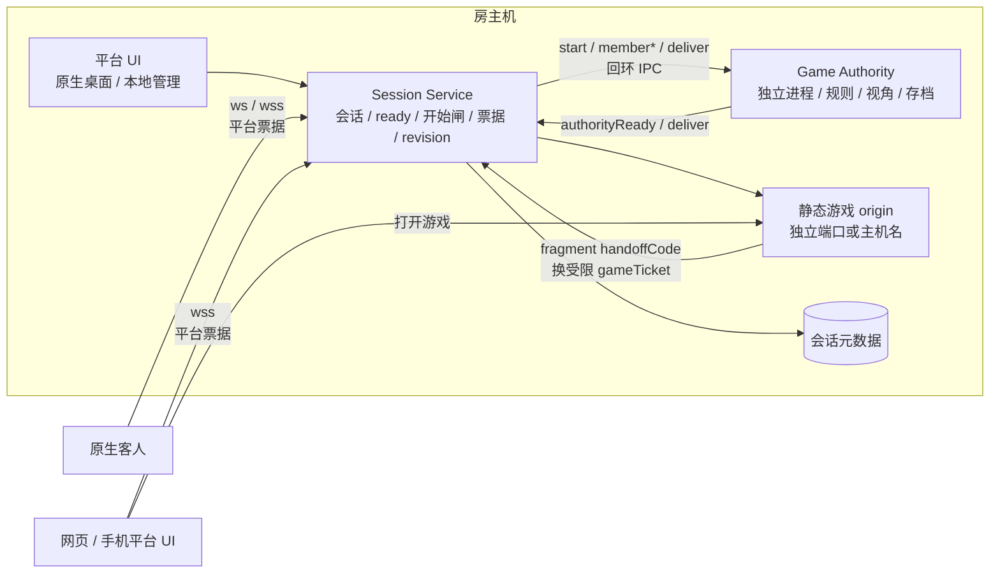
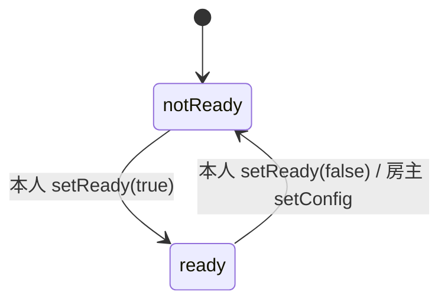
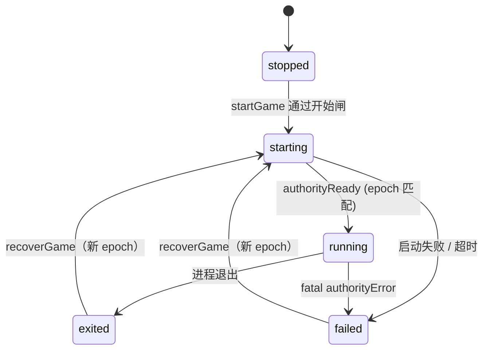
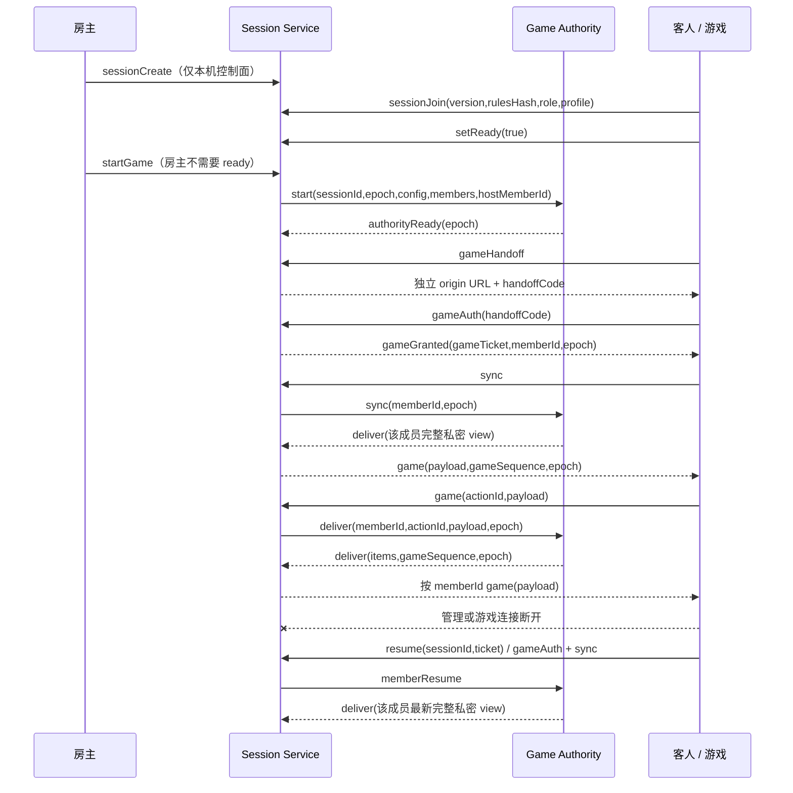
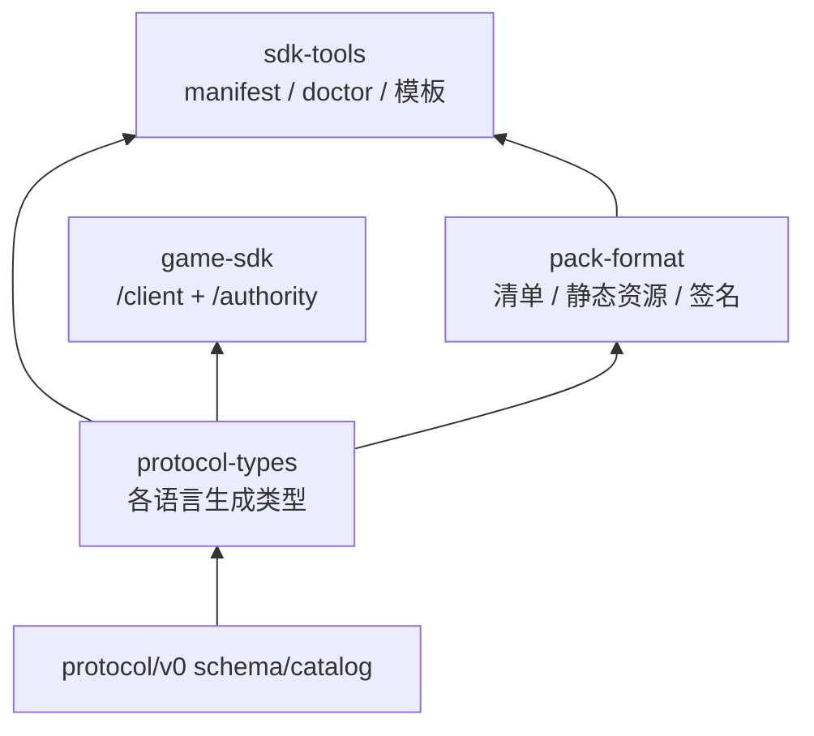
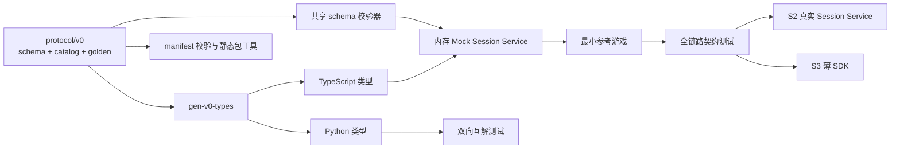

# 3178 语言中立会话协议 · v0

> 状态：S1 契约、双语言生成、内存 mock 与最小参考游戏已落地，并已按《全局目标架构》对齐 memberId/slot/role、authorityEpoch、sync、probe 与严格双通道；**不接现有运行时，不兼容旧 `PROTOCOL_VERSION=1`，未做真实网络 / 进程 / 崩溃恢复验证**。
> 唯一字据：[`catalog.json`](../../protocol/v0/catalog.json)（方向与权限）+ [`messages.schema.json`](../../protocol/v0/messages.schema.json)（字段形状）+ [`errors.json`](../../protocol/v0/errors.json) + [`capabilities.json`](../../protocol/v0/capabilities.json)。本文解释语义；字段冲突以 JSON Schema 为准。

## 1. 边界与目标拓扑

- 平台持有会话 `open/closing/closed`、成员表、通用 `ready`、开始闸、票据、revision、会话落盘与游戏进程生命周期。
- 成员身份用 `memberId`；`slot` 只用于玩家/AI 的 1–8 显示槽位，观战没有 slot；`hostMemberId` 单独标识权限。票据、成员事件、`deliver.to` 与权限判断统一使用 memberId。
- 每次启动或恢复权威分配单调递增的 `authorityEpoch`；旧 epoch 的帧必须拒绝。
- `startGame` 通过前没有 Game Authority 进程；通过后平台才拉起它并发送 `start` 快照。
- 平台不解释 `config`、`options` 与游戏 `payload`；不替游戏做视角裁剪。
- 平台身份资料 `profile` 可传给游戏；`displayColor` 仅用于识别，不是阵营或队伍。
- 转交房主只转移权限，不迁移 Session Service 或 Game Authority 所在机器。

## 2. 状态机

### 会话与成员

- `open`：会话存在，可入席、准备、聊天；与是否开始游戏无关。
- `closing`：房主已请求关闭，平台正在撤销票据并回收权威；`closed` 后不再接受任何会话命令。
- `closed`：会话终止；由房主关闭或房主宽限到期且无接手人触发。
- `ready` 是平台成员表里的通用布尔值，只由本人 `setReady` 改变；`setReady` 只在 `gameProcess=stopped` 时合法。
- 成员在线状态与游戏通道分开：`presence=online|grace`（带 `graceUntil`）表示管理连接；`gameConnected` 只表示游戏通道。掉线进入宽限，`resume` 回到 online，宽限到期由 `expireGrace()` 以 `reason=expired` 移出。
- `setConfig` 只在 `gameProcess=stopped` 时合法；成功后所有 `role=player` 的成员 `ready=false`，revision 增加。
- AI 与观战成员的 `ready` 恒为 `false`，不计入开始闸。
- 开始闸：仅房主可执行 `startGame`；房主不需要 ready；其他在线真人必须 ready；断线真人处于宽限时阻塞开始；人数按真人 + 电脑计，不低于清单 `minPlayers`，观战不计。
- 开始后加入按清单 `lateJoin` 处理：`spectator`（默认）降级为观战，`player` 允许补位，`deny` 拒绝。

### 游戏进程

- `stopped`：尚未开始；允许 `setConfig` / `setSeatOptions` / `addAi` / `removeAi` / `moveSlot` / `startGame`。
- `starting`：平台已收到合法 `startGame`，正在拉起进程；重复开始返回 `PHASE`。此时 `authorityEpoch` 已递增，旧游戏票据作废。
- `running`：收到带匹配 epoch 的 `authorityReady`；平台转发成员变化、游戏消息与 `sync`。
- `failed`：启动失败、启动超时或权威报告致命错误；保留会话，房主可用 `recoverGame` 以新 epoch 重启。
- `exited`：进程退出；平台不把它解释成胜负、结算或回合结束；`recoverGame` 可重启。
- 回合、胜负、结算、再来一局归游戏。`roundClosed` 的 `payload` 对平台不透明。
- `start` 必须带 `sessionId`、`authorityEpoch` 与 `hostMemberId`；权限移交后平台向权威发 `hostChanged {hostMemberId, authorityEpoch, revision}`，房主专属玩法规则不依赖客户端自报。

## 3. 身份、权限与网页游戏

- 平台成员票据只在 `seatGranted` 下发，带 `memberId` 与 `sessionId`；盘上只存摘要。`resume` 必须带 `sessionId` 与票据。
- 网页游戏不取得平台管理票据。平台通过 `gameHandoff` 返回独立 origin 的 URL 与一次性 `handoffCode`；游戏以 `gameAuth` 换取受限 `gameTicket`。一个成员只能有一条有效游戏连接，重新认证使旧连接失效。
- `handoffCode` 只放 URL fragment，短期有效、一次性、绑定 session + memberId；不得写入查询日志或 Referer。
- `gameTicket` 只允许 `gameAuth`、`game`、`sync`、`ping` 与游戏侧重连；不得调用准备他人、配置、开始、踢人、移交或解散。
- 踢出、离开、关会话与换 epoch 都撤销 gameTicket；凭证只以摘要形式保存。
- `profile = { nick, avatar?, displayColor? }`。`displayColor` 是 `#RRGGBB`，不使用 CSS 变量；身份色一色一席，由 `setProfile` 做占用校验。头像只能是平台校验后的资源地址；schema 只限制长度，资源安全策略由实现层执行。
- 阵营、队伍、难度等玩法含义放 `options`，不得借用 `displayColor`。

## 4. 消息、方向与最小链路

消息是扁平 UTF-8 JSON 对象，以 `type` 判别；未声明字段一律拒绝。完整方向、通道与权限见 `catalog.json`。解码必须按 `(from,to,type)` 选 schema，不能只凭 `type`，因为 `deliver/ping/pong` 在不同方向重复。

- 客户端 ↔ 平台：WebSocket；`hello` 只协商平台协议与能力，不带大厅里预选的 `gameId/version`。连接绑定会话或游戏之一后不能换；`game` / `sync` 只走游戏通道，管理动作只走会话通道，`ping` 两条通道都有。
- 平台 ↔ Game Authority：本地回环 TCP；同一 `type` 在不同方向可有不同字段，分别使用 `Platform*` / `Authority*` schema。
- 客户端 `game` 只发给权威，带 `actionId`，不提供客户端直达其他成员的 `to` 字段；同一 `actionId` 不重复投递。
- 权威 `deliver.items[]` 是唯一出站形式：`{to: memberId | 'all', payload, viewRevision?}`，并带 `gameSequence` 与 `authorityEpoch`。平台逐项投递、目标去重、顺序固定，不合并、不裁剪、不读 payload。
- `sessionState` 是会话、配置、成员、房主、进程、epoch 与 revision 的全量快照；`revision` 单调递增，客户端不得接受同房旧 revision 覆盖新状态。平台 revision 与游戏 `viewRevision` 分开，旧视图不得覆盖新状态。
- `sessionProbe` / `sessionPreview` 在加入前返回房名、游戏与版本、规范化 config、`rulesHash`、容量、必需能力、`lateJoin`、清单房间级部分与清单哈希。
- `sync` 只走游戏通道：平台转发给权威，权威回该成员当前完整私密视图；`memberResume` 只表示成员恢复，不再兼做补视图。
- `memberLeave.reason` 是 `disconnected | left | kicked | expired`；掉线保留成员并进入宽限，主动离开、被踢或宽限到期移出。
- 房间命令包括 `addAi` / `removeAi` / `moveSlot` / `setProfile`（身份色一色一席）与 `listGames`（仅本机控制面）。聊天带 `messageId`、`chatRevision` 与成员/系统 `kind`；加入与重连通过 `chatHistory` 补历史。
- `recoverGame` 只在 `failed` / `exited` 下合法，房主发起，不过准备闸，以新 epoch 重新 `start`。

## 5. 配置、清单与落盘

- `rulesHash` 由平台计算，不信任客户端自报。算法：对规范化后的 `config` 做 canonical JSON，UTF-8 编码后 SHA-256，输出小写 hex。
- canonical JSON 规则：对象键按 UTF-8 字节序排序（等价于 Unicode 码点序，**不是** RFC 8785 的 UTF-16 序）；数组保序；字符串按最短转义、其余字符原样 UTF-8，孤立代理项拒绝；数字只接受安全整数（绝对值 ≤ 2^53−1，`1.0` / `1e3` 按整数值处理，`-0` 输出 `0`），小数、NaN、Infinity 与超界整数拒绝；不接受 `undefined`、函数、Symbol、BigInt、非普通对象与循环引用。golden 见 [`protocol/v0/golden/canonical-json.json`](../../protocol/v0/golden/canonical-json.json)，TS 与 Python 实现必须逐字节和 SHA-256 一致。
- 配置规范化（`normalize-config.ts`）：按清单声明的字段补齐默认值；未声明的键、类型不符、枚举值不在选项内、整数越界都拒绝并指明字段；座位选项按 `roles` 过滤；`dependsOn` 只是界面提示，规范化不改值。声明本身的键长、标签长、枚举数量与整数跨度沿用旧 `ruleConfig` 口径（整数字段必须声明 `min` / `max`，跨度 ≤ 1000），见 [`golden/config-normalize.json`](../../protocol/v0/golden/config-normalize.json)。
- `sessionJoin` 的版本与 `rulesHash` 是针对目标房间的声明；`resume` 只凭票，不重新声明大厅预选版本。
- 平台只落盘会话元数据：房号、成员与 profile、票据摘要、连接状态、ready、config、options、gameProcess 与 revision。
- 游戏状态由 Authority 自有快照、原子写和重启恢复负责。快照目录、版本与兼容判断归游戏；S1 mock 不实现崩溃恢复。
- [`manifest.schema.json`](../../protocol/v0/manifest.schema.json) 定义游戏清单：`id` / `name` / `version`、`requiredCapabilities`、`lateJoin`、`platformRequirements`、authority/web entryPoints、静态 assets、可选签名、`sessionConfig.fields/seatOptions` 与 `reference`。字段类型只有 `boolean` / `enum` / `integer`。color-duel 示例只保留玩法参数和电脑难度，不把旧 GameModule 或平台身份色带回来。

## 6. 本地 IPC 帧

- 传输：回环 TCP，不在非本机地址监听。
- 帧：4 字节无符号大端长度 `N` + N 字节 UTF-8 JSON；N 不含长度字段自身。
- 上限：单帧 1 MiB；长度超限、JSON 解析失败或 schema 不匹配均关闭 IPC 并记 `BADMSG`。
- 每条 IPC 连接只允许一个会话；进程启动后第一条游戏侧消息必须是带匹配 epoch 的 `authorityReady` 或 `authorityError`。
- 除心跳 `ping` / `pong` 外，IPC 双向消息都携带 `authorityEpoch`；`start` 分配新 epoch，旧 epoch 的 `deliver` / `authorityReady` / `roundClosed` / `authorityError` 一律拒绝。
- 成员事件使用 `memberId`；`deliver` 带 `actionId`，权威回包带 `gameSequence`；`sync` 请求该成员完整私密视图。
- S2 待实测参数：启动超时 5s、IPC 请求超时 5s、心跳 10s；这些不是真机结论。

## 7. 错误与通知

- `error` 只用于平台级拒绝；码表见 `errors.json`。`text` 是给用户的中文说明，`details` 是可选结构化信息。
- 新增 `NOTREADY`（开始闸未满足）、`GAMEFAILED`（进程启动或运行失败）、`HANDOFF`（交接码无效 / 过期 / 已使用）、`FORBIDDEN`（受限凭证或越通道）、`UNKNOWN_GAME`（游戏或版本未注册）、`CONFIG`（配置不符合清单声明）、`COLOR`（身份色已被占用）。
- `NOTHOST` 表示当前成员不是房主；`HOSTONLY` 表示权限已移交的前房主再发房主命令。
- 玩法错误由游戏定义并通过 `deliver` 发给目标座位，不进入平台错误码表。
- 链路断开时房间命令本地拒绝并说明，不静默排队；只有握手与重连消息可等待连接建立。

## 8. SDK 与测试夹具迁移

旧 SDK 分层保留作迁移依据，但核心职责替换：

| 旧层 | 新职责 |
|---|---|
| core-abi：GameModule / GameInstance / Effect | 由 protocol-types 取代；旧包留 registry，不进新运行时 |
| pack-format：可执行 `.bpmap` | 保留包名，改清单、静态资源、内容哈希与签名 |
| game-sdk：公共门面、game-kit、mount/actions | 保留一个包，只留 `/client` 与 `/authority` 薄入口 |
| sdk-tools：旧 bpmap doctor / UI 模板 | 保留，改 manifest 校验、包检查与无 UI 最小模板 |
| @bp/protocol | 仍是平台内部实现，不作为公共 SDK |

测试夹具不全部推倒：随机数、虚拟时钟、Recorder、predicate 等帧、进程清理和纯会话覆盖保留；GameModule/Effect、fake-context、旧 contract-harness、fixture-kit UI、沙箱和可执行包测试用新 golden / mock / 参考游戏替换。S2 迁移纯会话测试，S3 确认旧契约引用数为 0 后才删除旧覆盖。

## 9. 验证与维护

- `protocol/v0/golden/messages.json` 覆盖每个方向条目；`golden/canonical-json.json` 与 `golden/config-normalize.json` 固定 canonical JSON / 配置规范化向量；`examples/` 提供可读样例，manifest 示例单独按清单 schema 校验。
- 共享校验器：`tools/testkit/src/protocol-v0/schema-validator.ts`。它只实现本 spec 使用的 JSON Schema 子集，未知关键字报错。
- 生成脚本：`node tools/testkit/scripts/gen-v0-types.mjs`；`--check` 比较入库生成物，禁止手改。
- TS 生成物：`tools/testkit/src/protocol-v0/generated/messages.ts`；Python：`tools/testkit/fixtures/protocol-v0/messages.py`。
- Python 互解使用 `-I -X utf8`，缺运行时测试失败，不静默 skip。
- mock 与参考游戏只做内存链路，不监听端口、不启动进程；不得写成真实服务已验证。
- 完整回归：`npm test`、`npm run seam`、`npx tsc -b`、`node tools/checks/smoke-sdk.mjs`。
- v0 在没有真实消费者前可迭代；发布后冻结，破坏性变更才开 v1。color-duel 只消费协议与 golden，不另抄协议。

### 命令矩阵验收映射（总纲 §5）

| 总纲命令 | 契约测试 |
|---|---|
| sessionProbe | 参考链路：sessionProbe 返回与当前会话一致的全量预览 |
| sessionCreate | 参考链路：只有本机控制面能建房，远程连接被拒 |
| sessionJoin | 参考链路：开始后加入按清单 lateJoin 降级为观战；前房主报 HOSTONLY…观战无 slot |
| setReady | 参考链路：准备闸通过前无权威… |
| setConfig | 参考链路：配置变更重置真人准备，房主移交有 hostChanged |
| setSeatOptions | 参考链路：房主加删电脑、移动槽位，AI 计入最低人数 |
| addAi / removeAi | 参考链路：房主加删电脑、移动槽位，AI 计入最低人数 |
| startGame | 参考链路：准备闸通过前无权威…；最低人数与断线真人阻塞开始 |
| transferHost | 参考链路：配置变更重置真人准备，房主移交有 hostChanged |
| kick / leave | 参考链路：前房主报 HOSTONLY…（kick）；房主离开被拒…（leave） |
| resume | 参考链路：断线凭票回原 member，游戏通道用 sync 补私密视图 |
| gameHandoff / gameAuth | 参考链路：一次性交接、唯一游戏连接、越通道与重复 actionId |
| game / sync | 参考链路：一次性交接…（game）；断线凭票回原 member…（sync） |
| closeSession | 参考链路：房主离开被拒，关会话撤销游戏凭证 |
| recoverGame | 参考链路：权威失败后可 recoverGame 换 epoch，旧凭证与旧 epoch 失效 |
| setProfile | 参考链路：profile 修改与身份色一色一席 |
| listGames | 参考链路：listGames 仅本机控制面返回已注册清单 |
| chat / chatHistory | 参考链路：聊天 messageId 去重、revision、系统消息与历史补发 |

<!-- multi-agent-task-handoff: scope=docs -->
